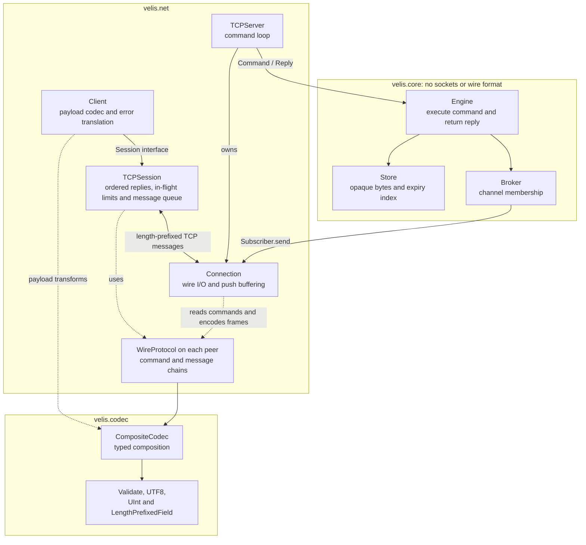
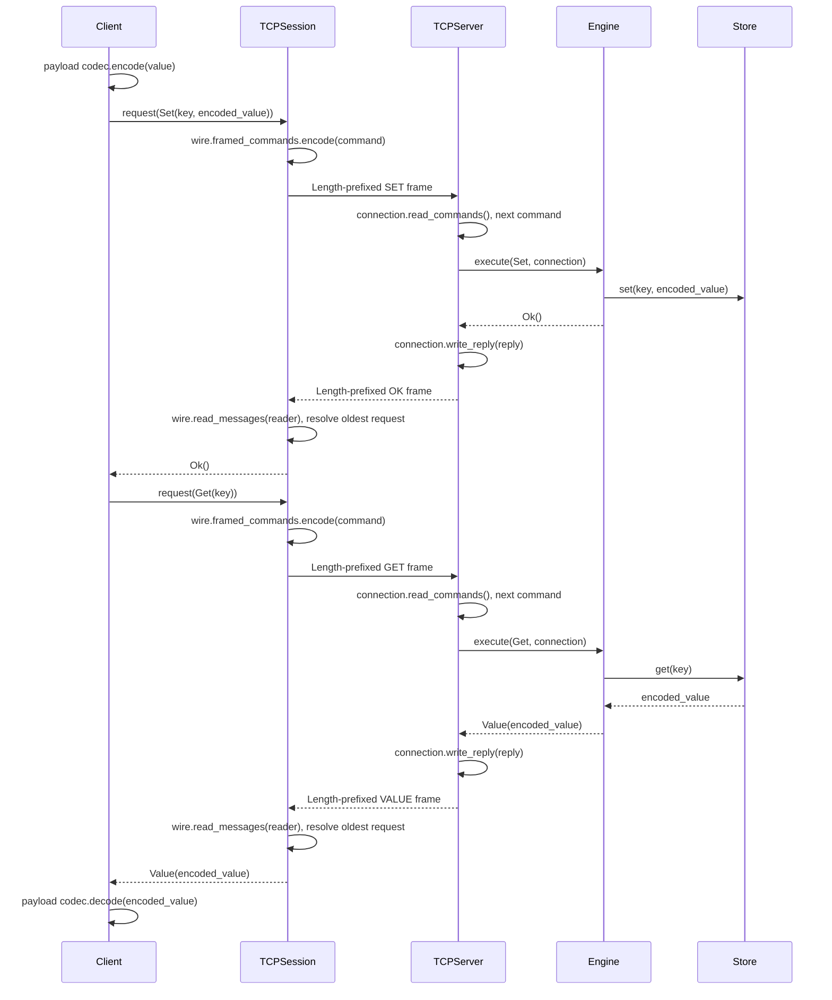
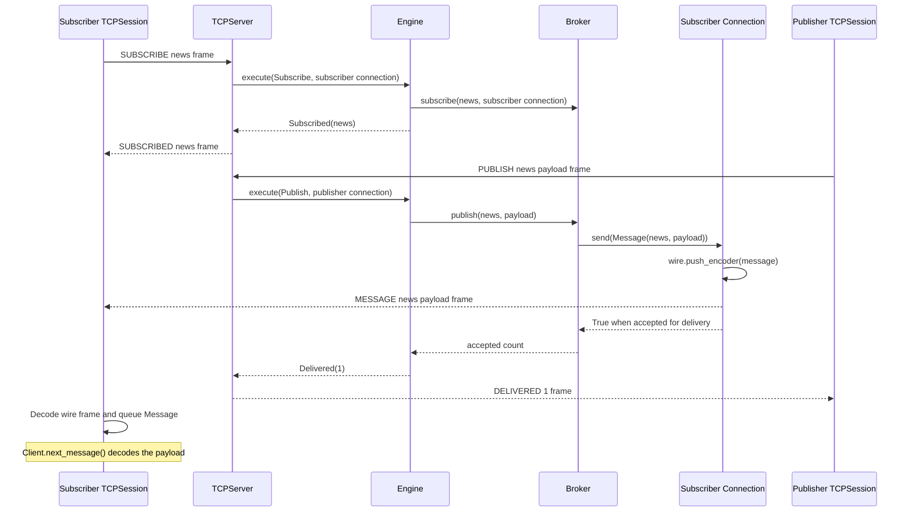
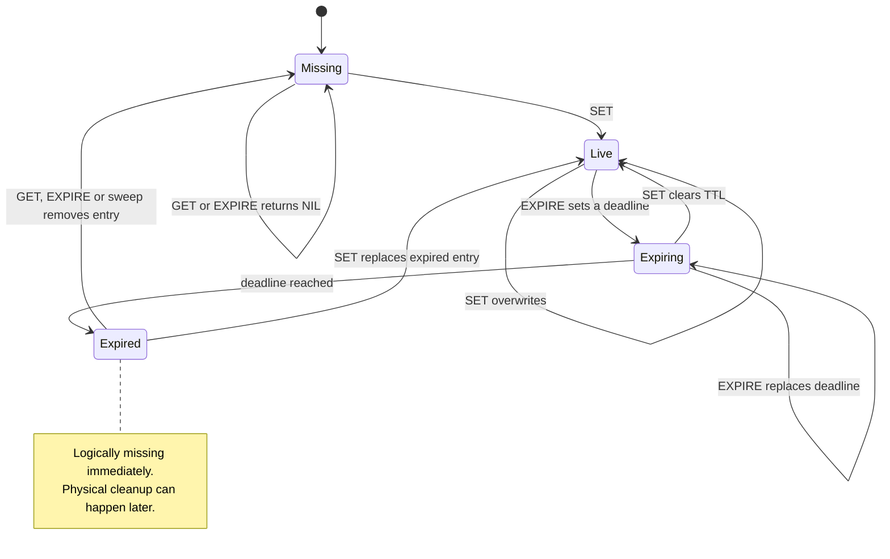
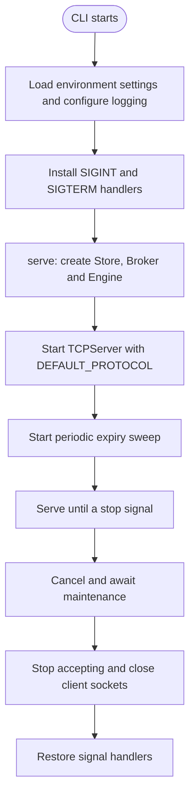
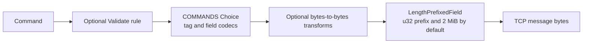

Velis is a lightweight in-memory key-value store with TTL expiration, pub-sub, a small TCP protocol and composable payload and wire codecs. It runs on a single asyncio event loop, so the store needs no locks.

> **Status: early development.** The store, TTL, pub-sub, TCP server and async client all work and are tested. The wire protocol is custom, and there is no authentication or TLS yet, so keep it bound to localhost. See [Roadmap](#roadmap) for what's next.

## Table of contents

- [Features](#features)
- [Installation](#installation)
- [Quick start](#quick-start)
- [Architecture](#architecture)
  - [Request lifecycle](#request-lifecycle)
  - [Pub-sub](#pub-sub)
  - [Key lifecycle](#key-lifecycle)
  - [Startup and shutdown](#startup-and-shutdown)
  - [Background maintenance](#background-maintenance)
- [Wire protocol](#wire-protocol)
- [Cache and pub-sub lifetime](#cache-and-pub-sub-lifetime)
- [Configuration](#configuration)
- [Codecs](#codecs)
  - [Typed representations and rules](#typed-representations-and-rules)
  - [Composing the wire protocol](#composing-the-wire-protocol)
- [Project layout](#project-layout)
- [Development](#development)
- [Design notes and limitations](#design-notes-and-limitations)
- [Roadmap](#roadmap)

---

## Features

| Area | Description |
| --- | --- |
| **Store** | `GET` / `SET` / `DEL` / `EXPIRE` / `TTL` / `PERSIST` on opaque `bytes` values, with key-count and byte limits. Single-owner, so no locks. |
| **TTL** | Exact monotonic deadlines, a tick-bucket expiry index, lazy read expiry and bounded background sweeps. |
| **Pub-sub** | `SUBSCRIBE` / `UNSUBSCRIBE` / `PUBLISH`. At-most-once delivery to connected subscribers on one server. Slow network connections are disconnected when their server write buffer exceeds the configured limit. |
| **Network** | Length-prefixed binary protocol over TCP, bounded pipelining with ordered replies, an asyncio server and an async `Client`. |
| **Codecs** | Typed `CompositeCodec`s for payload transforms, wire serialization and validation. Stored values remain opaque bytes. |
| **Configuration** | CLI environment loading and frozen limits owned by each component. |

---

## Installation

Velis uses [uv](https://docs.astral.sh/uv/) and a `src` layout. From a repository checkout:

```bash
cd velis
uv sync
```

Python **3.15.2 or newer** is required, as specified in `pyproject.toml`. Velis has no runtime dependencies. `uv sync` installs Ruff, ty, Pyright and Hypothesis for development.

---

## Quick start

Start a server:

```bash
uv run velis
```

Use one connection for key/value commands and another for subscriptions:

```python
import asyncio

from velis.net.client import Client


async def main() -> None:
    kv = await Client.connect("127.0.0.1", 9000)
    sub = await Client.connect("127.0.0.1", 9000)
    try:
        await kv.set("greeting", b"hello")
        print(await kv.get("greeting"))
        print(await kv.expire("greeting", 5_000))
        print(await kv.get("missing"))

        await sub.subscribe("news")
        print(await kv.publish("news", b"hi"))
        async with asyncio.timeout(1):
            print(await sub.next_message())
    finally:
        await sub.close()
        await kv.close()


asyncio.run(main())
```

The example prints `b"hello"`, `True`, `None`, `1`, and `Message(channel="news", payload=b"hi")`.

`Client` raises `CommandError` when the server replies `ERR`, `ProtocolError` for invalid outgoing fields, integer ranges or wire rules, and `ConnectionError` when the connection drops or an incoming wire frame is invalid. Exceptions from custom payload codecs propagate to the caller. Invalid outgoing data is rejected before writing and leaves the connection usable. Closing a client wakes waiting requests and message readers.

Use `asyncio.gather(client.get("a"), client.get("b"))` to pipeline independent commands on one connection. The server executes commands and sends replies in received order; the session matches each reply to the oldest unanswered request. Server pushes are routed separately. Await an earlier command when a later one depends on its result.

Use `asyncio.timeout(seconds)` around commands or `next_message()` to bound the wait. Cancelling or timing out a command leaves the connection usable and discards its eventual reply. A sent command may still execute on the server, including a write; cancellation does not undo it or guarantee that it was never applied. No request is sent when cancellation happens while waiting for an in-flight slot.

Wire encoding starts after a request acquires capacity. Invalid outgoing commands may therefore wait for a slot before raising; encoding failure releases the reservation without sending. Client payload codecs run before session admission, so application tasks and their payloads still require bounded submission for bulk work.

Clients allow at most 128 in-flight requests by default. Pass `limits=SessionLimits(max_pending_requests=...)` to `Client.connect()`, `TCPSession.connect()` or `TCPSession` to change this limit; import `SessionLimits` from `velis.net.session`. Additional calls wait for a slot. A cancelled sent request retains its slot until its reply arrives, keeping cancellation bookkeeping bounded. If a peer stops replying, slots remain occupied until the connection closes; waiting calls can still be cancelled or timed out.

Clients buffer at most 1,024 unread messages and 8 MiB of channel/payload bytes by default, measured after wire decoding and before client payload decoding. Set `max_pending_messages` and `max_pending_bytes` on the same `SessionLimits` object to change these positive limits. Crossing either limit closes the connection and fails pending requests. Already queued messages can be drained before `next_message()` raises `ConnectionError`. A full message buffer never blocks the reply reader.

`PUBLISH` returns the number of subscriber connections that accepted the message for delivery. It does not acknowledge that their applications have read or processed it.

---

## Architecture

The server separates command handling from networking, and the dependency only points one way: **`net` depends on `core`, never the reverse.** The core knows nothing about sockets or the wire format, so it can be tested and embedded without a network.



The diagram shows runtime calls and codec usage; each peer uses its own configured wire protocol. `Broker` calls the structural `Subscriber` interface, so it has no dependency on the concrete `Connection` class.

`Client` owns the user-facing command API, payload codecs and error translation. It delegates ordered request/reply handling, message buffering and connection shutdown to a `Session`. The built-in `TCPSession` implements that interface over the wire protocol. Payload codecs can be individual `Codec[bytes, bytes]` objects or composed `CompositeCodec[bytes, bytes]` instances. The default is `Identity()`, which returns bytes unchanged.

`Client.connect()` creates the TCP session for you. To supply a different transport, use `Client(session, codec)` with an object implementing `request(command)`, `next_message()` and `close()`. For existing asyncio streams, construct `Client(TCPSession(reader, writer), codec)`. Sessions exchange command/reply dataclasses containing payload-encoded bytes; the client applies codecs and translates `Err` replies into `CommandError`.

Clients support async context management, including cleanup when application code raises:

```python
async def read_greeting() -> bytes | None:
    async with await Client.connect("127.0.0.1", 9000) as client:
        return await client.get("greeting")
```

Commands and replies are plain frozen dataclasses (`velis.core.messages`). `net/protocol.py` defines `COMMANDS` and `SERVER_MESSAGES` as `Choice` tables mapping tags to dataclass variants and field codecs. `WireProtocol` adds bounded length framing. Use `DEFAULT_PROTOCOL.framed_commands.encode(command)`, `DEFAULT_PROTOCOL.framed_messages.encode(reply)`, or `.framed_messages.encode(message)` for a push. `read_commands(reader)` and `read_messages(reader)` return async generators; use one generator for each incoming stream. They use `StreamReader.readexactly()` to read and validate the length prefix before waiting for the body. The engine receives commands and returns replies: **validate, apply, reply.**

### Request lifecycle

Cache mutations only change memory. The store validates the TTL range and raises `CommandError` for invalid TTLs without changing existing values or deadlines. The engine lets command errors reach the transport, which replies with `ERR` and keeps the connection open. The store owns its monotonic clock and delegates timer scheduling, cancellation and sweeps to `ExpiryIndex`. System wall-clock adjustments do not change TTL duration.

`SET` clears any previous TTL. `EXPIRE` returns `NIL` for a missing or already expired key, so it cannot revive expired data. A zero TTL expires a live key immediately. Accepted TTLs are between `0` and `2**62` milliseconds, inclusive.

`await client.delete(key)` returns `True` when a live key was deleted, freeing its key and byte capacity; missing or expired keys return `False`. `await client.ttl(key)` returns remaining milliseconds, `-1` for a live key without expiry, or `-2` for a missing or expired key. TTL reads remove expired values without refreshing their deadlines. `await client.persist(key)` removes a live key's TTL while keeping its value and returns whether a deadline was removed. It returns `False` for missing, expired or already persistent keys. On the wire, `TTL` uses `TTL_VALUE` for remaining milliseconds, `PERSISTENT` for no expiry and `NIL` for missing keys; the client maps these to the integer API above. These commands use the same key validation as `GET`.

Direct core callers use `Store.ttl(key)`, which returns remaining milliseconds, `TtlStatus.PERSISTENT` or `TtlStatus.MISSING`. Import `TtlStatus` from `velis.core.store`. The `Engine` translates these enum values into wire replies; the client's `-1` and `-2` sentinels remain unchanged.




The server explicitly yields to the event loop after every 64 completed commands, allowing other connections and maintenance to run even when reads and drains complete immediately. Each individual command and publication remains synchronous.

The diagram shows a successful `SET` followed by `GET` on the same key. `TCPSession` keeps an ordered queue of futures for in-flight requests; its reader routes `Message` frames into a separate bounded queue. `Connection` owns server-side wire decoding, reply encoding and socket I/O; its async `write_reply()` pairs `StreamWriter.write()` with `drain()` so callers await flow control in one operation. `TCPServer` dispatches decoded commands to the engine and writes replies in the same order. Payload bytes stay encoded in the store.

### Pub-sub

The `Broker` only knows the `Subscriber` protocol (`send(message: Message) -> bool`). Delivery callbacks must return promptly; adapters own encoding, buffering and expected transport failures. A `Connection` implements this contract and returns `False` when disconnected, when a write fails with a connection error, or when its buffer limit is exceeded. The broker then removes that subscriber from every channel and continues delivering to healthy subscribers. Acceptance does not acknowledge application processing; unexpected adapter errors propagate.

Each `Broker.publish()` call creates one `Message(channel, payload)` and passes that same object to every subscriber. The broker owns no encoding cache. Connections sharing a `WireProtocol` instance use its cached `PushEncoder` through `wire.push_encoder(message)`. Consecutive deliveries of the same message reuse its encoded bytes; a new message replaces the single cached result, even when its contents are equal. Different wire instances keep separate encoders.

Each encoder retains only its last message and encoded frame until another push replaces them or the wire is released. A nested publication can replace the slot and cause an outer message to be encoded again. Custom subscribers read `message.channel` and `message.payload` directly.



Network arrows above represent complete length-prefixed frames encoded and decoded with each peer's configured wire chains. The publisher client encodes the payload before requesting `Publish`; the subscriber client decodes it when calling `next_message()`. `DELIVERED 1` means one connection accepted the push, regardless of when the subscriber reads it.

### Key lifecycle



The key-state diagram assumes valid commands. Invalid TTL values return an error without changing the key or its deadline.

### Startup and shutdown



The `serve(server_limits, ...)` async context manager in `velis.app` owns the server and maintenance task, including cleanup after startup or caller failures. It yields the running `TCPServer`. `TCPServer` also supports `async with` directly for applications that own maintenance separately; each `Connection` closes and awaits its stream on scope exit. Pass `engine=existing_engine` to reuse application state or a store with an injected clock; the default creates a fresh engine. Pass `wire=custom_wire` to configure the server's codec chains; the CLI uses `DEFAULT_PROTOCOL`. Shutdown releases runtime resources while an injected engine remains available to its owner. The CLI separately configures logging and installs signal handlers; embedded callers control the runtime scope themselves:

```python
from velis.app import serve
from velis.net.server import ServerLimits


async def embedded() -> None:
    async with serve(ServerLimits("127.0.0.1", 0)) as server:
        print(server.port)
```

### Background maintenance

Maintenance runs in a task group owned by `serve()`. An unexpected sweep failure interrupts the active runtime scope and closes the server. Worker and caller failures are reported in an `ExceptionGroup` after cleanup; external cancellation remains `CancelledError`. Normal shutdown uses Python 3.15's `TaskGroup.cancel()` and awaits the group before closing the server. Incoming command and message generators use `contextlib.aclosing()` for deterministic cleanup. Client disconnections remain local to their connections.

One task starts sweeping expired keys every `VELIS_SWEEP_MS`. Each round spends at most 1,000 units on expired keys or stale time ticks. A round can remove no keys while still making cleanup progress. While due ticks remain, maintenance yields to the event loop and runs another round without waiting for the next interval.

`ExpiryIndex` is the sole expiration scheduler. It maps each key to its exact deadline and groups keys by `deadline // tick_ms`; Python's `heapq` orders tick IDs. The store uses the default `tick_ms=1`, so keys become sweepable at their exact deadline. With larger ticks, a bucket becomes due after every deadline in it has passed: physical cleanup can be delayed by less than one tick, while reads and TTL queries still use exact deadlines.

Replacing or cancelling a timer removes its key from the old bucket immediately. `SET`, `PERSIST`, deletion and eviction therefore leave no stale per-key records. Empty buckets are deleted, although their tick IDs can remain in the heap until cleanup or compaction. Recreated tick IDs are harmless: keys are returned once, and leftover IDs consume sweep budget without expiring anything.

Deadline lookup takes expected constant time. Creating or removing the earliest tick costs O(log h), where h includes stale tick IDs. Cancelling a key normally updates dictionary and set membership. When the heap exceeds twice the occupied bucket count plus 64 IDs, compaction rebuilds it from occupied buckets. Compaction takes O(b) time for b occupied buckets, so the sweep limit bounds due-key and stale-tick work, **not compaction work or wall-clock duration**. Up to 64 stale IDs may remain after the last timer is cancelled. Clock jumps require no traversal of elapsed milliseconds.

---

## Wire protocol

By default, every request, reply and push is `u32 length + encoded body`. Integers use big-endian byte order. The length counts the encoded body, excluding the four-byte outer prefix. The default outer limit is 2 MiB, checked before waiting for the rest of the body. Peers can configure a different outer prefix, but must agree on the framing; there is no version or format negotiation.

Replies arrive in command order and carry no request identifiers. `MESSAGE` pushes can appear between replies and are routed separately. Cancelling a sent request leaves its place in the pending queue until its eventual reply arrives, which the client discards. An ordinary reply without a pending request closes the connection; an unsolicited `ERR` preserves the server rejection reason.

The following tables describe the default body codecs (`COMMANDS` and `SERVER_MESSAGES`). A **string** or **bytes** field is `u32 length` followed by that many bytes (strings are UTF-8). Values, publication payloads and general text fields are capped at 1 MiB; the limit includes any expansion from client-side codecs. Command, reply and push tags are capped at 32 bytes. Field byte limits are checked before UTF-8 decoding.

**Requests**

| Command | Fields | Reply |
| --- | --- | --- |
| `GET` | `key: str` | `VALUE` or `NIL` |
| `SET` | `key: str`, `value: bytes` | `OK` |
| `EXPIRE` | `key: str`, `ms: u64` | `OK`, or `NIL` if the key doesn't exist |
| `DEL` | `key: str` | `OK` if deleted, otherwise `NIL` |
| `TTL` | `key: str` | `TTL_VALUE`, `PERSISTENT`, or `NIL` |
| `PERSIST` | `key: str` | `OK` if a TTL was removed, otherwise `NIL` |
| `SUBSCRIBE` | `channel: str` | `SUBSCRIBED` |
| `UNSUBSCRIBE` | `channel: str` | `UNSUBSCRIBED` |
| `PUBLISH` | `channel: str`, `payload: bytes` | `DELIVERED` |

The default encoded body is the command name as a string followed by its fields.

Request keys contain 1–512 characters and request channels contain 1–256 characters. Their UTF-8 byte lengths are capped at 2,048 and 1,024 bytes respectively, allowing four bytes per character. These byte limits are checked before UTF-8 decoding, then the character rules run on the decoded strings. The character rules also run before sending; whitespace and control characters are allowed. Reply and push channels retain the existing UTF-8 and 1 MiB field size checks.

**Replies and pushes**

| Server message | Fields |
| --- | --- |
| `OK` / `NIL` | none |
| `VALUE` | `value: bytes` |
| `TTL_VALUE` | `ms: u64` |
| `PERSISTENT` | none; the key exists without a TTL |
| `ERR` | `message: str` |
| `SUBSCRIBED` / `UNSUBSCRIBED` | `channel: str` |
| `DELIVERED` | `count: u32` |
| `MESSAGE` *(server push, not a reply)* | `channel: str`, `payload: bytes` |

**Errors**

* `ERR` with the connection kept open: a valid command that cannot be honoured (for example a TTL out of range). The client raises `CommandError` for that request.
* Best-effort `ERR`, followed by closure: the message violates the protocol (unknown tag, oversized field/frame, invalid UTF-8, truncated record, trailing bytes or a failed wire rule). An incomplete TCP frame at EOF closes without a reply. The server closes even when it cannot encode or send the error.
* Admission rejection: an excess connection receives best-effort `ERR("connection limit exceeded")` before closure. An unsolicited `ERR` becomes `ConnectionError` with that reason. If a request is already pending, the ordered protocol delivers `ERR` as `CommandError` to the oldest request; EOF then fails the remaining requests with `ConnectionError`.

---

## Cache and pub-sub lifetime

The cache is entirely in memory. Keys and TTLs are discarded on restart. There is no cache WAL, recovery or compaction.

The default store retains at most 100,000 keys and 64 MiB of UTF-8 key plus encoded value bytes. The byte budget excludes Python object overhead; the key-count limit bounds resident entry metadata. Expired entries count until cleanup removes them. The default `s3-fifo` policy evicts entries to make room when either limit is reached. A value whose key plus payload exceeds the entire byte budget is rejected before changing existing values or deadlines. Successful replacements clear the TTL. A capacity error produces `ERR` and keeps the connection usable. Direct `Store` and `Broker` callers receive `CapacityError`, a `CommandError` subclass.

Select one of three eviction policies with `VELIS_EVICTION_POLICY` or `Store(limits=StoreLimits(eviction_policy=EvictionPolicy.LRU))` for direct embedding. `StoreLimits` lives in `velis.core.store`; import `EvictionPolicy` from `velis.core.eviction`. Policy strings are normalized to enum values:

| Policy | Behavior when full |
| --- | --- |
| `s3-fifo` (default) | Filter new keys through a small FIFO; retain reused keys in a main FIFO and remember recent probationary evictions in a bounded ghost queue. |
| `lru` | Evict the least recently used entry. |
| `lfu` | Evict the least frequently accessed entry, breaking ties by least recent access. |

S3-FIFO follows the [SOSP 2023 paper's queue and counter rules](https://www.cs.cmu.edu/~rvinayak/papers/s3-fifo-sosp-2023-fifo-queues-are-all-you-need-for-cache-eviction.pdf). New keys enter the small queue unless ghost history places them directly in the main queue. Resident accesses increment a counter capped at three without moving the key. Small-queue keys with more than one reuse are promoted, with their counters reset; others enter ghost history. Main-queue eviction reinserts keys with remaining credit, decrementing the counter each time.

In Velis, queue targets use **key counts**: the small target is `max(1, max_keys // 10)`, and the main target is `max(1, max_keys - small_target)`. Ghost history retains at most `main_target` keys and no values. It adds Python metadata and retained key strings outside `stored_bytes`. These are eviction targets, not reserved partitions: queues borrow unused space, and the store independently enforces both total limits. With variable-sized values or very small caches, behavior can differ from the paper's equal-sized-object model. A single S3-FIFO eviction step can remove multiple residents while promoting entries and trimming the main queue.

Eviction may remove several entries to fit the byte budget. Every victim's timer, cached size and resident policy metadata are removed together; S3-FIFO retains only its bounded ghost history. Explicit deletion and TTL expiry remove resident policy metadata without adding ghost entries. Under capacity pressure, every policy performs one bounded expiry sweep before evicting live entries. Remaining expired entries are reclaimed by later reads or maintenance. `GET` hits and successful `SET` operations count as accesses; a new S3-FIFO entry starts with zero reuse credit, while a replacement increments it. TTL inspection and expiry changes do not count as accesses. LFU uses linked frequency buckets for constant-time access, deletion and victim selection, including after deletions leave gaps between frequencies. Store owns values, capacity, byte accounting and TTL removal.

`store.stats()` returns a frozen `StoreStats(hits, misses, evictions, expirations)` snapshot. Hits and misses count `GET` results only. Evictions count capacity victims; expirations count keys physically removed by lazy access, sweeps or write-time cleanup. Deleting or overwriting live keys does not increment either removal counter. Counters accumulate from construction, and taking a snapshot does not purge keys or reset them.

Eviction policies expose resident key counts and membership through `len(policy)` and `key in policy`; S3-FIFO ghosts are excluded.

Running `uv run velis` uses S3-FIFO by default. Choose LRU with `VELIS_EVICTION_POLICY=lru uv run velis`, or use `lfu`. Policy performance depends on the workload; use `Store.stats()` to compare hit and eviction rates.

Each connection can subscribe to at most 1,024 channels by default. Repeating an existing subscription uses no extra capacity; unsubscribing frees a slot. The listener admits at most 1,024 active connections by default. Excess connections receive a best-effort `ERR` and are closed, leaving admitted clients usable.

Pub-sub provides at-most-once delivery to connected subscribers on the same server. Messages are not persisted, retried or replayed, and no server-to-server replication is implemented. Slow subscribers are disconnected when server write buffers or client unread-message queues overflow. A subscriber whose custom wire cannot encode a push is disconnected and removed from every channel; delivery continues to healthy subscribers and the publisher remains usable. Messages may be lost on disconnect; `PUBLISH` counts accepted deliveries, without acknowledging application processing. Future replication should carry pub-sub messages, not cache state.

---

## Configuration

> **`max_bytes` is a data budget, not a RAM limit.** It counts UTF-8 keys and stored values only. Python objects, dictionaries, eviction queues and expiry metadata use additional memory; with many small keys, process memory can be several times the budget. Use `max_keys` as well.

The CLI reads `VELIS_*` environment variables and constructs `ServerLimits` from `velis.net.server`, `StoreLimits` from `velis.core.store`, and `BrokerLimits` from `velis.core.broker`. Each component validates its own limits. Environment parsing and logging setup belong to `__main__.py`; `velis.app` owns the sweep interval and validates it before opening runtime resources. Embedded callers pass limits directly to `serve()` or `build_engine()` and control their own logging.

Unknown log levels, ports outside `0–65535`, nonpositive limits or sweep intervals, and non-integer numeric settings raise `ValueError` at startup. Integer parsing errors include the environment variable name.

| Variable | Default | Description |
| --- | --- | --- |
| `VELIS_LOG_LEVEL` | `INFO` | Log level for the `velis` logger. |
| `VELIS_HOST` | `127.0.0.1` | Interface to listen on. |
| `VELIS_PORT` | `9000` | Port to listen on (`0` picks a free port). |
| `VELIS_MAX_BUFFER` | `8388608` (8 MiB) | Server write buffer limit checked when pushing a message. Must be positive; allow room for both the channel and payload plus framing. |
| `VELIS_MAX_KEYS` | `100000` | Maximum retained cache keys; the eviction policy controls behavior when full. |
| `VELIS_MAX_BYTES` | `67108864` (64 MiB) | Maximum retained UTF-8 key plus encoded value bytes; excludes Python object overhead. |
| `VELIS_EVICTION_POLICY` | `s3-fifo` | One of `s3-fifo`, `lru`, `lfu`; applies to both key-count and byte pressure. |
| `VELIS_MAX_CONNECTIONS` | `1024` | Maximum admitted TCP connections; excess connections are closed after a best-effort error. |
| `VELIS_MAX_SUBSCRIPTIONS` | `1024` | Maximum distinct channels per subscriber connection. |
| `VELIS_SWEEP_MS` | `100` | Milliseconds between expiry sweeps; must be positive. |

`serve(server_limits, store_limits=..., broker_limits=..., sweep_interval_ms=...)` applies the supplied store and broker limits when building its default engine. All arguments have defaults. When supplying `engine=...`, configure its store and broker directly; the runtime uses that engine without applying the store or broker limits. Listener and write-buffer limits still apply. `build_engine(store_limits=..., broker_limits=...)` constructs a standalone engine without networking or environment loading.

---

## Codecs

Codecs describe reversible representations through the shared `Codec[T, Encoded]` interface. Individual codecs such as `UTF8` and `UInt` serve as leaves, while `CompositeCodec` aggregates children that may themselves be individual codecs or composites. The same components serve client payload transforms, protocol field encoders, complete commands/replies and validation rules. Client payload codecs still operate on `bytes`; the store retains their output as opaque bytes.

The codec components in `velis.codec` share errors and argument validation with the rest of Velis and have no dependencies on `velis.core` or `velis.net`. Applications compose their own model codecs and validation rules directly in Python.

A codec is any object satisfying this structural interface:

```python
from typing import Protocol


class Codec[T, Encoded](Protocol):
    def encode(self, value: T, /) -> Encoded: ...
    def decode(self, data: Encoded, /) -> T: ...
```

Encoding runs children left to right, and decoding runs them right to left. Direct construction, such as `CompositeCodec((group, field))`, preserves nested groups and executes each group in order. The typed shorthand `CompositeCodec.of(first) | next` concatenates top-level steps. Adjacent stages must have compatible types; the type checker checks the shorthand, while direct construction does not check representation types at runtime. `Identity()` returns bytes unchanged; an empty composite preserves any input. Codec exceptions propagate and stop processing.

Every codec uses the same `encode()` and `decode()` interface. A record encodes each field and joins its bytes, a choice adds its tag, and a length-prefixed field adds the encoded body's length. `WireProtocol` uses ordinary `CompositeCodec` composition to apply outer framing. Custom codecs and subclasses run through their regular methods.

`Cursor` delegates byte reads and position tracking to `io.BytesIO`, and integers use `int.from_bytes()` for every width. Tags are decoded as UTF-8 strings before lookup. Length limits, truncation errors and full-record consumption remain enforced.

```python
import base64

from velis.codec import CompositeCodec, Identity, LengthPrefixedField, UInt


class B64:
    def encode(self, data: bytes) -> bytes:
        return base64.b64encode(data)

    def decode(self, data: bytes) -> bytes:
        return base64.b64decode(data)


chain = CompositeCodec.of(B64()) | LengthPrefixedField(Identity(), 2048, prefix=UInt(2))
assert chain.decode(chain.encode(b"hello")) == b"hello"
```

Pass the chain to the client. Values pass through it on `set`, `get` and `publish`, and on received messages. Inside an async function, using the chain above:

```python
from velis.net.client import Client

kv = await Client.connect("127.0.0.1", 9000, codec=chain)
try:
    await kv.set("k", b"hello")
    print(await kv.get("k"))
finally:
    await kv.close()
```

Readers of a key and subscribers to a channel must use the same codec chain as their writers or publishers. Payload codecs do not transform keys or channel names; wire codecs serialize the entire command or frame, including those fields.

### Typed representations and rules

Built-in `UTF8`, `UInt(length)` and `LengthPrefixedField` codecs can be composed directly. Length settings count encoded bytes: `length` is an exact count, while `max_length` is an upper bound. For length-prefixed values, the limit excludes the prefix bytes. A field's required `prefix` argument selects its length encoding, such as `UInt(1)`, `UInt(2)` or `UInt(8)`; the limit must fit that prefix.

```python
from velis.codec import CompositeCodec, LengthPrefixedField, UInt, UTF8, Validate


def require_text(value: str) -> str | None:
    return "text must not be empty" if not value else None


text = LengthPrefixedField(
    CompositeCodec.of(Validate(require_text)) | UTF8(),
    1024,
    prefix=UInt(2),
)
assert text.decode(text.encode("hello")) == "hello"
```

`Validate[T]` runs a rule on both encode and decode, preserving the value. Its position determines what it validates: before `UTF8()` it sees strings; after it, bytes. Rules return `None` to accept or an error message to reject; `Validate` raises `ProtocolError` for that message. Returning `False` also rejects instead of silently accepting. `UInt` checks unsigned ranges and exact encoded lengths; `UTF8` rejects malformed text; `LengthPrefixedField` enforces the body limit and exact length.

### Composing the wire protocol

`COMMANDS` encodes and decodes `Command` values; `SERVER_MESSAGES` handles the `ServerFrame` union (`Reply | Message`). Both use `Choice`, whose table maps each text tag to a `Record`, such as `Choice("command", {"GET": Record(Get, KEY)})`. `Record` follows the class's constructor signature, one field codec per positional parameter, independently of pattern-matching metadata. Each parameter must correspond to a readable attribute of the same name. Keyword-only and variadic parameters are rejected during setup. Dataclass fields with `init=False` are treated as derived state: they are not encoded and must be reconstructed by the class when decoding.

Field codecs define the wire layout explicitly. `Record` requests string annotations through `inspect.signature(..., annotation_format=annotationlib.Format.STRING)`, so constructor annotations can reference types imported only under `TYPE_CHECKING` without requiring those imports at runtime.

`Field` extends `Codec` with `read(cursor)` to consume one complete field. `UInt(length)` is already a field, so use `U32`, `U64` or another `UInt` directly in records. It is a final class defining big-endian unsigned integers; length prefixes use that same representation. `FixedLengthField(codec, length)` supplies a boundary for other value codecs, including custom integer formats. `LengthPrefixedField(codec, max_length, prefix=UInt(n))` checks the configured byte length against the upper bound before consuming its body.

`Cursor` and `CursorCodec` are exported from `velis.codec` for custom fields. `LengthPrefixedField`, `Record` and `Choice` inherit `CursorCodec`, whose `decode()` calls their `read()` inside `with Cursor(data) as cursor`: a successful read requires complete consumption on context exit, while a failed read keeps its original exception. `Cursor` consumes exact byte counts and reports how many bytes a truncated read needed. Tags and constructor signatures are checked when records and choices are built. `UInt(length)` takes a positive byte length, such as `UInt(4)` for a u32.

The same `LengthPrefixedField` handles a value inside a record or the outer frame: choose `Identity()` for a byte body, or another codec to interpret it. Velis explicitly chooses `UInt(4)` for its default wire format. `WireProtocol` decodes the configured prefix, calls the field's public `check_length(length)`, reads exactly that many body bytes and applies the framing field's value codec. Encoding and record reads use the same length check. `StreamReader` owns buffering for fragmented or consecutive frames.

The `KEY` and `CHANNEL` fields in `net/protocol.py` apply the request name rules through `Validate`: before encoding on the client and after length and UTF-8 decoding on the server. Custom wire codecs define their own validation; direct core calls and sessions that bypass these codecs do not apply the wire name rules. A local name validation error raises `ProtocolError` before sending and leaves the connection usable; malformed names received by the server produce `ERR` and close the connection. Engine errors such as an invalid TTL continue to raise `CommandError` and leave the connection open.

```python
from velis.codec import CompositeCodec, Validate
from velis.core.messages import Command, Get
from velis.net.protocol import COMMANDS, SERVER_MESSAGES, WireProtocol


def check_command(command: Command) -> str | None:
    if isinstance(command, Get) and command.key.startswith("private:"):
        return "GET cannot read private keys"
    return None


wire = WireProtocol(
    command_codec=CompositeCodec.of(Validate(check_command)) | COMMANDS,
    message_codec=SERVER_MESSAGES,
)
```

Pass `wire=wire` to `serve(server_limits, ...)` or `TCPServer(engine, server_limits, ...)`, and to `Client.connect(...)`, `TCPSession.connect(...)` or `TCPSession(reader, writer, ...)`. `WireProtocol.framed_commands` and `.framed_messages` are cached codecs including outer framing. You can round-trip commands, replies and pushes synchronously with those codecs. The asynchronous readers use `StreamReader.readexactly()` for each prefix and body, decode complete bodies, finish normally at clean EOF, and raise `asyncio.IncompleteReadError` if EOF interrupts a header or body.

The full command chain has the following shape; `SERVER_MESSAGES` uses the same framing for replies and pushes:



Decoding runs right to left after `WireProtocol` checks the configured length prefix and reads a complete body. For example, `Get("k")` is `u32(12) + u32(3) + b"GET" + u32(1) + b"k"`. The 12-byte body includes the tag and field prefixes and excludes the outer prefix.

To use the rule above on both peers within an application:

```python
from velis.app import serve
from velis.net.server import ServerLimits
from velis.net.client import Client


async def with_custom_wire() -> None:
    async with serve(ServerLimits("127.0.0.1", 0), wire=wire) as server:
        async with await Client.connect("127.0.0.1", server.port, wire=wire) as client:
            await client.set("greeting", b"hello")
            assert await client.get("greeting") == b"hello"
```

Set `WireProtocol(framing=LengthPrefixedField(Identity(), max_length, prefix=UInt(4)))` to change the outer body limit. Choose another integer byte length for the outer prefix when both peers use the same configuration. This limit is independent of `VELIS_MAX_BUFFER` and the client queue limits; the default body codecs retain their field limits for tags, request names, payloads and general text.

Append custom byte transforms to the body codecs with `CompositeCodec.of(COMMANDS) | transform` and `CompositeCodec.of(SERVER_MESSAGES) | transform`, importing the tables from `velis.net.protocol`. `WireProtocol` appends outer framing last so TCP can collect a complete body before reversing the transformations. Both peers must agree on representations; there is no codec negotiation. Custom wire codecs must raise `ProtocolError` for malformed input, bound their output, and be safe to share across connections.

Wire rules validate representations and decoded commands. Stateful command semantics and access policies belong in the engine or a command validation layer, where they also apply to non-TCP sessions. Payload codecs configured with `codec=` remain independent from wire codecs configured with `wire=`.

`Record`, `Field` and `Choice` describe the binary layout: ordered fields form a record, and a tag selects one alternative. `Choice` follows established [ASN.1 terminology](https://www.itu.int/ITU-T/studygroups/com10/languages/X.680_1297.pdf). A frame is the length-prefix envelope around an encoded application message; TCP itself carries a byte stream and does not preserve application message boundaries ([RFC 9293](https://www.rfc-editor.org/rfc/rfc9293.html#section-3.7)).

---

## Project layout

```
src/velis/
  __main__.py — CLI: VELIS_* environment loading, logging, signals and startup
  app.py — composition root: serve() owns networking and maintenance
  errors.py — VelisError, ProtocolError, CommandError, CapacityError
  validation.py — shared positive-limit and exact byte-length checks
  core/ — no sockets, no wire format
    messages.py — Command / Reply / Message dataclasses and TTL sentinels
    engine.py — command dispatch and replies
    store.py — StoreLimits, StoreStats, TtlStatus, capacity and removal bookkeeping
    eviction.py — EvictionPolicy and S3-FIFO (default), LRU and LFU policies
    expiry_index.py — exact deadlines, tick buckets and stale-tick compaction
    broker.py — BrokerLimits, shared Message delivery and the Subscriber protocol
    membership.py — ManyToMany relation with mirrored membership indexes
    clock.py — structural Clock protocol and MonotonicClock implementation
  net/
    protocol.py — tagged codecs, shared PushEncoder and streaming TCP readers
    connection.py — server-side wire I/O and Subscriber push buffering
    server.py — ServerLimits and TCPServer
    client.py — command API, codecs, error translation and scoped cleanup
    session.py — Session interface and TCP request/message lifecycle
  codec/
    base.py — Codec interface and CompositeCodec
    values.py — Identity, unsigned integers, UTF-8 and validation
    fields.py — cursor reading, fixed lengths and length prefixes
    records.py — positional records and tagged choices
    cursor.py — exact byte consumption and record completion
tests/
  helpers.py — ManualClock and RecordingSubscriber test helpers
  app/ — runtime cleanup and CLI signal ownership
  codec/ — typed composition, rules and binary codecs
  core/ — store, engine, broker and cache lifetime
  net/ — protocol, client lifecycle and TCP integration tests
```

---

## Development

Tests use the standard library's `unittest` and Hypothesis state machines for shrinking cache operation sequences across all eviction policies.

```bash
make check
make test
make lint
make fmt
```

`make check` runs Ruff lint and formatting checks, ty, Pyright in strict mode for `src`, and tests with `python -X dev -W error`; it is also the default `make` target. `make fmt` applies supported lint fixes and formatting.

`unittest discover` only descends into directories that contain an `__init__.py`, so every `tests/` subdirectory needs one.

The core is deliberately easy to test without sockets or real time: the `Store` accepts any object implementing the `Clock` protocol's `now_ms()` method, without requiring inheritance. The `ManualClock` in `tests/helpers.py` makes TTLs deterministic. Decoder tests exercise seeded random bytes and mutations of every command and frame type. Network tests bind to localhost on an automatically selected port, so the test environment must allow local sockets.

Prefer direct stdlib APIs and clear ownership over custom infrastructure or small performance gains.

---

## Design notes and limitations

* **Single-threaded by design.** The event-loop thread owns the `Engine`, `Store` and `Broker`, which is why none of them take locks. Don't call them from other threads.
* **TTLs use monotonic time.** Deadlines are internal to the running process and are discarded on restart.
* **No auth or TLS.** Resource limits bound retained cache data, connection count, subscriptions and message buffers; they do not impose an exact process-memory ceiling. Don't expose it to untrusted networks.
* **Bounded pipelining.** TCP sessions match replies to requests in arrival order and limit requests awaiting replies. Server commands execute sequentially in received order. Closing wakes every pending request, capacity waiter and message reader. Cancellation leaves the connection usable but does not cancel execution on the server.
* **Separate buffer limits.** Server write buffers and client unread-message buffers have independent limits. Client byte budgets count UTF-8 channel bytes and payload-encoded bytes after wire decoding; decoded values and application-held messages use additional memory.

---

## Roadmap

- [x] `DEL`, `TTL` and `PERSIST` commands.
- [x] Bounded ordered pipelining with cancellation-safe reply handling.
- [ ] Pub-sub message replication between servers, independent of cache state.
- [x] Connection and memory limits.
- [x] Built-in S3-FIFO (default), LRU and LFU eviction policies.
- [ ] Built-in encryption codec to compose with `CompositeCodec`.
- [ ] Authentication and TLS.
