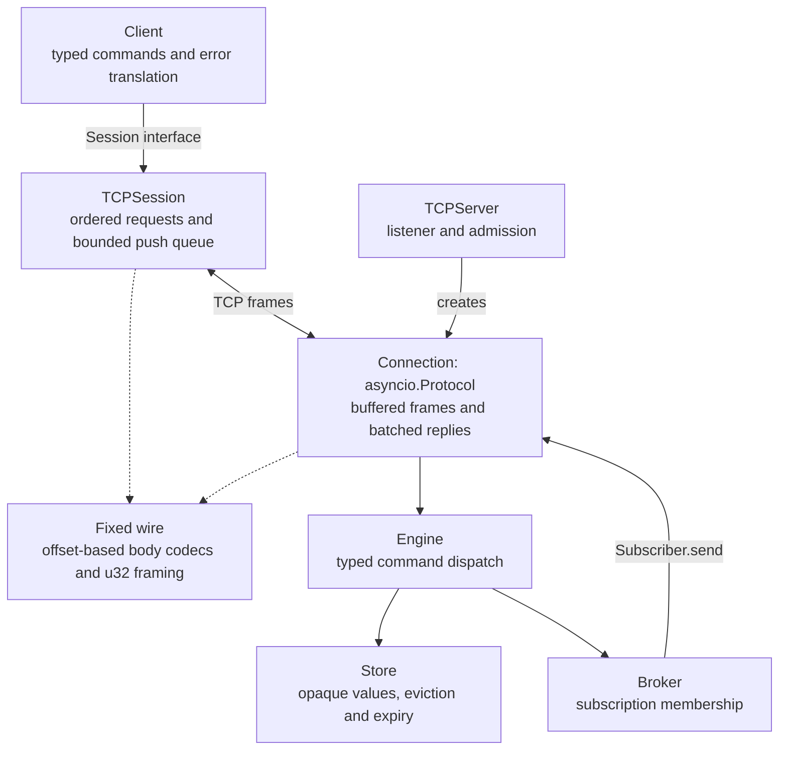
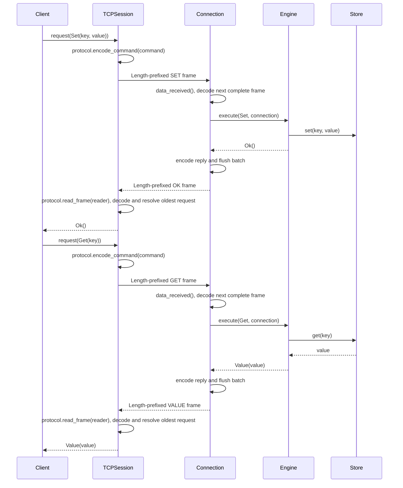
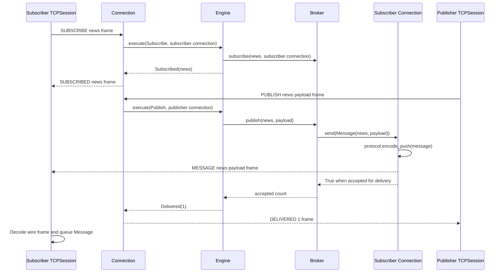
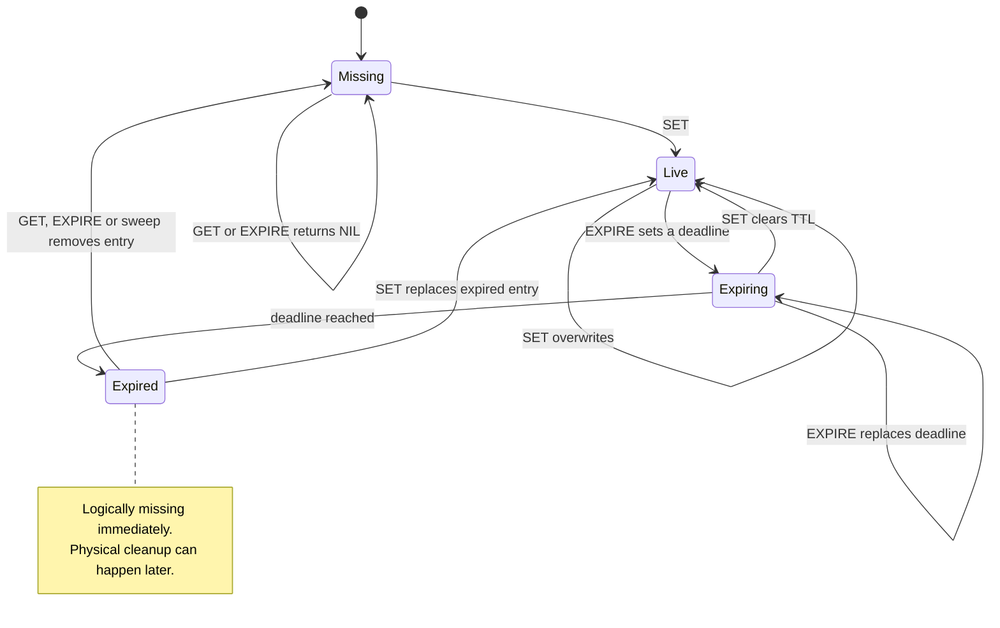

Velis is a lightweight in-memory key-value store with TTL expiration, pub-sub and a fixed binary TCP protocol. It runs on a single asyncio event loop, so the store needs no locks.

> **Status: early development.** The store, TTL, pub-sub, TCP server and async client all work and are tested. The wire protocol is custom, and there is no authentication or TLS yet, so keep it bound to localhost. See [Roadmap](#roadmap) for what's next.

## Table of contents

- [Features](#features)
- [Installation](#installation)
- [Quick start](#quick-start)
- [Architecture](#architecture)
  - [Request lifecycle](#request-lifecycle)
  - [Pub-sub](#pub-sub)
  - [Key lifecycle](#key-lifecycle)
  - [Startup and shutdown](#startup-and-shutdown)
  - [Background maintenance](#background-maintenance)
- [Wire protocol](#wire-protocol)
- [Cache and pub-sub lifetime](#cache-and-pub-sub-lifetime)
- [Configuration](#configuration)
- [Encoding and framing](#encoding-and-framing)
- [Project layout](#project-layout)
- [Development](#development)
- [Benchmarks](#benchmarks)
- [Design notes and limitations](#design-notes-and-limitations)
- [Roadmap](#roadmap)

---

## Features

| Area | Description |
| --- | --- |
| **Store** | `GET` / `SET` / `DEL` / `EXPIRE` / `TTL` / `PERSIST` on opaque `bytes` values, with key-count and byte limits. Single-owner, so no locks. |
| **TTL** | Exact monotonic deadlines, a heap-based expiry index, lazy read expiry and bounded background sweeps. |
| **Pub-sub** | `SUBSCRIBE` / `UNSUBSCRIBE` / `PUBLISH`. At-most-once delivery to connected subscribers on one server. Slow network connections are disconnected when their server write buffer exceeds the configured limit. |
| **Network** | Fixed binary protocol over TCP, ordered pipelining, an `asyncio.Protocol` server with batched replies, and an async `Client`. |
| **Configuration** | CLI environment loading and frozen limits owned by each component. |

---

## Installation

Velis uses [uv](https://docs.astral.sh/uv/) and a `src` layout. From a repository checkout:

```bash
cd velis
uv sync
```

Python **3.15.2 or newer** is required, as specified in `pyproject.toml`. Velis has no runtime dependencies. `uv sync` installs Ruff, ty, Pyright and Hypothesis for development.

---

## Quick start

Start a server:

```bash
uv run velis
```

Use one connection for key/value commands and another for subscriptions:

```python
import asyncio

from velis.net.client import Client


async def main() -> None:
    kv = await Client.connect("127.0.0.1", 9000)
    sub = await Client.connect("127.0.0.1", 9000)
    try:
        await kv.set("greeting", b"hello")
        print(await kv.get("greeting"))
        print(await kv.expire("greeting", 5_000))
        print(await kv.get("missing"))

        await sub.subscribe("news")
        print(await kv.publish("news", b"hi"))
        async with asyncio.timeout(1):
            print(await sub.next_message())
    finally:
        await sub.close()
        await kv.close()


asyncio.run(main())
```

The example prints `b"hello"`, `True`, `None`, `1`, and `Message(channel="news", payload=b"hi")`.

`Client` raises `CommandError` when the server replies `ERR`, `ProtocolError` for invalid outgoing fields or integer ranges, and `ConnectionError` when the connection drops or an incoming wire frame is invalid. Invalid outgoing data is rejected before writing and leaves the connection usable. Closing a client wakes waiting requests and message readers.

Use `asyncio.gather(client.get("a"), client.get("b"))` to pipeline independent commands on one connection. The server executes commands and sends replies in received order; the session matches each reply to the oldest unanswered request. Server pushes are routed separately. Await an earlier command when a later one depends on its result.

Use `asyncio.timeout(seconds)` around commands or `next_message()` to bound the wait. Cancelling or timing out a command leaves the connection usable and discards its eventual reply. A sent command may still execute on the server, including a write; cancellation does not undo it or guarantee that it was never applied. No request is sent when cancellation happens while waiting for an in-flight slot.

Commands are encoded before waiting for pending-queue capacity, so invalid outgoing commands fail immediately even when the queue is full. Waiting calls retain their encoded frames; use bounded application submission for bulk work as well.

Clients allow at most 128 in-flight requests by default. Pass `limits=SessionLimits(max_pending_requests=...)` to `Client.connect()`, `TCPSession.connect()` or `TCPSession` to change this limit; import `SessionLimits` from `velis.config`. Additional calls wait for a slot. A cancelled sent request retains its slot until its reply arrives, keeping cancellation bookkeeping bounded. If a peer stops replying, slots remain occupied until the connection closes; waiting calls can still be cancelled or timed out.

Clients buffer at most 1,024 unread messages and 8 MiB of channel/payload bytes by default, measured as UTF-8 channel bytes plus payload bytes after wire decoding. Set `max_pending_messages` and `max_pending_bytes` on the same `SessionLimits` object to change these positive limits. Crossing either limit closes the connection and fails pending requests. Already queued messages can be drained before `next_message()` raises `ConnectionError`. A full message buffer never blocks the reply reader.

`PUBLISH` returns the number of subscriber connections that accepted the message for delivery. It does not acknowledge that their applications have read or processed it.

---

## Architecture

The dependency points one way: `net` depends on `core`. The core knows nothing about sockets or wire bytes, so it can be tested and embedded without a network.



`Client` exposes typed commands and translates server errors. Values and publication payloads remain opaque bytes. It delegates requests and push buffering to a `Session`; `TCPSession` implements that interface using asyncio streams. For a different transport, construct `Client(session)` with an object implementing `request(command)`, `next_message()` and `close()`.

`TCPServer` creates a `Connection` protocol for each socket. The connection buffers partial input, executes complete commands synchronously on the owning event loop and writes each batch's replies together. Expected command errors produce `ERR` without closing; malformed wire data closes the connection after a best-effort error reply.

Commands, replies and publication pushes are frozen dataclasses in `velis.core.messages`. `net.wire` provides reusable field codecs and a table-driven message codec. `net.protocol` declares each tag and its fields once, frames encoded bodies, and exposes `encode_command()`, `encode_message()`, `iter_frames()` and `read_frame()`.

Clients support async context management, including cleanup after caller failures:

```python
async def read_greeting() -> bytes | None:
    async with await Client.connect("127.0.0.1", 9000) as client:
        return await client.get("greeting")
```

### Request lifecycle

Cache mutations only change memory. The store validates the TTL range and raises `CommandError` for invalid TTLs without changing existing values or deadlines. The engine lets command errors reach the transport, which replies with `ERR` and keeps the connection open. The store owns its monotonic clock and delegates timer scheduling, cancellation and sweeps to `ExpiryIndex`. System wall-clock adjustments do not change TTL duration.

`SET` clears any previous TTL. `EXPIRE` returns `NIL` for a missing or already expired key, so it cannot revive expired data. A zero TTL expires a live key immediately. Accepted TTLs are between `0` and `2**62` milliseconds, inclusive.

`await client.delete(key)` returns `True` when a live key was deleted, freeing its key and byte capacity; missing or expired keys return `False`. `await client.ttl(key)` returns remaining milliseconds, `-1` for a live key without expiry, or `-2` for a missing or expired key. TTL reads remove expired values without refreshing their deadlines. `await client.persist(key)` removes a live key's TTL while keeping its value and returns whether a deadline was removed. It returns `False` for missing, expired or already persistent keys. On the wire, `TTL` uses `TTL_VALUE` for remaining milliseconds, `PERSISTENT` for no expiry and `NIL` for missing keys; the client maps these to the integer API above. These commands use the same key validation as `GET`.

Direct core callers use `Store.ttl(key)`, which returns remaining milliseconds, `TtlStatus.PERSISTENT` or `TtlStatus.MISSING`. Import `TtlStatus` from `velis.core.store`. The `Engine` translates these enum values into wire replies; the client's `-1` and `-2` sentinels remain unchanged.




The connection processes at most 64 commands per callback and writes their replies in one batch. If more commands remain, it pauses reading and schedules the next batch with `call_soon()`, allowing other connections and maintenance to run. Transport write backpressure also pauses reading until `resume_writing()` resumes buffered work. Each individual command and publication remains synchronous.

`TCPSession` matches replies to the oldest unanswered request and routes pushes into a separate bounded queue. Complete buffered requests are drained after a client half-closes its write side; an incomplete trailing frame closes without a reply. Closing a connection releases admission and removes all its subscriptions.

### Pub-sub

The `Broker` only knows the `Subscriber` protocol (`send(message: Message) -> bool`). Delivery callbacks must return promptly; adapters own encoding, buffering and expected transport failures. A `Connection` implements this contract and returns `False` when disconnected, when a write fails with a connection error, or when its buffer limit is exceeded. The broker then removes that subscriber from every channel and continues delivering to healthy subscribers. Acceptance does not acknowledge application processing; unexpected adapter errors propagate.

Each `Broker.publish()` call creates one `Message(channel, payload)` and passes that same object to every subscriber. The broker owns no encoding cache. All TCP connections use the fixed wire format and share `protocol.encode_push`, a `PushEncoder` caching the latest message by identity. Consecutive deliveries of the same object reuse its framed bytes; a new object replaces the cached result even when its contents are equal.

The push encoder retains only its latest message and encoded frame until another push replaces them. A nested publication can replace the slot and cause an outer message to be encoded again. Custom subscribers read `message.channel` and `message.payload` directly.



Network arrows above represent complete length-prefixed frames encoded and decoded with the fixed wire format. `DELIVERED 1` means one connection accepted the push, regardless of when the subscriber reads it.

### Key lifecycle



The key-state diagram assumes valid commands. Invalid TTL values return an error without changing the key or its deadline.

### Startup and shutdown


The `serve(server_limits, ...)` async context manager in `velis.app` owns the server and maintenance task, including cleanup after startup or caller failures. It yields the running `TCPServer`. `TCPServer` also supports `async with` directly for applications that own maintenance separately; the listener closes client transports and awaits their disconnect callbacks. Pass `engine=existing_engine` to reuse application state or a store with an injected clock; the default creates a fresh engine. Shutdown releases runtime resources while an injected engine remains available to its owner. The CLI separately configures logging and installs signal handlers; embedded callers control the runtime scope themselves:

```python
from velis.app import serve
from velis.config import ServerLimits


async def embedded() -> None:
    async with serve(ServerLimits("127.0.0.1", 0)) as server:
        print(server.port)
```

### Background maintenance

Maintenance runs in a task group owned by `serve()`. An unexpected sweep failure interrupts the active runtime scope and closes the server. Worker and caller failures are reported in an `ExceptionGroup` after cleanup; external cancellation remains `CancelledError`. Normal shutdown uses Python 3.15's `TaskGroup.cancel()` and awaits the group before closing the server. Client disconnections remain local to their connections.

One task starts sweeping expired keys every `VELIS_SWEEP_MS`. Each round removes at most 1,000 expired keys. While due keys remain, maintenance yields to the event loop and runs another round without waiting for the next interval.

`ExpiryIndex` maps each key to its exact deadline and uses a min-heap of `(deadline, key)` entries to return due keys in deadline order. Replacing or cancelling a timer updates the deadline map immediately; old heap entries remain until cleanup or compaction. Readiness checks skip stale entries, so `has_due(now)` is true only when a live timer is due. Stale entries do not consume the returned-key budget, and repeated deadlines return each key once.

Deadline lookup and cancellation take expected constant time. Scheduling costs amortized O(log h), where h includes stale heap entries. Scheduling rebuilds the heap from live timers when it exceeds twice the live timer count plus 64 entries. Cancellation alone does not compact the heap; readiness checks and sweeps discard stale heads, including heads with future deadlines. The sweep limit bounds removed keys, **not stale-entry cleanup, compaction work or wall-clock duration**. Clock jumps require no traversal of elapsed milliseconds.

---

## Wire protocol

By default, every request, reply and push is `u32 length + encoded body`. Integers use big-endian byte order. The length counts the encoded body, excluding the four-byte outer prefix. The default outer limit is 2 MiB, checked before waiting for the rest of the body. The u32 prefix, field layouts and limits are fixed; there is no format negotiation.

Replies arrive in command order and carry no request identifiers. `MESSAGE` pushes can appear between replies and are routed separately. Cancelling a sent request leaves its place in the pending queue until its eventual reply arrives, which the client discards. An ordinary reply without a pending request closes the connection; an unsolicited `ERR` preserves the server rejection reason.

The following tables describe the fixed command and server-message bodies (`COMMANDS` and `SERVER_MESSAGES`). A **string** or **bytes** field is `u32 length` followed by that many bytes (strings are UTF-8). Values, publication payloads and general text fields are capped at 1 MiB. Command, reply and push tags are capped at 32 bytes. Field byte limits are checked before UTF-8 decoding.

**Requests**

| Command | Fields | Reply |
| --- | --- | --- |
| `GET` | `key: str` | `VALUE` or `NIL` |
| `SET` | `key: str`, `value: bytes` | `OK` |
| `EXPIRE` | `key: str`, `ms: u64` | `OK`, or `NIL` if the key doesn't exist |
| `DEL` | `key: str` | `OK` if deleted, otherwise `NIL` |
| `TTL` | `key: str` | `TTL_VALUE`, `PERSISTENT`, or `NIL` |
| `PERSIST` | `key: str` | `OK` if a TTL was removed, otherwise `NIL` |
| `SUBSCRIBE` | `channel: str` | `SUBSCRIBED` |
| `UNSUBSCRIBE` | `channel: str` | `UNSUBSCRIBED` |
| `PUBLISH` | `channel: str`, `payload: bytes` | `DELIVERED` |

The default encoded body is the command name as a string followed by its fields.

Request keys contain 1–512 characters and request channels contain 1–256 characters. Their UTF-8 byte lengths are capped at 2,048 and 1,024 bytes respectively, allowing four bytes per character. These byte limits are checked before UTF-8 decoding, then the character rules run on the decoded strings. The character rules also run before sending; whitespace and control characters are allowed. Reply and push channels retain the existing UTF-8 and 1 MiB field size checks.

**Replies and pushes**

| Server message | Fields |
| --- | --- |
| `OK` / `NIL` | none |
| `VALUE` | `value: bytes` |
| `TTL_VALUE` | `ms: u64` |
| `PERSISTENT` | none; the key exists without a TTL |
| `ERR` | `message: str` |
| `SUBSCRIBED` / `UNSUBSCRIBED` | `channel: str` |
| `DELIVERED` | `count: u32` |
| `MESSAGE` *(server push, not a reply)* | `channel: str`, `payload: bytes` |

**Errors**

* `ERR` with the connection kept open: a valid command that cannot be honoured (for example a TTL out of range). The client raises `CommandError` for that request.
* Best-effort `ERR`, followed by closure: the message violates the protocol (unknown tag, oversized field/frame, invalid UTF-8, truncated record, trailing bytes). An incomplete TCP frame at EOF closes without a reply. The server closes even when it cannot encode or send the error.
* Admission rejection: an excess connection receives best-effort `ERR("connection limit exceeded")` before closure. An unsolicited `ERR` becomes `ConnectionError` with that reason. If a request is already pending, the ordered protocol delivers `ERR` as `CommandError` to the oldest request; EOF then fails the remaining requests with `ConnectionError`.

---

## Cache and pub-sub lifetime

The cache is entirely in memory. Keys and TTLs are discarded on restart. There is no cache WAL, recovery or compaction.

The default store retains at most 100,000 keys and 64 MiB of UTF-8 key plus encoded value bytes. The byte budget excludes Python object overhead; the key-count limit bounds resident entry metadata. Expired entries count until cleanup removes them. The default `s3-fifo` policy evicts entries to make room when either limit is reached. A value whose key plus payload exceeds the entire byte budget is rejected before changing existing values or deadlines. Successful replacements clear the TTL. A capacity error produces `ERR` and keeps the connection usable. Direct `Store` and `Broker` callers receive `CapacityError`, a `CommandError` subclass.

Select one of three eviction policies with `VELIS_EVICTION_POLICY` or `Store(limits=StoreLimits(eviction_policy=EvictionPolicy.LRU))` for direct embedding. `StoreLimits` lives in `velis.config` and is also exported by `velis.core.store`; import `EvictionPolicy` from `velis.core.eviction`. Policy strings are normalized to enum values:

| Policy | Behavior when full |
| --- | --- |
| `s3-fifo` (default) | Filter new keys through a small FIFO; retain reused keys in a main FIFO and remember recent probationary evictions in a bounded ghost queue. |
| `lru` | Evict the least recently used entry. |
| `lfu` | Evict the least frequently accessed entry, breaking ties by least recent access. |

S3-FIFO follows the [SOSP 2023 paper's queue and counter rules](https://www.cs.cmu.edu/~rvinayak/papers/s3-fifo-sosp-2023-fifo-queues-are-all-you-need-for-cache-eviction.pdf). New keys enter the small queue unless ghost history places them directly in the main queue. Resident accesses increment a counter capped at three without moving the key. Small-queue keys with more than one reuse are promoted, with their counters reset; others enter ghost history. Main-queue eviction reinserts keys with remaining credit, decrementing the counter each time.

In Velis, queue targets follow the **current resident key count**, independently of `max_keys`: the small target is `max(1, int(residents * small_ratio))`, and the main target is `max(1, residents - small_target)`. `S3FIFO(small_ratio=0.1, ghost_ratio=0.9)` supplies the defaults. Small ratios must be between zero and one; ghost ratios must be positive. When recording a small-queue victim, ghost history is trimmed to `max(1, int(residents * ghost_ratio))` keys and retains no values. It adds Python metadata and retained key strings outside `stored_bytes`. Queues borrow unused space, and the store independently enforces both total limits. With variable-sized values or very small caches, behavior can differ from the paper's equal-sized-object model. Each policy eviction removes exactly one resident, though it may first promote several small entries.

Eviction may remove several entries to fit the byte budget. Every victim's value, byte accounting, timer and resident policy metadata are removed together; S3-FIFO may retain ghost history. Explicit deletion and TTL expiry forget policy history. Under capacity pressure, every policy performs one bounded expiry sweep before evicting live entries. Remaining expired entries are reclaimed by later reads or maintenance. `GET` hits update access history. Each successful `SET` starts fresh access history and clears any TTL; a new S3-FIFO entry starts with zero reuse credit. Re-inserting a key remembered in S3-FIFO ghost history enters main directly. TTL inspection and expiry changes do not count as accesses. LFU uses a min-heap ordered by frequency and last access, with lazy stale-entry removal and compaction; access and eviction cost amortized O(log n).

`Store` composes `Expiring` over `Evicting` over `Memory`: the outer layer owns TTLs, the middle layer enforces capacity and tracks policy history, and the base layer stores values and accounts for bytes. Expiry removes keys through the eviction layer. Capacity eviction clears timers through a hook, and a reclamation hook sweeps expired keys before selecting live victims.

`store.stats()` returns a frozen `StoreStats(hits, misses, evictions, expirations)` snapshot. Hits and misses count `GET` results only. Evictions count capacity victims; expirations count keys physically removed by lazy access, sweeps or write-time cleanup. Deleting or overwriting live keys does not increment either removal counter. Counters accumulate from construction, and taking a snapshot does not purge keys or reset them.

Eviction policies expose resident key counts and membership through `len(policy)` and `key in policy`; S3-FIFO ghosts are excluded.

Running `uv run velis` uses S3-FIFO by default. Choose LRU with `VELIS_EVICTION_POLICY=lru uv run velis`, or use `lfu`. Policy performance depends on the workload; use `Store.stats()` to compare hit and eviction rates.

Each connection can subscribe to at most 1,024 channels by default. Repeating an existing subscription uses no extra capacity; unsubscribing frees a slot. The listener admits at most 1,024 active connections by default. Excess connections receive a best-effort `ERR` and are closed, leaving admitted clients usable.

Pub-sub provides at-most-once delivery to connected subscribers on the same server. Messages are not persisted, retried or replayed, and no server-to-server replication is implemented. Slow subscribers are disconnected when server write buffers or client unread-message queues overflow. A network subscriber that cannot accept an encoded push is disconnected and removed from every channel; publication continues to healthy subscribers. Messages may be lost on disconnect; `PUBLISH` counts accepted deliveries, without acknowledging application processing. Future replication should carry pub-sub messages, not cache state.

---

## Configuration

> **`max_bytes` is a data budget, not a RAM limit.** It counts UTF-8 keys and stored values only. Python objects, dictionaries, eviction queues and expiry metadata use additional memory; with many small keys, process memory can be several times the budget. Use `max_keys` as well.

`velis/config.py` defines the defaults, validated `ServerLimits`, `StoreLimits`, `SessionLimits`, and the immutable `Config` snapshot. `Config.from_env()` reads `VELIS_*` variables when called. The CLI loads it once before configuring logging or opening runtime resources. `Config()` uses explicit values and defaults; embedded callers can load environment settings themselves. Existing limit imports from the store, server and session modules remain available.

Unknown log levels, ports outside `0–65535`, nonpositive limits or sweep intervals, and non-integer numeric settings raise `ValueError` before startup. Empty values are parsed and validated; only missing variables use defaults. Parsing errors include the environment variable name. Logging setup and signals belong to `__main__.py`; `velis.app` owns the runtime lifecycle.

| Variable | Default | Description |
| --- | --- | --- |
| `VELIS_LOG_LEVEL` | `INFO` | Log level for the `velis` logger. |
| `VELIS_HOST` | `127.0.0.1` | Interface to listen on. |
| `VELIS_PORT` | `9000` | Port to listen on (`0` picks a free port). |
| `VELIS_MAX_BUFFER` | `8388608` (8 MiB) | Server write buffer limit checked when pushing a message. Must be positive; allow room for both the channel and payload plus framing. |
| `VELIS_MAX_KEYS` | `100000` | Maximum retained cache keys; the eviction policy controls behavior when full. |
| `VELIS_MAX_BYTES` | `67108864` (64 MiB) | Maximum retained UTF-8 key plus encoded value bytes; excludes Python object overhead. |
| `VELIS_EVICTION_POLICY` | `s3-fifo` | One of `s3-fifo`, `lru`, `lfu`; applies to both key-count and byte pressure. |
| `VELIS_MAX_CONNECTIONS` | `1024` | Maximum admitted TCP connections; excess connections are closed after a best-effort error. |
| `VELIS_MAX_SUBSCRIPTIONS` | `1024` | Maximum distinct channels per subscriber connection. |
| `VELIS_SWEEP_MS` | `100` | Milliseconds between expiry sweeps; must be positive. |
| `VELIS_MAX_PENDING_REQUESTS` | `128` | Maximum in-flight requests per client session. |
| `VELIS_MAX_PENDING_MESSAGES` | `1024` | Maximum unread publications per client session. |
| `VELIS_MAX_PENDING_BYTES` | `8388608` (8 MiB) | Maximum unread channel/payload bytes per client session. |

For example, start the CLI with environment overrides:

```sh
VELIS_PORT=9001 VELIS_MAX_BYTES=33554432 VELIS_LOG_LEVEL=debug uv run velis
```

Embedded callers use the same configuration:

```python
from velis.app import serve
from velis.config import Config
from velis.net.client import Client


async def embedded() -> None:
    config = Config.from_env()
    async with serve(
        config.server_limits,
        store_limits=config.store_limits,
        max_subscriptions=config.max_subscriptions,
        sweep_interval_ms=config.sweep_interval_ms,
    ) as server:
        async with await Client.connect(
            config.server_limits.host, server.port, limits=config.session_limits
        ) as client:
            await client.set("greeting", b"hello")
```

Client environment settings take effect when passing `config.session_limits` to `Client.connect()` or `TCPSession`. `Config.from_env(mapping)` supports loading an explicit mapping, including an empty mapping for defaults.

`serve(server_limits, store_limits=..., max_subscriptions=..., sweep_interval_ms=...)` applies the supplied store and broker limits when building its default engine. All arguments have defaults. When supplying `engine=...`, configure its store and broker directly; the runtime uses that engine without applying the store or broker limits. Listener and write-buffer limits still apply. `build_engine(store_limits=..., max_subscriptions=...)` constructs a standalone engine. Embedded callers control their own logging.

---

## Encoding and framing

Stored values and publication payloads are opaque bytes from end to end. Applications serialize, compress or encrypt before calling `set()` or `publish()` and reverse that transformation after `get()` or `next_message()`. The client performs no application payload transforms.

`velis.net.wire.Codec` derives encoding, decoding and validation from the command and server-message tables in `net.protocol`. Reusable fields read by byte offset and use precompiled integer structs. Duplicate tags and field-count mismatches fail when a codec is declared. Both directions enforce UTF-8, text and byte limits, integer ranges, truncation and complete record consumption. `velis.net.limits` owns all wire limits.

`protocol.COMMANDS` and `protocol.SERVER_MESSAGES` expose body encoding and decoding. `protocol.encode_command()` and `encode_message()` add the fixed u32 body length. `iter_frames(bytearray)` yields complete bodies and end offsets, leaving partial data unconsumed; callers discard consumed bytes only after iteration ends. The client loops over `read_frame(reader)`, which reads and validates the length before waiting for the body, then decodes each body with `SERVER_MESSAGES`. Clean EOF at a frame boundary returns `None`; partial headers and bodies raise `IncompleteReadError`.

```python
from velis.core.messages import Get
from velis.net.protocol import COMMANDS, encode_command

encoded = encode_command(Get("k"))
assert encoded == b"\x00\x00\x00\x0c\x00\x00\x00\x03GET\x00\x00\x00\x01k"
assert COMMANDS.decode(encoded[4:]) == Get("k")
```

Golden byte fixtures cover every command, reply and push. Truncation, malformed-field and mutation tests enforce the fixed format and error contracts; raw TCP tests cover batching, fragmentation, backpressure, admission and shutdown.

---

## Project layout

```
src/velis/
  __main__.py — CLI: logging, signals and startup
  config.py — all runtime settings, defaults, validation and VELIS_* loading
  app.py — composition root: serve() owns networking and maintenance
  errors.py — VelisError, ProtocolError, CommandError, CapacityError
  validation.py — shared positive-limit validation
  core/ — no sockets, no wire format
    messages.py — Command / Reply / Message dataclasses and TTL sentinels
    engine.py — command dispatch and replies
    store.py — public Store composition and StoreStats snapshots
    kv.py — KV protocol, Memory and byte accounting
    limits.py — re-export of StoreLimits and defaults from config.py
    evicting.py — capacity enforcement, eviction policy and layer hooks
    expiring.py — TTL operations, TtlStatus and expiration counts
    eviction.py — EvictionPolicy and S3-FIFO (default), LRU and LFU policies
    expiry_index.py — exact deadlines and a min-heap with lazy stale-entry removal
    broker.py — subscription limits, shared Message delivery and Subscriber protocol
    membership.py — Memberships with join/leave operations and mirrored indexes
    clock.py — structural Clock protocol and MonotonicClock implementation
  net/
    protocol.py — message tables, fixed u32 framing and shared PushEncoder
    wire.py — reusable field codecs and table-driven tagged message codec
    limits.py — fixed wire field, frame and text limits
    connection.py — asyncio.Protocol callbacks, ordered batches and push buffering
    server.py — TCPServer listener lifecycle and connection admission
    client.py — opaque-byte command API, error translation and scoped cleanup
    session.py — Session interface and TCP request/message lifecycle
tests/
  helpers.py — ManualClock and RecordingSubscriber test helpers
  app/ — runtime cleanup and CLI signal ownership
  core/ — store, engine, broker and cache lifetime
  net/ — protocol, client lifecycle and TCP integration tests
benchmarks/
  tcp.py — repeatable localhost TCP throughput benchmark
  tcp-results.json — machine details and individual throughput samples
```

---

## Development

Tests use the standard library's `unittest` and Hypothesis state machines for shrinking cache operation sequences across all eviction policies.

```bash
make check
make test
make lint
make fmt
```

`make check` runs Ruff lint and formatting checks, ty, Pyright in strict mode for `src`, and tests with `python -X dev -W error`; it is also the default `make` target. `make fmt` applies supported lint fixes and formatting.

`unittest discover` only descends into directories that contain an `__init__.py`, so every `tests/` subdirectory needs one.

The core is deliberately easy to test without sockets or real time: the `Store` accepts any object implementing the `Clock` protocol's `now_ms()` method, without requiring inheritance. The `ManualClock` in `tests/helpers.py` makes TTLs deterministic. Wire tests exercise golden byte fixtures, every truncation of valid bodies, and seeded mutations in both directions. Network tests bind to localhost on an automatically selected port, so the test environment must allow local sockets.

Prefer direct stdlib APIs and clear ownership over custom infrastructure or small performance gains.

---

## Benchmarks

Run the current server's TCP benchmark from the repository root:

```bash
make bench
```

Pass benchmark options with `BENCH_ARGS`, for example `make bench BENCH_ARGS="--pipeline 64 1024 --repeats 3"`. To save the JSON output, invoke `uv run python benchmarks/tcp.py > results.json` directly; benchmark progress goes to stderr.

The benchmark starts the real Store, Broker and TCP runtime in a separate process, with the default S3-FIFO policy, capacity limits and 100 ms maintenance interval. One load-generator process uses one localhost connection per sample. Requests are encoded before timing; every reply is validated inside the timed interval. Connection setup and warmup are excluded.

Each case measures 100,000 operations after 10,000 warmup operations, repeated five times with alternating case order. Keys are 16 bytes, values are 64 bytes, and the working set is 10,000 preloaded keys. SET overwrites existing keys; GET hits cycle through the resident keys, and GET misses use a disjoint key prefix. A pipeline window is sent and fully answered before the next window; depth 1 waits for each individual reply.

Measured on **2026-11-09** with **CPython 3.15.2**, the standard asyncio event loop, **Linux 7.2.15 x86_64**, and an **AMD Ryzen 5 7535HS**. No CPU affinity or frequency tuning was applied. Median operations per second, rounded to the nearest 100:

| Operation | Pipeline 1 | Pipeline 64 | Pipeline 1,024 |
| --- | ---: | ---: | ---: |
| SET overwrite | 21,000 | 233,900 | 269,600 |
| GET hit | 23,200 | 286,400 | 341,400 |
| GET miss | 24,400 | 367,400 | 447,000 |

Results are machine-specific and cover cache operations without expiry or eviction pressure. The load generator uses raw wire frames, so application serialization and the `Client` API add costs beyond these measurements. Multi-connection scaling, larger values, TTL churn and pub-sub fan-out need separate workloads. Raw samples and environment details are in [benchmarks/tcp-results.json](benchmarks/tcp-results.json).

---

## Design notes and limitations

* **Single-threaded by design.** The event-loop thread owns the `Engine`, `Store` and `Broker`, which is why none of them take locks. Don't call them from other threads.
* **TTLs use monotonic time.** Deadlines are internal to the running process and are discarded on restart.
* **No auth or TLS.** Resource limits bound retained cache data, connection count, subscriptions and message buffers; they do not impose an exact process-memory ceiling. Don't expose it to untrusted networks.
* **Bounded pipelining.** TCP sessions match replies to requests in arrival order and limit requests awaiting replies. Server commands execute sequentially in received order. Closing wakes every pending request, capacity waiter and message reader. Cancellation leaves the connection usable but does not cancel execution on the server.
* **Separate buffer limits.** Server write buffers and client unread-message buffers have independent limits. Client byte budgets count UTF-8 channel bytes and payload bytes after wire decoding; application-held values and messages use additional memory.

---

## Roadmap

- [x] `DEL`, `TTL` and `PERSIST` commands.
- [x] Bounded ordered pipelining with cancellation-safe reply handling.
- [ ] Pub-sub message replication between servers, independent of cache state.
- [x] Connection and memory limits.
- [x] Built-in S3-FIFO (default), LRU and LFU eviction policies.
- [ ] Authentication and TLS.
