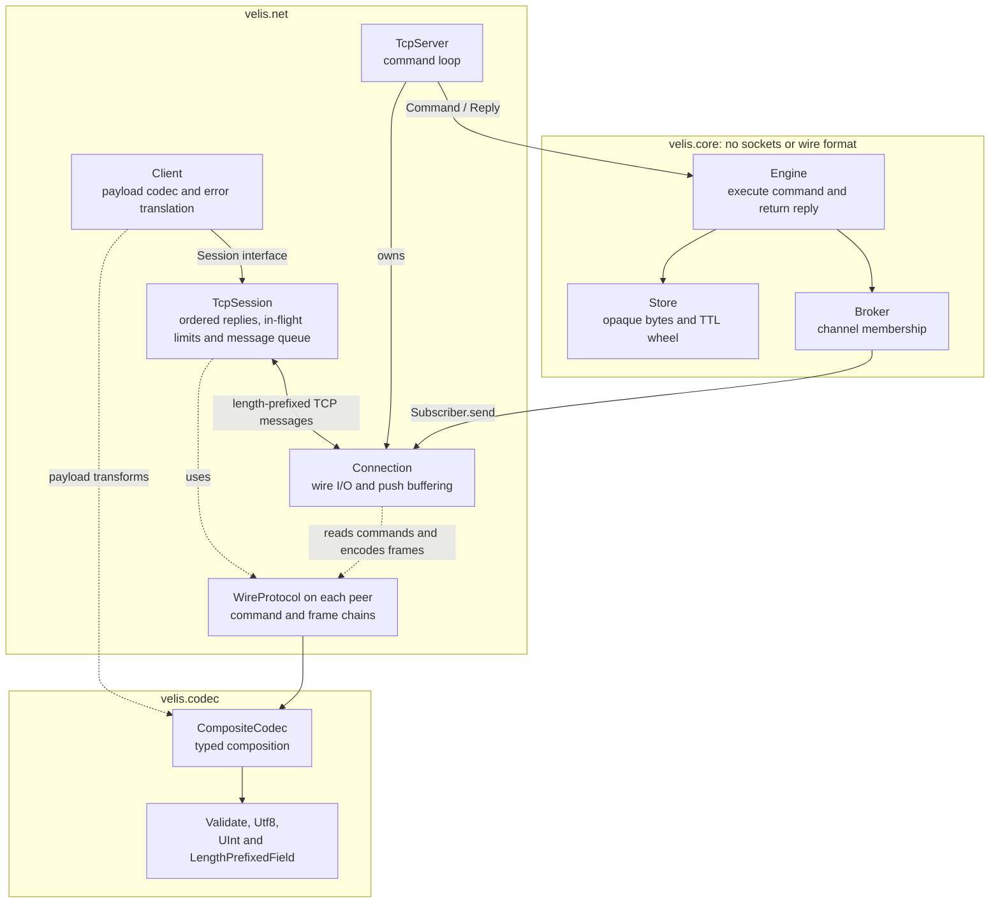
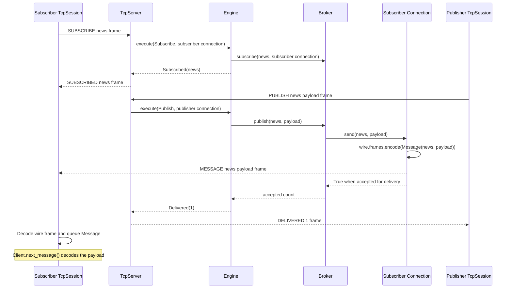
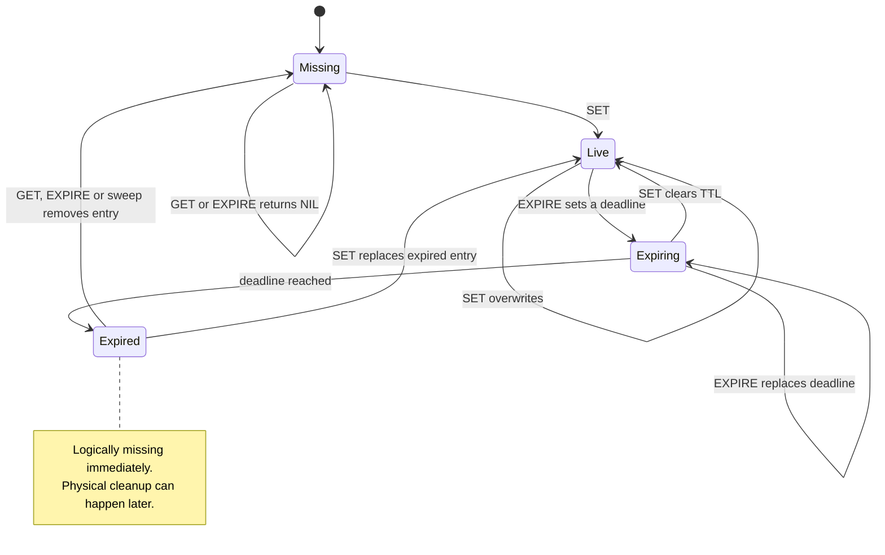
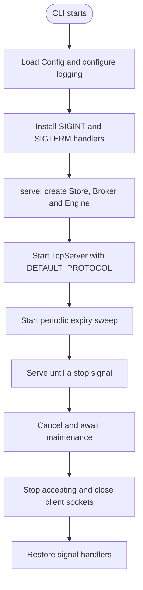
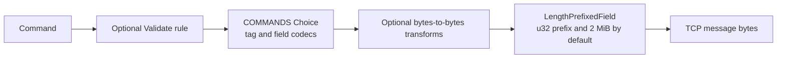

Velis is a lightweight in-memory key-value store with TTL expiration, pub-sub, a small TCP protocol and composable payload and wire codecs. It runs on a single asyncio event loop, so the store needs no locks.

> **Status: early development.** The store, TTL, pub-sub, TCP server and async client all work and are tested. The wire protocol is custom, and there is no authentication or TLS yet, so keep it bound to localhost. See [Roadmap](#roadmap) for what's next.

## Table of contents

- [Features](#features)
- [Installation](#installation)
- [Quick start](#quick-start)
- [Architecture](#architecture)
  - [Request lifecycle](#request-lifecycle)
  - [Pub-sub](#pub-sub)
  - [Key lifecycle](#key-lifecycle)
  - [Startup and shutdown](#startup-and-shutdown)
  - [Background maintenance](#background-maintenance)
- [Wire protocol](#wire-protocol)
- [Cache and pub-sub lifetime](#cache-and-pub-sub-lifetime)
- [Configuration](#configuration)
- [Codecs](#codecs)
  - [Typed representations and rules](#typed-representations-and-rules)
  - [Composing the wire protocol](#composing-the-wire-protocol)
- [Project layout](#project-layout)
- [Development](#development)
- [Benchmarks](#benchmarks)
  - [In-process operations](#in-process-operations)
  - [Local TCP GET](#local-tcp-get)
  - [Local TCP pub-sub](#local-tcp-pub-sub)
- [Design notes and limitations](#design-notes-and-limitations)
- [Roadmap](#roadmap)

---

## Features

| Area | Description |
| --- | --- |
| **Store** | `GET` / `SET` / `DEL` / `EXPIRE` / `TTL` / `PERSIST` on opaque `bytes` values, with key-count and byte limits. Single-owner, so no locks. |
| **TTL** | Exact monotonic deadlines, a hierarchical timing wheel, lazy read expiry and bounded background sweeps. |
| **Pub-sub** | `SUBSCRIBE` / `UNSUBSCRIBE` / `PUBLISH`. At-most-once delivery to connected subscribers on one server. Slow network connections are disconnected when their server write buffer exceeds the configured limit. |
| **Network** | Length-prefixed binary protocol over TCP, bounded pipelining with ordered replies, an asyncio server and an async `Client`. |
| **Codecs** | Typed `CompositeCodec`s for payload transforms, wire serialization and validation. Stored values remain opaque bytes. |
| **Config** | Frozen, validated `Config` loaded from `VELIS_*` environment variables. |

---

## Installation

Velis uses [uv](https://docs.astral.sh/uv/) and a `src` layout. From a repository checkout:

```bash
cd velis
uv sync
```

Python **3.15.2 or newer** is required, as specified in `pyproject.toml`. Velis has no runtime dependencies. `uv sync` installs Ruff and ty for development.

---

## Quick start

Start a server:

```bash
uv run velis
```

Use one connection for key/value commands and another for subscriptions:

```python
import asyncio

from velis.net.client import Client


async def main() -> None:
    kv = await Client.connect("127.0.0.1", 9000)
    sub = await Client.connect("127.0.0.1", 9000)
    try:
        await kv.set("greeting", b"hello")
        print(await kv.get("greeting"))
        print(await kv.expire("greeting", 5_000))
        print(await kv.get("missing"))

        await sub.subscribe("news")
        print(await kv.publish("news", b"hi"))
        async with asyncio.timeout(1):
            print(await sub.next_message())
    finally:
        await sub.close()
        await kv.close()


asyncio.run(main())
```

The example prints `b"hello"`, `True`, `None`, `1`, and `Message(channel="news", payload=b"hi")`.

`Client` raises `CommandError` when the server replies `ERR`, `ProtocolError` for invalid outgoing fields, integer ranges or wire rules, and `ConnectionError` when the connection drops or an incoming wire frame is invalid. Exceptions from custom payload codecs propagate to the caller. Invalid outgoing data is rejected before writing and leaves the connection usable. Closing a client wakes waiting requests and message readers.

Use `asyncio.gather(client.get("a"), client.get("b"))` to pipeline independent commands on one connection. The server executes commands and sends replies in received order; the session matches each reply to the oldest unanswered request. Server pushes are routed separately. Await an earlier command when a later one depends on its result.

Use `asyncio.timeout(seconds)` around commands or `next_message()` to bound the wait. Cancelling or timing out a command leaves the connection usable and discards its eventual reply. A sent command may still execute on the server, including a write; cancellation does not undo it or guarantee that it was never applied. No request is sent when cancellation happens while waiting for an in-flight slot.

Wire encoding starts after a request acquires capacity. Invalid outgoing commands may therefore wait for a slot before raising; encoding failure releases the reservation without sending. Client payload codecs run before session admission, so application tasks and their payloads still require bounded submission for bulk work.

Clients allow at most 128 in-flight requests by default. Pass `limits=SessionLimits(max_pending_requests=...)` to `Client.connect()`, `TcpSession.connect()` or `TcpSession` to change this limit; import `SessionLimits` from `velis.net.session`. Additional calls wait for a slot. A cancelled sent request retains its slot until its reply arrives, keeping cancellation bookkeeping bounded. If a peer stops replying, slots remain occupied until the connection closes; waiting calls can still be cancelled or timed out.

Clients buffer at most 1,024 unread messages and 8 MiB of channel/payload bytes by default, measured after wire decoding and before client payload decoding. Set `max_pending_messages` and `max_pending_bytes` on the same `SessionLimits` object to change these positive limits. Crossing either limit closes the connection and fails pending requests. Already queued messages can be drained before `next_message()` raises `ConnectionError`. A full message buffer never blocks the reply reader.

`PUBLISH` returns the number of subscriber connections that accepted the message for delivery. It does not acknowledge that their applications have read or processed it.

---

## Architecture

The server separates command handling from networking, and the dependency only points one way: **`net` depends on `core`, never the reverse.** The core knows nothing about sockets or the wire format, so it can be tested and embedded without a network.



The diagram shows runtime calls and codec usage; each peer uses its own configured wire protocol. `Broker` calls the structural `Subscriber` interface, so it has no dependency on the concrete `Connection` class.

`Client` owns the user-facing command API, payload codecs and error translation. It delegates ordered request/reply handling, message buffering and connection shutdown to a `Session`. The built-in `TcpSession` implements that interface over the wire protocol. Payload codecs can be individual `Codec[bytes, bytes]` objects or composed `CompositeCodec[bytes, bytes]` instances. The default is `Identity()`, which returns bytes unchanged.

`Client.connect()` creates the TCP session for you. To supply a different transport, use `Client(session, codec)` with an object implementing `request(command)`, `next_message()` and `close()`. For existing asyncio streams, construct `Client(TcpSession(reader, writer), codec)`. Sessions exchange command/reply dataclasses containing payload-encoded bytes; the client applies codecs and translates `Err` replies into `CommandError`.

Clients support async context management, including cleanup when application code raises:

```python
async def read_greeting() -> bytes | None:
    async with await Client.connect("127.0.0.1", 9000) as client:
        return await client.get("greeting")
```

Commands and replies are plain frozen dataclasses (`velis.core.commands`). `net/protocol.py` defines `COMMANDS` and `FRAMES` as `Choice` tables mapping tags to dataclass variants and field codecs. `WireProtocol` adds bounded length framing. Use `DEFAULT_PROTOCOL.commands.encode(command)`, `DEFAULT_PROTOCOL.frames.encode(reply)`, or `.frames.encode(message)` for a push. `read_commands(reader)` and `read_frames(reader)` return async generators; use one generator for each incoming stream. They use `StreamReader.readexactly()` to read and validate the length prefix before waiting for the body. The engine receives commands and returns replies: **validate, apply, reply.**

### Request lifecycle

Cache mutations only change memory. The store validates the TTL range and raises `CommandError` for invalid TTLs without changing existing values or deadlines. The engine lets command errors reach the transport, which replies with `ERR` and keeps the connection open. The store owns its monotonic clock and delegates timer scheduling, cancellation and bounded sweeps to `TimingWheel`. System wall-clock adjustments do not change TTL duration.

`SET` clears any previous TTL. `EXPIRE` returns `NIL` for a missing or already expired key, so it cannot revive expired data. A zero TTL expires a live key immediately. Accepted TTLs are between `0` and `2**62` milliseconds, inclusive.

`await client.delete(key)` returns `True` when a live key was deleted, freeing its key and byte capacity; missing or expired keys return `False`. `await client.ttl(key)` returns remaining milliseconds, `-1` for a live key without expiry, or `-2` for a missing or expired key. TTL reads remove expired values without refreshing their deadlines. `await client.persist(key)` removes a live key's TTL while keeping its value and returns whether a deadline was removed. It returns `False` for missing, expired or already persistent keys. On the wire, `TTL` uses `TTL_VALUE` for remaining milliseconds, `PERSISTENT` for no expiry and `NIL` for missing keys; the client maps these to the integer API above. These commands use the same key validation as `GET`.


The server explicitly yields to the event loop after every 64 completed commands, allowing other connections and maintenance to run even when reads and drains complete immediately. Each individual command and publication remains synchronous.

The diagram shows a successful `SET` followed by `GET` on the same key. `TcpSession` keeps an ordered queue of futures for in-flight requests; its reader routes `Message` frames into a separate bounded queue. `Connection` owns server-side wire decoding, reply encoding and socket I/O; `TcpServer` dispatches decoded commands to the engine and writes replies in the same order. Payload bytes stay encoded in the store.

### Pub-sub

The `Broker` only knows the `Subscriber` protocol (`send(channel, payload) -> bool`). Delivery callbacks must return promptly; adapters own encoding, buffering and expected transport failures. A `Connection` implements this contract and returns `False` when disconnected, when a write fails with a connection error, or when its buffer limit is exceeded. The broker then removes that subscriber from every channel and continues delivering to healthy subscribers. Acceptance does not acknowledge application processing; unexpected adapter errors propagate.

During each server command dispatch, connections sharing a `WireProtocol` instance reuse the encoded push bytes. The encoding cache is released after dispatch, and distinct wire protocol instances use separate encodings. This avoids serializing a large publication once per subscriber while preserving custom wire codecs. Custom subscriber adapters still own their delivery behavior.



Network arrows above represent complete length-prefixed frames encoded and decoded with each peer's configured wire chains. The publisher client encodes the payload before requesting `Publish`; the subscriber client decodes it when calling `next_message()`. `DELIVERED 1` means one connection accepted the push, regardless of when the subscriber reads it.

### Key lifecycle



The key-state diagram assumes valid commands. Invalid TTL values return an error without changing the key or its deadline.

### Startup and shutdown



The `serve(config)` async context manager in `velis.app` owns the server and maintenance task, including cleanup after startup or caller failures. It yields the running `TcpServer`. Pass `engine=existing_engine` to reuse application state or a store with an injected clock; the default creates a fresh engine. Pass `wire=custom_wire` to configure the server's codec chains; the CLI uses `DEFAULT_PROTOCOL`. Shutdown releases runtime resources while an injected engine remains available to its owner. The CLI separately configures logging and installs signal handlers; embedded callers control the runtime scope themselves:

```python
from velis.app import serve
from velis.config import Config, Server


async def embedded() -> None:
    config = Config(log_level="INFO", server=Server("127.0.0.1", 0))
    async with serve(config) as server:
        print(server.port)
```

### Background maintenance

Maintenance runs in a task group owned by `serve()`. An unexpected sweep failure interrupts the active runtime scope and closes the server. Worker and caller failures are reported in an `ExceptionGroup` after cleanup; external cancellation remains `CancelledError`. Normal shutdown cancels and awaits maintenance before closing the server. Client disconnections remain local to their connections.

One task starts sweeping expired keys every `VELIS_SWEEP_MS`. Each round processes at most 1,000 timers, counting both expiration and moves from coarse buckets into finer buckets. While ready buckets remain, maintenance yields to the event loop and runs another round without waiting for the next interval. A round that only moves future timers still allows the next round to process a due backlog.

`TimingWheel` uses sparse levels with 64 slots each: the base level has 1 ms slots, and each following level spans 64 times more time. Levels grow to cover the full supported TTL range. Advancing across a long pause examines at most 64 slots per level instead of every elapsed millisecond. Ready buckets are drained within the timer budget. The original millisecond deadline is checked before a key is removed, so coarse buckets never expire values early. Reads also check exact deadlines independently of maintenance.

Each key owns one scheduled timer. Replacing a TTL, `SET`, `PERSIST`, deletion and eviction unlink the previous timer immediately, including from partly drained buckets. The wheel has no stale timer accumulation or full-index compaction. Bucket advancement is bounded by the number of wheel levels and slots; timer processing is bounded by the sweep limit. An individual command or publication can still take more CPU time than a scheduling quantum.

---

## Wire protocol

By default, every request, reply and push is `u32 length + encoded body`. Integers use big-endian byte order. The length counts the encoded body, excluding the four-byte outer prefix. The default outer limit is 2 MiB, checked before waiting for the rest of the body. Peers can configure a different outer prefix, but must agree on the framing; there is no version or format negotiation.

Replies arrive in command order and carry no request identifiers. `MESSAGE` pushes can appear between replies and are routed separately. Cancelling a sent request leaves its place in the pending queue until its eventual reply arrives, which the client discards. An ordinary reply without a pending request closes the connection; an unsolicited `ERR` preserves the server rejection reason.

The following tables describe the default body codecs (`COMMANDS` and `FRAMES`). A **string** or **bytes** field is `u32 length` followed by that many bytes (strings are UTF-8). Values, publication payloads and general text fields are capped at 1 MiB; the limit includes any expansion from client-side codecs. Command, reply and push tags are capped at 32 bytes. Field byte limits are checked before UTF-8 decoding.

**Requests**

| Command | Fields | Reply |
| --- | --- | --- |
| `GET` | `key: str` | `VALUE` or `NIL` |
| `SET` | `key: str`, `value: bytes` | `OK` |
| `EXPIRE` | `key: str`, `ms: u64` | `OK`, or `NIL` if the key doesn't exist |
| `DEL` | `key: str` | `OK` if deleted, otherwise `NIL` |
| `TTL` | `key: str` | `TTL_VALUE`, `PERSISTENT`, or `NIL` |
| `PERSIST` | `key: str` | `OK` if a TTL was removed, otherwise `NIL` |
| `SUBSCRIBE` | `channel: str` | `SUBSCRIBED` |
| `UNSUBSCRIBE` | `channel: str` | `UNSUBSCRIBED` |
| `PUBLISH` | `channel: str`, `payload: bytes` | `DELIVERED` |

The default encoded body is the command name as a string followed by its fields.

Request keys contain 1–512 characters and request channels contain 1–256 characters. Their UTF-8 byte lengths are capped at 2,048 and 1,024 bytes respectively, allowing four bytes per character. These byte limits are checked before UTF-8 decoding, then the character rules run on the decoded strings. The character rules also run before sending; whitespace and control characters are allowed. Reply and push channels retain the existing UTF-8 and 1 MiB field size checks.

**Replies and pushes**

| Frame | Fields |
| --- | --- |
| `OK` / `NIL` | none |
| `VALUE` | `value: bytes` |
| `TTL_VALUE` | `ms: u64` |
| `PERSISTENT` | none; the key exists without a TTL |
| `ERR` | `message: str` |
| `SUBSCRIBED` / `UNSUBSCRIBED` | `channel: str` |
| `DELIVERED` | `count: u32` |
| `MESSAGE` *(server push, not a reply)* | `channel: str`, `payload: bytes` |

**Errors**

* `ERR` with the connection kept open: a valid command that cannot be honoured (for example a TTL out of range). The client raises `CommandError` for that request.
* Best-effort `ERR`, followed by closure: the message violates the protocol (unknown tag, oversized field/frame, invalid UTF-8, truncated record, trailing bytes or a failed wire rule). An incomplete TCP frame at EOF closes without a reply. The server closes even when it cannot encode or send the error.
* Admission rejection: an excess connection receives best-effort `ERR("connection limit exceeded")` before closure. An unsolicited `ERR` becomes `ConnectionError` with that reason. If a request is already pending, the ordered protocol delivers `ERR` as `CommandError` to the oldest request; EOF then fails the remaining requests with `ConnectionError`.

---

## Cache and pub-sub lifetime

The cache is entirely in memory. Keys and TTLs are discarded on restart. There is no cache WAL, recovery or compaction.

The default store retains at most 100,000 keys and 64 MiB of UTF-8 key plus encoded value bytes. The byte budget excludes Python object overhead; the key-count limit also bounds entry metadata. Expired entries count until cleanup removes them. The default `lru` policy evicts the least recently used entries to make room when either limit is reached. Select `reject` explicitly to reject writes that exceed the limits while retaining live entries. Rejected replacements preserve the previous value and TTL; successful replacements clear the TTL. A capacity error produces `ERR` and keeps the connection usable. Direct `Store` and `Broker` callers receive `CapacityError`, a `CommandError` subclass.

Select a built-in eviction policy with `VELIS_EVICTION_POLICY` or `Store(limits=StoreLimits(eviction_policy=EvictionPolicy.LRU))` for direct embedding. `StoreLimits` and the `EvictionPolicy` enum live in `velis.core.store`. Pass store settings through `limits=StoreLimits(...)`; the policy is normalized to an enum value:

| Policy | Behavior when full |
| --- | --- |
| `lru` (default) | Evict the least recently used entry. |
| `reject` | Reject the write without evicting values. |
| `sieve` | Keep insertion order, mark accesses, and scan with a moving hand to evict an unvisited entry. |

Eviction may remove several entries to fit the byte budget. Each victim's deadline and cached entry size are removed together. An entry whose own UTF-8 key plus value exceeds the entire byte budget is rejected before any eviction, preserving existing values and TTLs. Under capacity pressure, every policy, including `reject`, performs one bounded expiry sweep when due entries exist before making room or refusing the write. Remaining expired entries are reclaimed by later reads or maintenance. `GET` reads and successful `SET` operations update the selected policy; TTL inspection and expiry changes do not count as accesses. LRU moves accessed keys to the newest end. SIEVE leaves keys in insertion order: new keys start unvisited, accesses mark them, and eviction clears visited bits until the moving hand finds an unvisited key. `reject` raises `CapacityError("store limit exceeded")` when a write cannot fit. Store owns values, capacity, byte accounting and TTL removal; eviction policies only track candidate keys.

Running `uv run velis` uses LRU by default. To retain entries and reject writes when full, use `VELIS_EVICTION_POLICY=reject uv run velis`. Select SIEVE with `VELIS_EVICTION_POLICY=sieve uv run velis`. The former `lfu`, `fifo` and `rr` settings are no longer supported.

Each connection can subscribe to at most 1,024 channels by default. Repeating an existing subscription uses no extra capacity; unsubscribing frees a slot. The listener admits at most 1,024 active connections by default. Excess connections receive a best-effort `ERR` and are closed, leaving admitted clients usable.

Pub-sub provides at-most-once delivery to connected subscribers on the same server. Messages are not persisted, retried or replayed, and no server-to-server replication is implemented. Slow subscribers are disconnected when server write buffers or client unread-message queues overflow. A subscriber whose custom wire cannot encode a push is disconnected and removed from every channel; delivery continues to healthy subscribers and the publisher remains usable. Messages may be lost on disconnect; `PUBLISH` counts accepted deliveries, without acknowledging application processing. Future replication should carry pub-sub messages, not cache state.

The former `VELIS_WAL_PATH`, `VELIS_FSYNC` and `VELIS_COMPACT_BYTES` settings are no longer used. Existing WAL files are left untouched and are not loaded.

---

## Configuration

The entry point loads a frozen `Config` from environment variables. `Config.server` holds listener, write-buffer and subscription limits; `Config.store` holds core-owned `StoreLimits` for retained key and byte limits and the eviction policy. Environment parsing stays in `config.py`, while `StoreLimits` owns store validation. `Config.sweep_interval_ms` holds the expiry sweep interval.

Unknown log levels, ports outside `0–65535`, nonpositive limits or sweep intervals, and non-integer numeric settings raise `ValueError` at startup. Integer parsing errors include the environment variable name.

| Variable | Default | Description |
| --- | --- | --- |
| `VELIS_LOG_LEVEL` | `INFO` | Log level for the `velis` logger. |
| `VELIS_HOST` | `127.0.0.1` | Interface to listen on. |
| `VELIS_PORT` | `9000` | Port to listen on (`0` picks a free port). |
| `VELIS_MAX_BUFFER` | `8388608` (8 MiB) | Server write buffer limit checked when pushing a message. Must be positive; allow room for both the channel and payload plus framing. |
| `VELIS_MAX_KEYS` | `100000` | Maximum retained cache keys; the eviction policy controls behavior when full. |
| `VELIS_MAX_BYTES` | `67108864` (64 MiB) | Maximum retained UTF-8 key plus encoded value bytes; excludes Python object overhead. |
| `VELIS_EVICTION_POLICY` | `lru` | One of `lru`, `sieve`, `reject`; applies to both key-count and byte pressure. |
| `VELIS_MAX_CONNECTIONS` | `1024` | Maximum admitted TCP connections; excess connections are closed after a best-effort error. |
| `VELIS_MAX_SUBSCRIPTIONS` | `1024` | Maximum distinct channels per subscriber connection. |
| `VELIS_SWEEP_MS` | `100` | Milliseconds between expiry sweeps; must be positive. |

`serve(config)` applies all limits to the engine it builds. When supplying your own engine, configure its store and broker explicitly with `Store(limits=config.store)` and `Broker(max_subscriptions=config.server.max_subscriptions)`; the server still applies its connection and write-buffer limits.

---

## Codecs

Codecs describe reversible representations through the shared `Codec[T, Encoded]` interface. Individual codecs such as `Utf8` and `UInt` serve as leaves, while `CompositeCodec` aggregates children that may themselves be individual codecs or composites. The same components serve client payload transforms, protocol field encoders, complete commands/replies and validation rules. Client payload codecs still operate on `bytes`; the store retains their output as opaque bytes.

The codec components in `velis.codec` have no dependencies on `velis.core` or `velis.net`. Applications compose their own model codecs and validation rules directly in Python. This is the boundary for extracting the codec layer into a separate framework package later.

A codec is any object satisfying this structural interface:

```python
from typing import Protocol


class Codec[T, Encoded](Protocol):
    def encode(self, value: T, /) -> Encoded: ...
    def decode(self, data: Encoded, /) -> T: ...
```

Encoding runs children left to right, and decoding runs them right to left, recursively. Direct construction, such as `CompositeCodec((group, field))`, preserves nested groups. The typed shorthand `CompositeCodec.of(first) | next` concatenates top-level steps. Adjacent stages must have compatible types; the type checker checks the shorthand, while direct construction does not check representation types at runtime. `Identity()` returns bytes unchanged; an empty composite preserves any input. Codec exceptions propagate and stop processing.

```python
import base64

from velis.codec import CompositeCodec, Identity, LengthPrefixedField, UInt


class B64:
    def encode(self, data: bytes) -> bytes:
        return base64.b64encode(data)

    def decode(self, data: bytes) -> bytes:
        return base64.b64decode(data)


chain = CompositeCodec.of(B64()) | LengthPrefixedField(Identity(), 2048, prefix=UInt(2))
assert chain.decode(chain.encode(b"hello")) == b"hello"
```

Pass the chain to the client. Values pass through it on `set`, `get` and `publish`, and on received messages. Inside an async function, using the chain above:

```python
from velis.net.client import Client

kv = await Client.connect("127.0.0.1", 9000, codec=chain)
try:
    await kv.set("k", b"hello")
    print(await kv.get("k"))
finally:
    await kv.close()
```

Readers of a key and subscribers to a channel must use the same codec chain as their writers or publishers. Payload codecs do not transform keys or channel names; wire codecs serialize the entire command or frame, including those fields.

### Typed representations and rules

Built-in `Utf8`, `UInt(length)` and `LengthPrefixedField` codecs can be composed directly. Length settings count encoded bytes: `length` is an exact count, while `max_length` is an upper bound. For length-prefixed values, the limit excludes the prefix bytes. A field's required `prefix` argument selects its length encoding, such as `UInt(1)`, `UInt(2)` or `UInt(8)`; the limit must fit that prefix.

```python
from velis.codec import CompositeCodec, LengthPrefixedField, UInt, Utf8, Validate


def require_text(value: str) -> None:
    if not value:
        raise ValueError("text must not be empty")


text = LengthPrefixedField(
    CompositeCodec.of(Validate(require_text)) | Utf8(),
    1024,
    prefix=UInt(2),
)
assert text.decode(text.encode("hello")) == "hello"
```

`Validate[T]` runs a rule on both encode and decode, preserving the value. Its position determines what it validates: before `Utf8()` it sees strings; after it, bytes. Rules raise to reject input. `UInt` checks unsigned ranges and exact encoded lengths; `Utf8` rejects malformed text; `LengthPrefixedField` enforces the body limit and exact length.

### Composing the wire protocol

`COMMANDS` encodes and decodes `Command` values; `FRAMES` handles `Reply | Message` values. Both use `Choice`, whose table maps each text tag to a `Record`, such as `Choice("command", {"GET": Record(Get, KEY)})`. `Record` follows the class's constructor signature, one field codec per positional parameter, independently of pattern-matching metadata. Each parameter must correspond to a readable attribute of the same name. Keyword-only and variadic parameters are rejected during setup. Dataclass fields with `init=False` are treated as derived state: they are not encoded and must be reconstructed by the class when decoding.

`Field` extends `Codec` with `read(cursor)` to consume one complete field. `FixedLengthField(codec, length)` consumes exactly that many bytes; `LengthPrefixedField(codec, max_length, prefix=UInt(n))` checks the configured byte length against the upper bound before consuming its body. The inner codec performs only value transformations, so `FixedLengthField(CompositeCodec.of(UInt(8)), 8)` has the same layout as `FixedLengthField(UInt(8), 8)`. Whole-value decoding uses `with Cursor(data) as cursor`: a successful read requires complete consumption on context exit, while a failed read keeps its original exception. `Cursor` consumes exact byte counts and reports how many bytes a truncated read needed. Tags and constructor signatures are checked when records and choices are built. `UInt(length)` takes a positive byte length, such as `UInt(4)` for a u32.

The same `LengthPrefixedField` handles a value inside a record or the outer frame: choose `Identity()` for a byte body, or another codec to interpret it. Velis explicitly chooses `UInt(4)` for its default wire format. `WireProtocol` decodes the configured prefix, calls the field's public `check_length(length)`, reads exactly that many body bytes and applies the framing field's value codec. Encoding and record reads use the same length check. `StreamReader` owns buffering for fragmented or consecutive frames.

The `KEY` and `CHANNEL` fields in `net/protocol.py` apply the request name rules through `Validate`: before encoding on the client and after length and UTF-8 decoding on the server. Custom wire codecs define their own validation; direct core calls and sessions that bypass these codecs do not apply the wire name rules. A local name validation error raises `ProtocolError` before sending and leaves the connection usable; malformed names received by the server produce `ERR` and close the connection. Engine errors such as an invalid TTL continue to raise `CommandError` and leave the connection open.

```python
from velis.codec import CompositeCodec, Validate
from velis.core.commands import Command, Get
from velis.errors import ProtocolError
from velis.net.protocol import COMMANDS, FRAMES, WireProtocol


def check_command(command: Command) -> None:
    if isinstance(command, Get) and command.key.startswith("private:"):
        raise ProtocolError("GET cannot read private keys")


wire = WireProtocol(
    command_codec=CompositeCodec.of(Validate(check_command)) | COMMANDS,
    frame_codec=FRAMES,
)
```

Pass `wire=wire` to `serve(config, ...)` or `TcpServer(engine, config.server, ...)`, and to `Client.connect(...)`, `TcpSession.connect(...)` or `TcpSession(reader, writer, ...)`. `WireProtocol.commands` and `.frames` are cached complete chains including outer framing. You can round-trip commands, replies and pushes synchronously with those chains. The asynchronous readers use `StreamReader.readexactly()` for each prefix and body, decode complete bodies, finish normally at clean EOF, and raise `asyncio.IncompleteReadError` if EOF interrupts a header or body.

The full command chain has the following shape; `FRAMES` uses the same framing for replies and pushes:



Decoding runs right to left after `WireProtocol` checks the configured length prefix and reads a complete body. For example, `Get("k")` is `u32(12) + u32(3) + b"GET" + u32(1) + b"k"`. The 12-byte body includes the tag and field prefixes and excludes the outer prefix.

To use the rule above on both peers within an application:

```python
from velis.app import serve
from velis.config import Config, Server
from velis.net.client import Client


async def with_custom_wire() -> None:
    config = Config("INFO", Server("127.0.0.1", 0))
    async with serve(config, wire=wire) as server:
        async with await Client.connect("127.0.0.1", server.port, wire=wire) as client:
            await client.set("greeting", b"hello")
            assert await client.get("greeting") == b"hello"
```

Set `WireProtocol(framing=LengthPrefixedField(Identity(), max_length, prefix=UInt(4)))` to change the outer body limit. Choose another integer byte length for the outer prefix when both peers use the same configuration. This limit is independent of `VELIS_MAX_BUFFER` and the client queue limits; the default body codecs retain their field limits for tags, request names, payloads and general text.

Append custom byte transforms to the body codecs with `CompositeCodec.of(COMMANDS) | transform` and `CompositeCodec.of(FRAMES) | transform`, importing the tables from `velis.net.protocol`. `WireProtocol` appends outer framing last so TCP can collect a complete body before reversing the transformations. Both peers must agree on representations; there is no codec negotiation. Custom wire codecs must raise `ProtocolError` for malformed input, bound their output, and be safe to share across connections.

Wire rules validate representations and decoded commands. Stateful command semantics and access policies belong in the engine or a command validation layer, where they also apply to non-TCP sessions. Payload codecs configured with `codec=` remain independent from wire codecs configured with `wire=`.

Migration from the earlier API: replace `CommandCodec()` and `FrameCodec()` with `COMMANDS` and `FRAMES`. Encode commands and replies directly; `Request` and `Response` envelopes have been removed. Replace one-message reads with a persistent `read_commands(reader)` or `read_frames(reader)` async generator. Pass store settings through `Store(limits=StoreLimits(...))` and use `Config.store`. Pass client queue settings through `limits=SessionLimits(...)`. Import `MISSING` and `NO_EXPIRY` from `velis.core.commands`. Codecs require only `encode` and `decode`; `name` has been removed, and `Validate(rule)` takes a rule directly. Tagged-union tables now require explicit `FixedLengthField` or `LengthPrefixedField` fields, and `Cursor.take(size)` replaces layout guessing. The high-level `Client` and custom `Session` interfaces retain their command/reply API.

---

## Project layout

```
src/velis/
  __main__.py — CLI: configuration, logging, signals and runtime startup
  app.py — composition root: serve() owns networking and maintenance
  config.py — Config / Server, loaded from VELIS_* env vars
  errors.py — VelisError, ProtocolError, CommandError, CapacityError
  validation.py — shared positive-limit validation
  core/ — no sockets, no wire format
    commands.py — Command / Reply / Message dataclasses and TTL sentinels
    engine.py — command dispatch and replies
    store.py — StoreLimits, capacity and centralized removal bookkeeping
    eviction.py — internal LRU and SIEVE candidate ordering
    timing_wheel.py — hierarchical timing wheel and bounded timer processing
    broker.py — pub-sub over the Subscriber protocol
    clock.py — structural Clock protocol and monotonic SystemClock
  net/
    protocol.py — tagged command/frame tables and streaming TCP readers
    connection.py — server-side wire I/O and Subscriber push buffering
    server.py — TcpServer
    client.py — command API, codecs, error translation and scoped cleanup
    session.py — Session interface and TCP request/message lifecycle
  codec/
    base.py — Codec interface and CompositeCodec
    values.py — Identity, unsigned integers, UTF-8 and validation
    fields.py — cursor reading, fixed lengths and length prefixes
    records.py — positional records and tagged choices
    cursor.py — exact byte consumption and record completion
tests/
  helpers.py — ManualClock and RecordingSubscriber test helpers
  app/ — runtime cleanup and CLI signal ownership
  codec/ — typed composition, rules and binary codecs
  core/ — store, engine, broker and cache lifetime
  net/ — protocol, client lifecycle and TCP integration tests
benchmarks/
  run.py — reproducible core, codec, TCP and pub-sub benchmarks
  results.json — environment, workload parameters and individual trials
```

---

## Development

Tests use the standard library's `unittest`.

```bash
make check
make test
make lint
make fmt
make bench
```

`make check` runs lint, formatting, type checks and tests; it is also the default `make` target. `make fmt` applies supported lint fixes and formatting. `make bench` runs the benchmark suite and writes its raw measurements to `benchmarks/results.json`.

`unittest discover` only descends into directories that contain an `__init__.py`, so every `tests/` subdirectory needs one.

The core is deliberately easy to test without sockets or real time: the `Store` accepts any object implementing the `Clock` protocol's `now_ms()` method, without requiring inheritance. The `ManualClock` in `tests/helpers.py` makes TTLs deterministic. Decoder tests exercise seeded random bytes and mutations of every command and frame type. Network tests bind to localhost on an automatically selected port, so the test environment must allow local sockets.

---

## Benchmarks

Measured on 2026-11-08 with CPython 3.15.2, Linux x86-64 and an AMD Ryzen 5 7535HS with Radeon Graphics. The process could use 12 logical CPUs and was not pinned. TCP clients, subscribers and server shared one `_UnixSelectorEventLoop` event loop in one process; asyncio debug mode was disabled.

Reproduce the suite with:

```bash
make bench
```

The equivalent command is `uv run python benchmarks/run.py --output benchmarks/results.json`. The [benchmark runner](benchmarks/run.py) has no additional dependencies. [Raw results](benchmarks/results.json) contain the environment, source fingerprint, parameters and all individual trials.

Each measured workload ran once for warm-up and five times for measurement. Setup, prefill and teardown were outside the timers. Full garbage collection ran before each trial and stayed enabled during measurement. Rates below are medians; ranges are the observed minimum and maximum trial rates. These ranges are not confidence intervals. Latency percentiles use nearest ranks within each trial, then the median percentile across the five trials.

### In-process operations

Store and timing-wheel trials each performed 100,000 operations. Store workloads used 4,096 resident keys and 256-byte values: GET was a 100% hit workload, while SET inserted new keys into a full store, forcing eviction. Input keys and the shared value buffer were prepared before timing. These rates include the Python benchmark loops.

Wheel scheduling used deadlines from 1 to 4,096 ms; rescheduling moved existing timers to 4,097–8,192 ms. Expiration advanced to 4,096 ms and drained the already-due timers with a 1,000-timer sweep budget. The wire case encoded and decoded a complete 256-byte SET frame 100,000 times.

| Workload | Median operations/s | Observed trial range |
| --- | ---: | ---: |
| LRU GET hit | 4,601,404 | 3,132,609–4,620,892 |
| SIEVE GET hit | 4,866,344 | 4,466,379–4,990,157 |
| LRU SET with eviction | 730,182 | 670,524–759,129 |
| SIEVE SET with eviction | 598,101 | 564,134–627,778 |
| Wheel schedule | 1,072,427 | 956,855–1,138,522 |
| Wheel reschedule | 911,363 | 842,927–924,509 |
| Wheel cancel | 4,790,499 | 4,290,031–5,159,566 |
| Wheel expire | 2,681,926 | 2,425,687–2,830,538 |
| Wire SET encode + decode | 212,825 | 208,167–220,904 |

One codec round-trip counts as one operation, including both encoding and decoding. SIEVE had higher hot-key read throughput in this run, while LRU handled eviction writes faster. This workload does not measure cache hit quality or justify changing the default policy.

### Local TCP GET

Each trial read 5,000 values from 1,024 prefilled keys over one client connection. Depth is the maximum number of concurrent GETs in each fixed batch; the next batch starts after all replies in the previous batch arrive. Throughput includes task/batch overhead. Each request latency is measured from entry into its client coroutine until the decoded reply is returned, rather than dividing batch time by the number of requests. Replies were verified against the expected payload.

| Policy | Value | Depth | Median GET/s | Observed GET/s range | P50 µs | P95 µs | P99 µs |
| --- | ---: | ---: | ---: | ---: | ---: | ---: | ---: |
| LRU | 64 B | 1 | 15,450 | 15,252–15,935 | 60.0 | 83.5 | 95.8 |
| LRU | 64 B | 32 | 31,271 | 30,994–32,073 | 772.1 | 984.6 | 1,205.0 |
| LRU | 64 B | 128 | 35,465 | 35,316–35,663 | 2,750.0 | 3,243.7 | 3,344.8 |
| LRU | 1 KiB | 1 | 14,606 | 14,485–14,768 | 63.1 | 89.9 | 110.3 |
| LRU | 1 KiB | 32 | 29,297 | 28,821–30,523 | 839.7 | 1,028.1 | 1,275.4 |
| LRU | 1 KiB | 128 | 31,816 | 27,752–31,929 | 3,155.1 | 3,659.3 | 3,851.8 |
| SIEVE | 1 KiB | 32 | 31,286 | 31,063–31,415 | 787.5 | 916.8 | 959.3 |

### Local TCP pub-sub

Each trial sent 1,000 sequential acknowledged publications while one or eight subscriber clients drained and verified every message. The throughput timer ended after all subscriber deliveries completed. Latencies below measure publisher acknowledgments; they do not measure subscriber processing latency. A publication to eight subscribers counts as one publication and eight deliveries.

| Value | Subscribers | Median publications/s | Observed publications/s range | Median deliveries/s | Ack P50 µs | Ack P95 µs |
| --- | ---: | ---: | ---: | ---: | ---: | ---: |
| 64 B | 1 | 10,150 | 9,538–10,428 | 10,150 | 94.7 | 115.2 |
| 64 B | 8 | 4,262 | 4,241–4,292 | 34,097 | 228.8 | 258.3 |
| 1 KiB | 1 | 9,694 | 9,622–9,791 | 9,694 | 98.8 | 121.2 |
| 1 KiB | 8 | 4,047 | 3,946–4,073 | 32,373 | 241.4 | 271.7 |

These are local measurements of this implementation and harness, with CPU frequency and other host activity uncontrolled. TCP trials used the default wire and payload codecs, without TLS or authentication. No other server was benchmarked. The results do not establish remote-network capacity, multi-process scaling, memory overhead, or the performance of every workload.

---
## Design notes and limitations

* **Single-threaded by design.** The event-loop thread owns the `Engine`, `Store` and `Broker`, which is why none of them take locks. Don't call them from other threads.
* **TTLs use monotonic time.** Deadlines are internal to the running process and are discarded on restart.
* **No auth or TLS.** Resource limits bound retained cache data, connection count, subscriptions and message buffers; they do not impose an exact process-memory ceiling. Don't expose it to untrusted networks.
* **Bounded pipelining.** TCP sessions match replies to requests in arrival order and limit requests awaiting replies. Server commands execute sequentially in received order. Closing wakes every pending request, capacity waiter and message reader. Cancellation leaves the connection usable but does not cancel execution on the server.
* **Separate buffer limits.** Server write buffers and client unread-message buffers have independent limits. Client byte budgets count UTF-8 channel bytes and payload-encoded bytes after wire decoding; decoded values and application-held messages use additional memory.

---

## Roadmap

- [x] `DEL`, `TTL` and `PERSIST` commands.
- [x] Bounded ordered pipelining with cancellation-safe reply handling.
- [ ] Pub-sub message replication between servers, independent of cache state.
- [x] Connection and memory limits.
- [x] Built-in LRU (default), SIEVE and strict-capacity reject mode.
- [ ] Built-in encryption codec to compose with `CompositeCodec`.
- [ ] Authentication and TLS.
