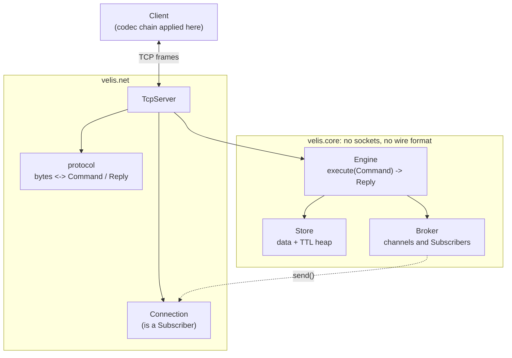
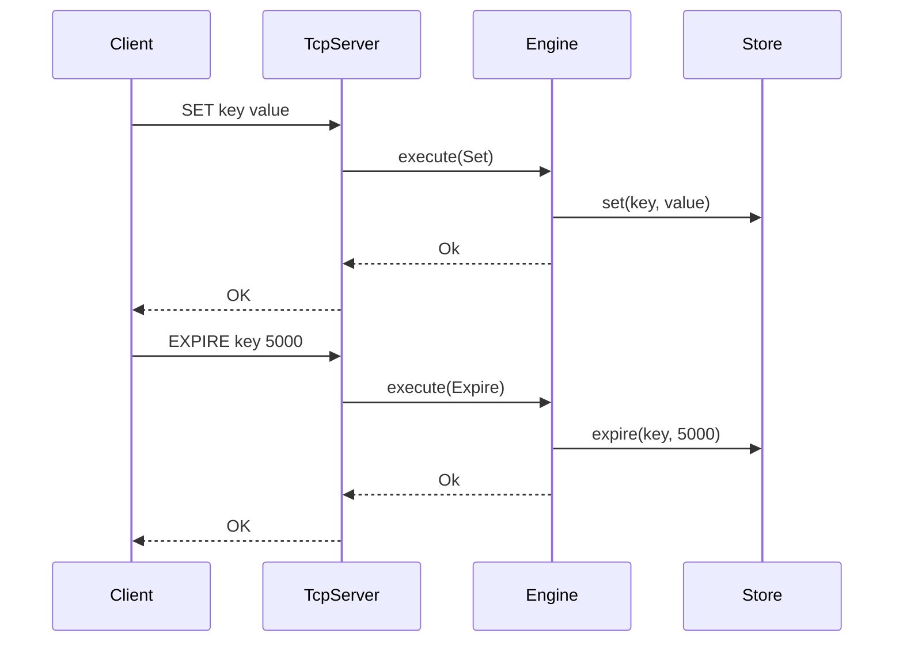
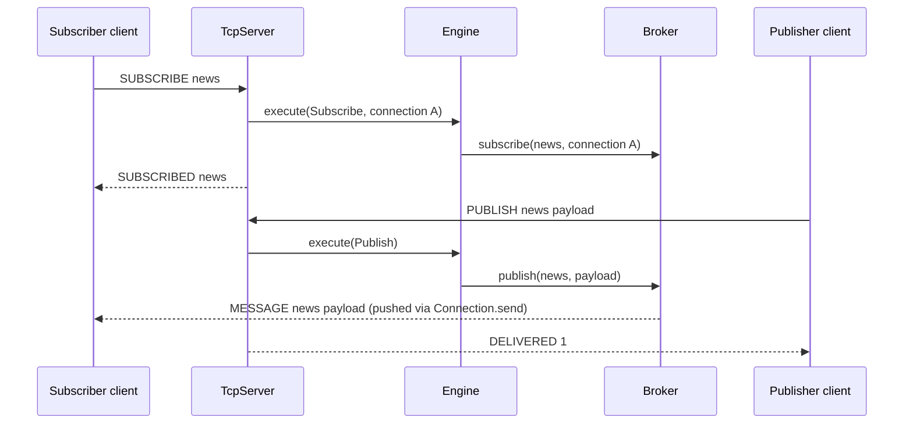
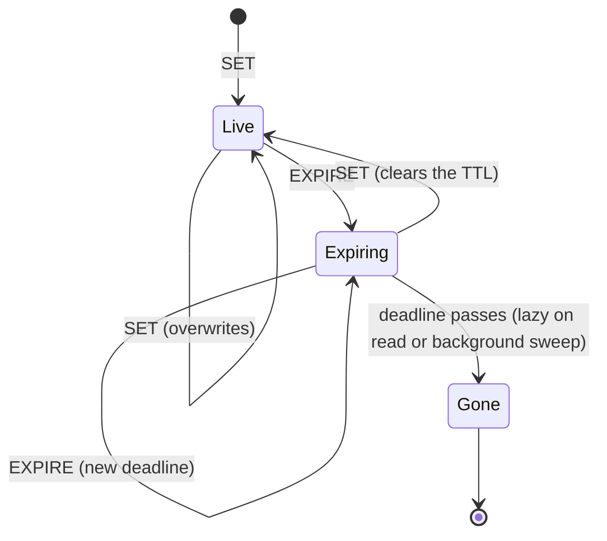
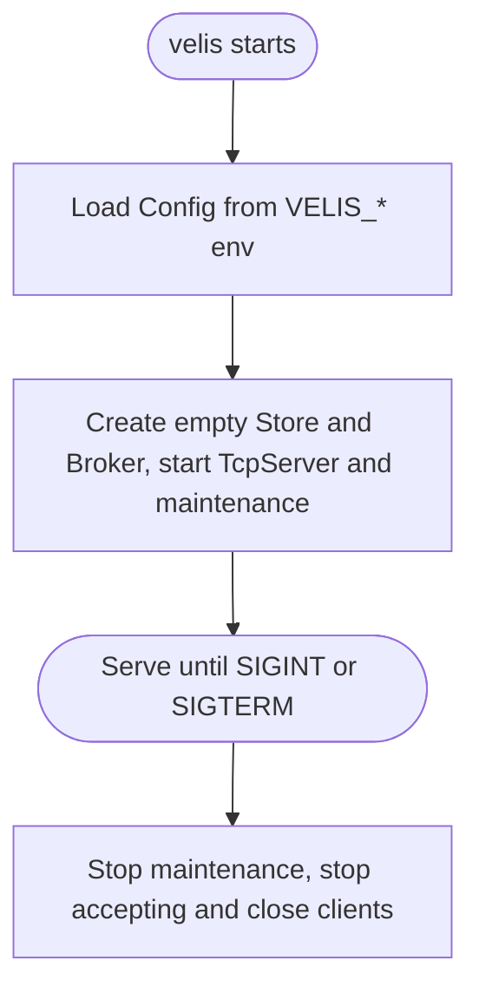

Velis is a lightweight in-memory key-value store with TTL expiration, pub-sub, a small TCP protocol and pluggable client-side codecs. It runs on a single asyncio event loop, so the store needs no locks.

> **Status: early development.** The store, TTL, pub-sub, TCP server and async client all work and are tested. The wire protocol is custom, and there is no authentication or TLS yet, so keep it bound to localhost. See [Roadmap](#roadmap) for what's next.

---

## Features

| Area | Description |
| --- | --- |
| **Store** | `GET` / `SET` / `EXPIRE` on opaque `bytes` values. Single-owner, so no locks. |
| **TTL** | Absolute deadlines, expired lazily on read **and** actively by a background sweep, so keys nobody reads are still freed. |
| **Pub-sub** | `SUBSCRIBE` / `UNSUBSCRIBE` / `PUBLISH`. Live delivery to connected subscribers on one server. Slow network connections are disconnected when their server write buffer exceeds the configured limit. |
| **Network** | Length-prefixed binary protocol over TCP, an asyncio server and an async `Client`. |
| **Codecs** | Composable `CodecChain`s applied on the client, optionally registered as Python text codecs. The server only sees opaque bytes. |
| **Config** | Frozen, validated `Config` loaded from `VELIS_*` environment variables. |

---

## Installation

Velis uses [uv](https://docs.astral.sh/uv/) and a `src` layout. From a repository checkout:

```bash
cd velis
uv sync
```

Python **3.15.2 or newer** is required, as specified in `pyproject.toml`. There are no runtime dependencies; `uv sync` also installs Ruff and ty for development.

---

## Quick start

Start a server:

```bash
uv run velis
```

Talk to it from Python:

```python
import asyncio

from velis.net.client import Client


async def main() -> None:
    kv = await Client.connect("127.0.0.1", 9000)
    sub = await Client.connect("127.0.0.1", 9000)
    try:
        await kv.set("greeting", b"hello")
        print(await kv.get("greeting"))  # b"hello"
        print(await kv.expire("greeting", 5_000))  # True: expires in 5 s
        print(await kv.get("missing"))  # None

        # Use a separate connection to listen for messages.
        await sub.subscribe("news")
        print(await kv.publish("news", b"hi"))  # 1 subscriber reached
        async with asyncio.timeout(1):
            print(await sub.next_message())  # Message(channel='news', payload=b'hi')
    finally:
        await sub.close()
        await kv.close()


asyncio.run(main())
```

`Client` raises `CommandError` when the server replies `ERR` and `ConnectionError` when the connection drops. Closing a client wakes waiting requests and message readers.

`next_message()` has no timeout argument. Use `asyncio.timeout(seconds)` around the call; timing out while waiting for a message leaves the connection usable. Cancelling or timing out an in-flight command closes that connection, because its pending reply cannot safely be matched to a later request. Connect a new client before sending another command.

`PUBLISH` returns the number of subscriber connections that accepted the message for delivery. It does not acknowledge that their applications have read or processed it.

---

## Architecture

The server separates command handling from networking, and the dependency only points one way: **`net` depends on `core`, never the reverse.** The core knows nothing about sockets or the wire format, so it can be tested and embedded without a network.



Requests and replies are plain frozen dataclasses (`velis.core.commands`). `net/protocol.py` converts them to and from bytes, and `Engine.execute` handles each one the same way: **validate, apply, reply.**

### Request lifecycle

Cache mutations only change memory. The engine validates the TTL range and calls `Store.expire(key, ms)`. The store owns its clock and converts the relative TTL to an absolute deadline for its expiry heap.

`SET` clears any previous TTL. `EXPIRE` returns `NIL` for a missing or already expired key, so it cannot revive expired data. A zero TTL expires a live key immediately. Accepted TTLs are between `0` and `2**62` milliseconds, inclusive.



### Pub-sub

The `Broker` only knows the `Subscriber` protocol (`send(channel, payload) -> bool`). A `Connection` implements it, enforces the per-connection buffer limit and returns `False` when it should be dropped. The broker then removes that subscriber from every channel.



### Key lifecycle



### Startup and shutdown



### Background maintenance

One task sweeps expired keys every `VELIS_SWEEP_MS`. Each sweep processes at most 1,000 heap entries to limit work on the event loop; stale entries left by overwritten values or TTLs count toward that limit. Reads and `EXPIRE` also remove expired keys as needed.

---

## Wire protocol

Integers use big-endian byte order. A **string** or **bytes** field is `u32 length` followed by that many bytes (strings are UTF-8). Receivers reject string and bytes fields larger than 1 MiB; the limit includes any expansion from client-side codecs. There is no outer length prefix for the entire request.

**Requests**

| Command | Fields | Reply |
| --- | --- | --- |
| `GET` | `key: str` | `VALUE` or `NIL` |
| `SET` | `key: str`, `value: bytes` | `OK` |
| `EXPIRE` | `key: str`, `ms: u64` | `OK`, or `NIL` if the key doesn't exist |
| `SUBSCRIBE` | `channel: str` | `SUBSCRIBED` |
| `UNSUBSCRIBE` | `channel: str` | `UNSUBSCRIBED` |
| `PUBLISH` | `channel: str`, `payload: bytes` | `DELIVERED` |

A request is the command name as a string followed by its fields.

**Replies and pushes**

| Frame | Fields |
| --- | --- |
| `OK` / `NIL` | none |
| `VALUE` | `value: bytes` |
| `ERR` | `message: str` |
| `SUBSCRIBED` / `UNSUBSCRIBED` | `channel: str` |
| `DELIVERED` | `count: u32` |
| `MESSAGE` *(server push, not a reply)* | `channel: str`, `payload: bytes` |

**Errors**

* `ERR` with the connection kept open: a valid request that can't be honoured (for example a TTL out of range).
* `ERR` followed by the server closing the connection: the stream is malformed (unknown command, oversized field, invalid UTF-8). It can't be resynchronised.

---

## Cache and pub-sub lifetime

The cache is entirely in memory. Keys and TTLs are discarded on restart. There is no cache WAL, recovery or compaction.

Pub-sub currently delivers messages only to connected subscribers on the same server. Messages are not persisted or replayed, and no server-to-server replication is implemented. Future replication should carry pub-sub messages, not cache state.

The former `VELIS_WAL_PATH`, `VELIS_FSYNC` and `VELIS_COMPACT_BYTES` settings are no longer used. Existing WAL files are left untouched and are not loaded.

---

## Configuration

The entry point loads a frozen `Config` from environment variables. `Config.server` holds a `Server` configuration, and `Config.sweep_interval_ms` holds the expiry sweep interval.

Unknown log levels, ports outside `0–65535`, nonpositive buffer sizes or sweep intervals, and non-integer numeric settings raise `ValueError` at startup. Integer parsing errors include the environment variable name.

| Variable | Default | Description |
| --- | --- | --- |
| `VELIS_LOG_LEVEL` | `INFO` | Log level for the `velis` logger. |
| `VELIS_HOST` | `127.0.0.1` | Interface to listen on. |
| `VELIS_PORT` | `9000` | Port to listen on (`0` picks a free port). |
| `VELIS_MAX_BUFFER` | `8388608` (8 MiB) | Server write buffer limit checked when pushing a message. Must be positive; allow room for both the channel and payload plus framing. |
| `VELIS_SWEEP_MS` | `100` | Milliseconds between expiry sweeps; must be positive. |

---

## Codecs

Codecs transform values on the **client** (compress, encode, encrypt, ...). The server stores whatever bytes it is given, and the codec chain never leaves the client.

A codec is any object with a `name` and `encode` / `decode` methods that work on `bytes`:

```python
from typing import Protocol


class Codec(Protocol):
    name: str

    def encode(self, data: bytes) -> bytes: ...
    def decode(self, data: bytes) -> bytes: ...
```

Codecs are combined into a `CodecChain` with `|`. Encoding runs the codecs left to right, and decoding runs them right to left. The chain's name is the codec names joined with `_`. Combining chains preserves the written order and flattens their steps. An empty chain leaves bytes unchanged. Codec exceptions propagate to the caller.

```python
import base64
import zlib

from velis.codec import CodecChain


class Deflate:
    name = "deflate"

    def encode(self, data: bytes) -> bytes:
        return zlib.compress(data)

    def decode(self, data: bytes) -> bytes:
        return zlib.decompress(data)


class B64:
    name = "b64"

    def encode(self, data: bytes) -> bytes:
        return base64.b64encode(data)

    def decode(self, data: bytes) -> bytes:
        return base64.b64decode(data)


chain = CodecChain.of(Deflate()) | B64()  # or CodecChain() | Deflate() | B64()
chain.name  # "deflate_b64"
chain.decode(chain.encode(b"hello"))  # b"hello"
```

Pass the chain to the client. Values pass through it on `set`, `get` and `publish`, and on received messages. Inside an async function, using the chain above:

```python
from velis.net.client import Client

kv = await Client.connect("127.0.0.1", 9000, codec=chain)
try:
    await kv.set("k", b"hello")  # stored compressed + base64
    print(await kv.get("k"))  # b"hello"
finally:
    await kv.close()
```

Readers of a key and subscribers to a channel must use the same codec chain as their writers or publishers. Keys and channel names are not transformed.

### Registering a chain as a Python codec

`register` also makes a chain available to the standard `str.encode` and `bytes.decode` under the chain's name. Text is encoded with the given text encoding (default `utf-8`) before the chain runs, and decoded after it on the way back.

```python
from velis.codec import register, unregister

register(chain)  # or register(chain, encoding="latin-1")

blob = "hello".encode("deflate_b64")
blob.decode("deflate_b64")  # "hello"

unregister("deflate_b64")  # mainly useful in tests
```

Notes:

* Registering an empty chain, a chain whose name is not lowercase `a-z0-9` words joined by `_`, or a name already taken (including a built-in Python codec such as `zlib` or `base64`) raises `ValueError`.
* Importing `velis.codec` registers a lookup function in Python's global codec registry. `register` and `unregister` modify that process-wide state.

---

## Project layout

```
src/velis/
  __main__.py         # entry point: config -> logging -> banner -> app.run
  app.py             # composition root: serve, maintenance, shutdown
  config.py          # Config / Server, loaded from VELIS_* env vars
  errors.py          # VelisError, ProtocolError, CommandError
  banner.py          # startup banner (honours NO_COLOR)
  core/              # no sockets, no wire format
    commands.py      # Command / Reply dataclasses
    engine.py        # validate -> apply -> reply
    store.py         # key/value map, TTL heap
    broker.py        # pub-sub over the Subscriber protocol
    clock.py         # Clock protocol and SystemClock
  net/
    protocol.py      # bytes <-> commands and replies
    connection.py    # one client socket; implements Subscriber
    server.py        # TcpServer
    client.py        # async Client (applies the codec chain)
  codec/
    chain.py         # Codec protocol and CodecChain
    registry.py      # register chains as Python text codecs
tests/
  helpers.py         # ManualClock and RecordingSubscriber test helpers
  codec/             # composition, round trips and codec registration
  core/              # store, engine, broker and cache lifetime
  net/               # client lifecycle and TCP integration tests
```

---

## Development

Tests use the standard library's `unittest`.

```bash
make test   # uv run python -m unittest discover -s tests -v
make lint   # ruff check, ruff format --check, ty check

# Format code and fix supported lint issues:
uv run ruff format .
uv run ruff check --fix .
```

`unittest discover` only descends into directories that contain an `__init__.py`, so every `tests/` subdirectory needs one.

The core is deliberately easy to test without sockets or real time: the `Store` takes an injectable `Clock`. The `ManualClock` in `tests/helpers.py` makes TTLs deterministic. Network tests bind to localhost on an automatically selected port, so the test environment must allow local sockets.

---

## Design notes and limitations

* **Single-threaded by design.** The event-loop thread owns the `Engine`, `Store` and `Broker`, which is why none of them take locks. Don't call them from other threads.
* **TTLs use wall-clock time.** A large clock jump can expire keys early or late.
* **No auth or TLS**, and no limits on connections or total memory yet. Don't expose it to untrusted networks.
* **One command at a time per client.** An asyncio lock serializes requests; server pushes are separated by their `MESSAGE` tag. There are no request IDs.
* **Client message queues are unbounded.** Server write buffer limits protect slow network connections, but an application that stops calling `next_message()` can still accumulate messages in its client queue.

---

## Roadmap

* `DEL`, `TTL` and `PERSIST` commands.
* Request IDs to support pipelining and safer request cancellation.
* Pub-sub message replication between servers, independent of cache state.
* Connection and memory limits, with an eviction policy.
* Built-in codecs (compression, encryption) to compose with `CodecChain`.
* Authentication and TLS.
