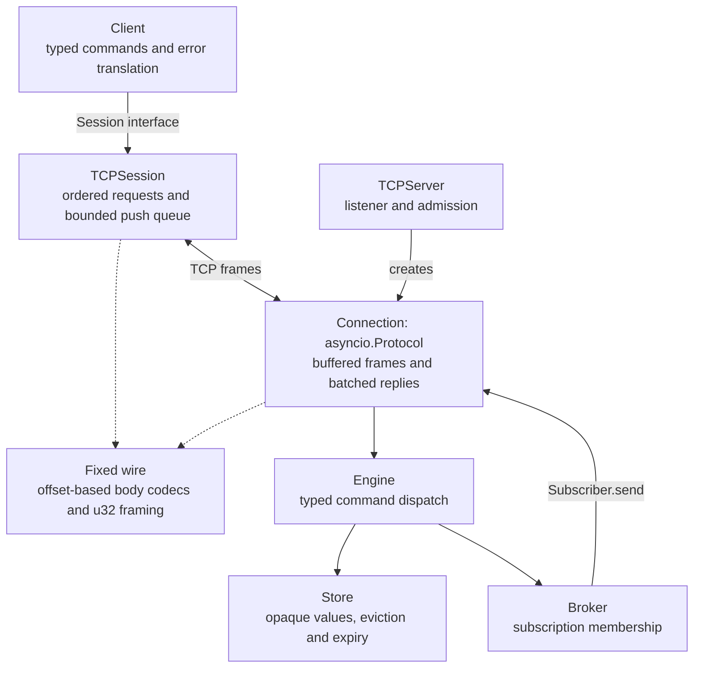
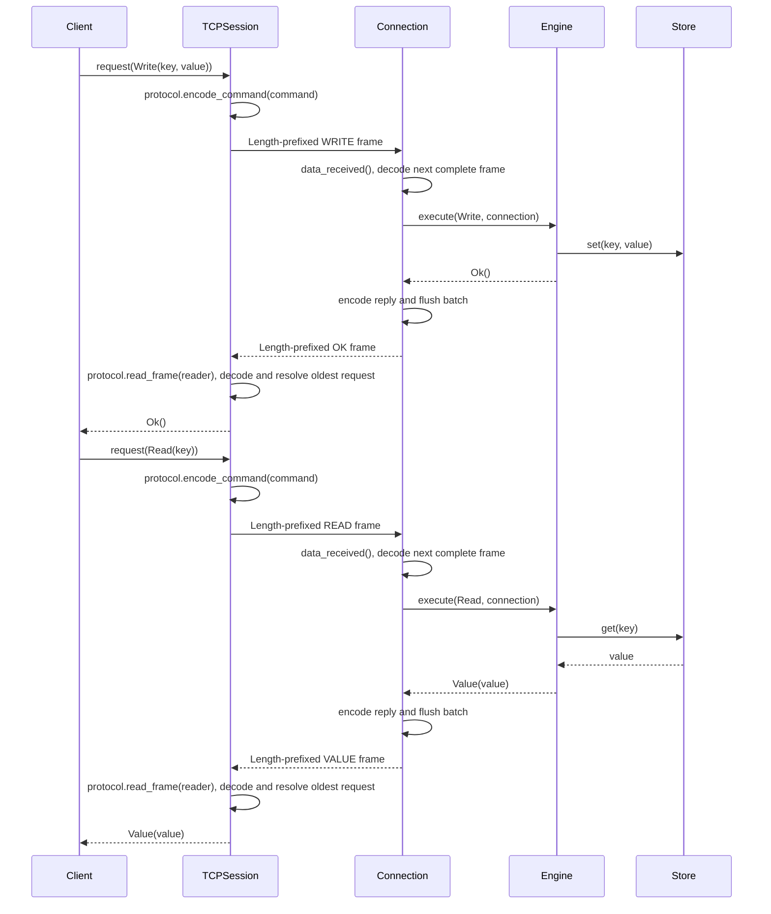
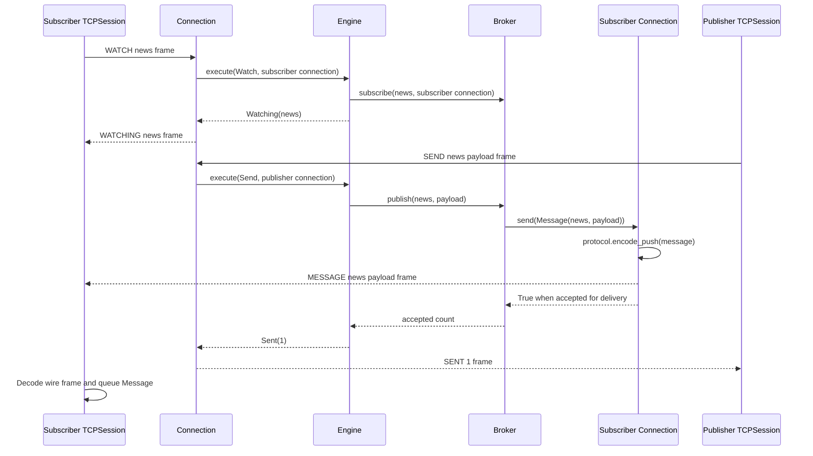
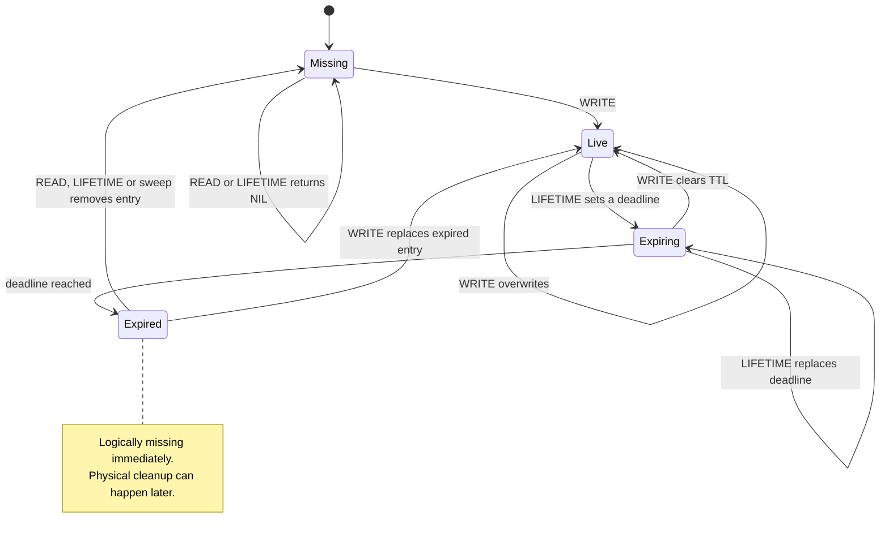
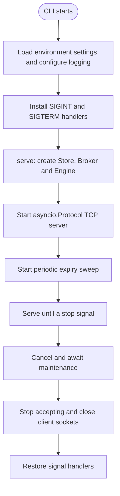

Velis is a lightweight in-memory key-value store with TTL expiration, pub-sub and a fixed binary TCP protocol. It runs on a single asyncio event loop, so the store needs no locks.

## Table of contents

- [Features](#features)
- [Screenshots](#screenshots)
- [Installation](#installation)
- [Quick start](#quick-start)
- [Architecture](#architecture)
  - [Request lifecycle](#request-lifecycle)
  - [Pub-sub](#pub-sub)
  - [Key lifecycle](#key-lifecycle)
  - [Startup and shutdown](#startup-and-shutdown)
  - [Background maintenance](#background-maintenance)
- [Wire protocol](#wire-protocol)
- [Cache and pub-sub lifetime](#cache-and-pub-sub-lifetime)
- [Configuration](#configuration)
- [Encoding and framing](#encoding-and-framing)
- [Project layout](#project-layout)
- [Development](#development)
- [Benchmarks](#benchmarks)
- [Design notes and limitations](#design-notes-and-limitations)
- [Roadmap](#roadmap)

---

## Features

| Area              | Description                                                                                                                                                                                        |
| ----------------- | -------------------------------------------------------------------------------------------------------------------------------------------------------------------------------------------------- |
| **Store**         | `READ` / `WRITE` / `REMOVE` / `LIFETIME` / `REMAINING` / `KEEP` on opaque `bytes` values, with key-count and byte limits. Single-owner, so no locks.                                               |
| **TTL**           | Exact monotonic deadlines, a heap-based expiry index, lazy read expiry and bounded background sweeps.                                                                                              |
| **Pub-sub**       | `WATCH` / `UNWATCH` / `SEND`. At-most-once delivery to connected subscribers on one server. Slow network connections are disconnected when their server write buffer exceeds the configured limit. |
| **Network**       | Fixed binary protocol over TCP, ordered pipelining, an `asyncio.Protocol` server with batched replies, and an async `Client`.                                                                      |
| **Configuration** | CLI environment loading and frozen limits owned by each component.                                                                                                                                 |

---

## Screenshots


---

## Installation

Velis uses [uv](https://docs.astral.sh/uv/) and a `src` layout. From a repository checkout:

```bash
cd velis
uv sync
```

Python **3.15.2 or newer** is required, as specified in `pyproject.toml`. Velis has no runtime dependencies. `uv sync` installs Ruff, ty, Pyright and Hypothesis for development.

---

## Quick start

Start a server:

```bash
uv run velis
```

Open the terminal client in another terminal:

```bash
uv run python -m velis.tui
```

Use `--host`, `--port` or `--read-only` as needed. Press `:` to explore actions,
Tab to complete an action, `/` to filter local key names, `?` for help, and
`t` or `:status` for session statistics: uptime, operation counts,
errors, latency, READ hits/misses and pub-sub activity. Operations include background
TTL refreshes; hit/miss counters count READ replies only. Statistics describe this client session. `list` discovers server key names;
tracked values and lifetime observations remain local previews, and server-wide
statistics are unavailable. Clearing the activity log preserves the counters.

The same purple mascot and wordmark appear at interactive server startup and in
the TUI's empty value pane when there is room. A nonempty `NO_COLOR` environment
variable disables all TUI colors. Redirected logs stay plain.

Help and statistics support ↑/↓, PgUp/PgDn and Home/End; Esc returns to browsing.
Command mode shows matching actions and usage as you type. Value previews wrap to the pane width,
and the layout keeps values and activity visible down to 60 columns by 14 rows.

Use one connection for key/value commands and another for subscriptions:

```python
import asyncio

from velis.net.client import Client


async def main() -> None:
    kv = await Client.connect("127.0.0.1", 9000)
    sub = await Client.connect("127.0.0.1", 9000)
    try:
        await kv.write("greeting", b"hello")
        print(await kv.read("greeting"))
        print(await kv.lifetime("greeting", 5_000))
        print(await kv.read("missing"))

        await sub.watch("news")
        print(await kv.send("news", b"hi"))
        async with asyncio.timeout(1):
            print(await sub.next_message())
    finally:
        await sub.close()
        await kv.close()


asyncio.run(main())
```

The example prints `b"hello"`, `True`, `None`, `1`, and `Message(channel="news", payload=b"hi")`.

Individual `Client` methods raise `CommandError` when the server replies `ERR`, `ProtocolError` for invalid outgoing fields or integer ranges, and `ConnectionError` when the connection drops or an incoming wire frame is invalid. Invalid outgoing data is rejected before writing and leaves the connection usable. Closing a client wakes waiting requests and message readers.

Use `asyncio.gather(client.read("a"), client.read("b"))` to pipeline independent commands on one connection. The server executes commands and sends replies in received order; the session matches each reply to the oldest unanswered request. Server pushes are routed separately. Await an earlier command when a later one depends on its result.

Use `Client.batch()` to group commands into writes and collect their replies in input order:

```python
from velis.core.messages import Remaining, Read, Write

replies = await client.batch(
    [Write("greeting", b"hello"), Read("greeting"), Remaining("greeting")]
)
# [Ok(), Value(value=b"hello"), Unlimited()]
```

Batch results are typed reply objects from `velis.core.messages`, including `Err` in the position of each command the server rejects. A command error does not stop later commands. All commands are encoded before anything is sent, so an invalid outgoing command rejects the whole batch without sending a prefix. Empty batches return `[]`.

TCP batches use one write and drain per available in-flight window, with defaults of 64 pending requests and a 256 KiB encoded write target (`SessionLimits.max_batch_bytes`). A command larger than the byte target is written alone; the wire limits still apply. Each window's replies are collected before sending the next. Batches are not transactions: other calls may run between windows, and cancellation can leave a sent prefix applied. Late replies to a cancelled batch are discarded without shifting subsequent replies. The encoded batch and returned results occupy memory proportional to the batch size; submit bounded batches for large workloads.

Use `asyncio.timeout(seconds)` around commands or `next_message()` to bound the wait. Cancelling or timing out a command leaves the connection usable and discards its eventual reply. A sent command may still execute on the server, including a write; cancellation does not undo it or guarantee that it was never applied. No request is sent when cancellation happens while waiting for an in-flight slot.

Commands are encoded before waiting for pending-queue capacity, so invalid outgoing commands fail immediately even when the queue is full. Waiting calls retain their encoded frames; use bounded application submission for bulk work as well.

Clients allow at most 64 in-flight requests by default, matching one server command turn. Pass `limits=SessionLimits(max_pending_requests=..., max_batch_bytes=...)` to `Client.connect()`, `TCPSession.connect()` or `TCPSession` to change these limits; import `SessionLimits` from `velis.config`. Additional calls wait for a slot. A cancelled sent request retains its slot until its reply arrives, keeping cancellation bookkeeping bounded. If a peer stops replying, slots remain occupied until the connection closes; waiting calls can still be cancelled or timed out.

Clients buffer at most 1,024 unread messages and 8 MiB of channel/payload bytes by default, measured as UTF-8 channel bytes plus payload bytes after wire decoding. Set `max_pending_messages` and `max_pending_bytes` on the same `SessionLimits` object to change these positive limits. Crossing either limit closes the connection and fails pending requests. Already queued messages can be drained before `next_message()` raises `ConnectionError`. A full message buffer never blocks the reply reader.

`SEND` returns the number of subscriber connections that accepted the message for delivery. It does not acknowledge that their applications have read or processed it.

`Client.connect()` and `TCPSession.connect()` default to `127.0.0.1:9000`, matching the listener defaults. Explicit arguments override them; environment settings are loaded only through `Config.from_env()`.

Connections use asyncio and operating-system socket defaults, including
[asyncio's `TCP_NODELAY` default](https://docs.python.org/3.15/library/asyncio-eventloop.html#asyncio.loop.create_connection).
Velis does not tune kernel buffers or enable TCP keepalive. Bound application
waits with `asyncio.timeout()`; shutdown has its own flush deadline.

The custom `Keepalive` type, `keepalive=` arguments and `VELIS_TCP_KEEP*`
settings have been removed. Remove these arguments from embedded callers;
the old environment variables no longer affect configuration.

The terminal and wire use the same command names:

| Terminal action          | Wire command | Purpose                                         |
| ------------------------ | ------------ | ----------------------------------------------- |
| `ping`                   | `PING`       | Check a round trip                              |
| `list [PREFIX] [CURSOR]` | `LIST`       | Discover a page of server key names             |
| `exists NAME`            | `EXISTS`     | Inspect existence without reading the value     |
| `size NAME`              | `SIZE`       | Inspect value byte length without reading it    |
| `read NAME`              | `READ`       | Read a value                                    |
| `write NAME TEXT`        | `WRITE`      | Write text; Python/wire values remain bytes     |
| `remove NAME`            | `REMOVE`     | Remove a key                                    |
| `lifetime NAME 5m`       | `LIFETIME`   | Set a relative lifetime; wire uses milliseconds |
| `remaining NAME`         | `REMAINING`  | Inspect remaining lifetime                      |
| `keep NAME`              | `KEEP`       | Remove the lifetime limit                       |
| `watch CHANNEL`          | `WATCH`      | Listen for messages                             |
| `unwatch CHANNEL`        | `UNWATCH`    | Stop listening                                  |
| `send CHANNEL TEXT`      | `SEND`       | Send a message                                  |

`sync`, `untrack`, `clear`, `status`, `help` and `quit` manage the terminal session.
Use `w`, `l`, `x` or `p` to start write, lifetime, remove or keep for the selected
key. `b` starts a server key listing. `/` filters names locally; Enter accepts the filter and Esc restores it while
editing or clears it while browsing. `r` syncs observed lifetimes. Reads remain
explicit: selecting or filtering a key never reads it from the server.

Every queued terminal action has ten seconds from submission to completion.
Expired queued actions are reported and discarded before sending. A timeout after
transmission may leave the action applied on the server. Read-only policy is checked
at submission and again before execution. A sync reports per-key errors while still
applying successful results for other keys.

`list` returns up to 100 names per page and scans at most 1,000 candidates.
A nonzero cursor means more candidates remain, including when a filtered page is
empty. Continue with `list "PREFIX" CURSOR`; cursor zero ends the listing. Treat continuation cursors as opaque. Names
are tracked without fetching values. Listing is weakly consistent: concurrent
inserts, removals or expiry can change later pages. Offset skipping costs grow
with the cursor; the candidate bound is not a hard latency guarantee.

`Client.list_keys(prefix="", cursor=0, limit=100)` returns `KeyPage(cursor, keys)`;
limits must be between 1 and 100. `Client.exists(key)` returns a boolean,
`Client.size(key)` returns the value byte length or `None` for a missing key, and
`Client.ping()` checks a complete round trip. These metadata operations do not
increment read hit/miss counters or update eviction usage.

`Client.read_entry(key)` returns an `EntrySnapshot(value, remaining_ms)` from two
ordered commands; it is not an atomic snapshot. `Client.remaining_many(keys)`
returns ordered integers or `CommandError` objects for individual server rejections;
malformed replies and transport failures raise. `Client.batch()` retains raw replies.

**Breaking change:** the old command names and Python client methods have been
removed. Update clients and servers together. The dedicated hex-write terminal
command has been removed; use `write` for text or `Client.write()` for opaque bytes.
Reply tags now follow the same vocabulary: WATCHING, UNWATCHED, SENT,
REMAINING_VALUE and UNLIMITED. Update reply decoders together with request
encoders. Length-prefixed field encodings retain their existing layouts.

---

## Architecture

The dependency points one way: `net` depends on `core`. The core knows nothing about sockets or wire bytes, so it can be tested and embedded without a network.



`Client` exposes typed commands and translates server errors for individual calls; `batch(commands)` returns the ordered reply objects. Values and publication payloads remain opaque bytes. It delegates requests, batches and push buffering to a `Session`; `TCPSession` implements that interface using asyncio streams. For a different transport, construct `Client(session)` with an object implementing `request(command)`, `batch(commands)`, `next_message()` and `close()`.

`TCPServer` creates a `Connection` protocol for each socket. The connection buffers partial input, executes complete commands synchronously on the owning event loop and writes each batch's replies together. Expected command errors produce `ERR` without closing; malformed wire data closes the connection after a best-effort error reply.

Commands, replies and publication pushes are frozen dataclasses in `velis.core.messages`. `net.wire` provides reusable field codecs and a table-driven message codec. `net.protocol` declares each tag and its fields once, frames encoded bodies, and exposes `encode_command()`, `encode_message()`, `iter_frames()` and `read_frame()`.

The design uses a few patterns with specific responsibilities. See the
[architecture review](docs/architecture.md) for ownership boundaries, pattern
choices, terminal behavior and validation limits.

| Pattern                 | Where it applies                                                | Purpose                                                                      |
| ----------------------- | --------------------------------------------------------------- | ---------------------------------------------------------------------------- |
| Composition root        | `serve()` and `build_engine()`                                  | Construct dependencies and give runtime resources one owner.                 |
| Strategy                | `Eviction` with LRU, LFU and S3-FIFO                            | Change victim selection while `Store` owns capacity and expiry invariants.   |
| Ports and adapters      | `Session` and `Subscriber` interfaces, with TCP implementations | Keep client semantics and core delivery independent of transport details.    |
| Immutable value objects | Limits, commands and replies                                    | Validate configuration once and share values without mutable global state.   |
| Table-driven codec      | `COMMANDS` and `SERVER_MESSAGES`                                | Derive encoding, decoding and maximum body sizes from one field declaration. |

Concrete classes are constructed directly. Protocols mark the boundaries with interchangeable implementations, and async context managers own cleanup. Transport flow control stays in the network layer; cache consistency stays in the store.

Clients support async context management, including cleanup after caller failures:

```python
async def read_greeting() -> bytes | None:
    async with await Client.connect() as client:
        return await client.read("greeting")
```

### Request lifecycle

Cache mutations only change memory. The store validates the TTL range and raises `CommandError` for invalid TTLs without changing existing values or deadlines. The engine lets command errors reach the transport, which replies with `ERR` and keeps the connection open. The store owns its monotonic clock and delegates timer scheduling, cancellation and sweeps to `ExpiryIndex`. System wall-clock adjustments do not change TTL duration.

`WRITE` clears any previous TTL. `LIFETIME` returns `NIL` for a missing or already expired key, so it cannot revive expired data. A zero TTL expires a live key immediately. Accepted TTLs are between `0` and `2**62` milliseconds, inclusive.

`await client.remove(key)` returns `True` when a live key was deleted, freeing its key and byte capacity; missing or expired keys return `False`. `await client.remaining(key)` returns remaining milliseconds, `-1` for a live key without expiry, or `-2` for a missing or expired key. TTL reads remove expired values without refreshing their deadlines. `await client.keep(key)` removes a live key's TTL while keeping its value and returns whether a deadline was removed. It returns `False` for missing, expired or already persistent keys. On the wire, `REMAINING` uses `REMAINING_VALUE` for remaining milliseconds, `UNLIMITED` for no expiry and `NIL` for missing keys; the client maps these to the integer API above. These commands use the same key validation as `READ`.

Direct core callers use `Store.ttl(key)`, which returns remaining milliseconds, `TtlStatus.PERSISTENT` or `TtlStatus.MISSING`. Import `TtlStatus` from `velis.core.store`. The `Engine` translates these enum values into wire replies; the client's `-1` and `-2` sentinels remain unchanged.



The connection processes at most 64 commands per callback and writes their replies in one batch. If more commands remain, it pauses reading and schedules the next batch with `call_soon()`, allowing other connections and maintenance to run. Transport write backpressure also pauses reading until `resume_writing()` resumes buffered work. Each individual command and publication remains synchronous.

`TCPSession` matches replies to the oldest unanswered request and routes pushes into a separate bounded queue. After acquiring capacity, it registers reply waiters and writes their frames without yielding to another task. This keeps replies aligned without holding a lock across socket backpressure; concurrent callers can wait for the same transport to drain.

The server drains complete buffered requests after a client half-closes its write side; an incomplete trailing frame closes without a reply. Closing a connection releases admission and removes all its subscriptions.

### Pub-sub

The `Broker` only knows the `Subscriber` protocol (`send(message: Message) -> bool`). Delivery callbacks must return promptly; adapters own encoding, buffering and expected transport failures. A `Connection` implements this contract and returns `False` when disconnected, when a write fails with a connection error, or when its buffer limit is exceeded. The broker then removes that subscriber from every channel and continues delivering to healthy subscribers. Acceptance does not acknowledge application processing; unexpected adapter errors propagate.

Each `Broker.publish()` call creates one `Message(channel, payload)` and passes that same object to every subscriber. The broker owns no encoding cache. All TCP connections use the fixed wire format and share `protocol.encode_push`, a `PushEncoder` caching the latest message by identity. Consecutive deliveries of the same object reuse its framed bytes; a new object replaces the cached result even when its contents are equal.

The push encoder retains only its latest message and encoded frame until another push replaces them. A nested publication can replace the slot and cause an outer message to be encoded again. Custom subscribers read `message.channel` and `message.payload` directly.



Network arrows above represent complete length-prefixed frames encoded and decoded with the fixed wire format. `SENT 1` means one connection accepted the push, regardless of when the subscriber reads it.

### Key lifecycle



The key-state diagram assumes valid commands. Invalid TTL values return an error without changing the key or its deadline.

### Startup and shutdown



The `serve(server_limits, ...)` async context manager in `velis.app` owns the server and maintenance task, including cleanup after startup or caller failures. It yields the running `TCPServer`. `TCPServer` also supports `async with` directly for applications that own maintenance separately; the listener closes client transports and awaits their disconnect callbacks. Client and server cleanup allow five seconds to flush buffered writes by default, then abort stalled transports; cancelling cleanup also aborts. Set `close_timeout_seconds` on `ServerLimits` or `SessionLimits` to change this positive, finite grace period. Buffered data can be discarded on abort. Pass `engine=existing_engine` to reuse application state or a store with an injected clock; the default creates a fresh engine. Shutdown releases runtime resources while an injected engine remains available to its owner. The CLI separately configures logging and installs signal handlers; embedded callers control the runtime scope themselves:

```python
from velis.app import serve
from velis.config import ServerLimits


async def embedded() -> None:
    async with serve(ServerLimits("127.0.0.1", 0)) as server:
        print(server.port)
```

### Background maintenance

Maintenance runs in a task group owned by `serve()`. An unexpected sweep failure interrupts the active runtime scope and closes the server. Worker and caller failures are reported in an `ExceptionGroup` after cleanup; external cancellation remains `CancelledError`. Normal shutdown uses Python 3.15's `TaskGroup.cancel()` and awaits the group before closing the server. Client disconnections remain local to their connections.

One task starts sweeping expired keys every `VELIS_SWEEP_MS`. Each round removes at most 1,000 expired keys. While due keys remain, maintenance yields to the event loop and runs another round without waiting for the next interval.

`ExpiryIndex` maps each key to its exact deadline and uses a min-heap of `(deadline, key)` entries to return due keys in deadline order. Replacing or cancelling a timer updates the deadline map immediately; old heap entries remain until cleanup or compaction. Readiness checks skip stale entries, so `has_due(now)` is true only when a live timer is due. Stale entries do not consume the returned-key budget, and repeated deadlines return each key once.

Deadline lookup takes expected constant time. Scheduling costs amortized O(log h), where h includes stale heap entries; cancellation costs amortized O(1). Scheduling, cancellation and sweeps rebuild the heap from live timers when it exceeds twice the live timer count plus 64 entries, so stale metadata stays bounded as the store shrinks. Readiness checks discard only due stale heads: a future heap head proves no timer can be due. Setting an unchanged deadline is a constant-time no-op. The sweep limit bounds removed keys, **not stale-entry cleanup, occasional O(n) compaction or wall-clock duration**. Clock jumps require no traversal of elapsed milliseconds.

---

## Wire protocol

Every request, reply and push is `u32 length + encoded body`. Integers use big-endian byte order. The length counts the encoded body, excluding the four-byte outer prefix. Each direction's body limit is derived from its codec table (`MAX_COMMAND_BODY_BYTES` and `MAX_SERVER_BODY_BYTES`) and checked before waiting for the rest of the body. The u32 prefix, field layouts and limits are fixed; there is no format negotiation.

Replies arrive in command order and carry no request identifiers. `MESSAGE` pushes can appear between replies and are routed separately. Cancelling a sent request leaves its place in the pending queue until its eventual reply arrives, which the client discards. An ordinary reply without a pending request closes the connection; an unsolicited `ERR` preserves the server rejection reason.

The following tables describe the fixed command and server-message bodies (`COMMANDS` and `SERVER_MESSAGES`). A **string** or **bytes** field is `u32 length` followed by that many bytes (strings are UTF-8). Values, publication payloads and general text fields are capped at 1 MiB. Command, reply and push tags are capped at 32 bytes. Field byte limits are checked before UTF-8 decoding.

**Requests**

| Command     | Fields                                     | Reply                                                 |
| ----------- | ------------------------------------------ | ----------------------------------------------------- |
| `PING`      | none                                       | `PONG`                                                |
| `EXISTS`    | `key: str`                                 | `FOUND` or `NIL`                                      |
| `SIZE`      | `key: str`                                 | `SIZE_VALUE` or `NIL`                                 |
| `LIST`      | `prefix: str`, `cursor: u64`, `limit: u32` | `KEY_PAGE`                                            |
| `READ`      | `key: str`                                 | `VALUE` or `NIL`                                      |
| `WRITE`     | `key: str`, `value: bytes`                 | `OK`                                                  |
| `LIFETIME`  | `key: str`, `ms: u64`                      | `OK`, or `NIL` if the key does not exist              |
| `REMOVE`    | `key: str`                                 | `OK` if removed, otherwise `NIL`                      |
| `REMAINING` | `key: str`                                 | `REMAINING_VALUE`, `UNLIMITED`, or `NIL`              |
| `KEEP`      | `key: str`                                 | `OK` if a lifetime limit was removed, otherwise `NIL` |
| `WATCH`     | `channel: str`                             | `WATCHING`                                            |
| `UNWATCH`   | `channel: str`                             | `UNWATCHED`                                           |
| `SEND`      | `channel: str`, `payload: bytes`           | `SENT`                                                |

The encoded body is the command name as a string followed by its fields. LIST
accepts an empty prefix of at most 2,048 UTF-8 bytes; its limit is 1–100. The reply
KEY_PAGE carries `cursor: u64` followed by `keys: tuple[str, ...]`, encoded as a
u32 count and that many length-prefixed UTF-8 strings. At most 100 names are
returned, each at most 2,048 encoded bytes.

Request keys contain 1–512 characters and request channels contain 1–256 characters. Their UTF-8 byte lengths are capped at 2,048 and 1,024 bytes respectively, allowing four bytes per character. These byte limits are checked before UTF-8 decoding, then the character rules run on the decoded strings. The character rules also run before sending; whitespace and control characters are allowed. Reply and push channels have the same 1,024-byte limit and UTF-8 validation, without the request-channel emptiness and character-count rules.

**Replies and pushes**

| Server message           | Fields                                 |
| ------------------------ | -------------------------------------- |
| `OK` / `NIL`             | none                                   |
| `VALUE`                  | `value: bytes`                         |
| `REMAINING_VALUE`        | `ms: u64`                              |
| `UNLIMITED`              | none; the key has no lifetime limit    |
| `ERR`                    | `message: str`                         |
| `WATCHING` / `UNWATCHED` | `channel: str`                         |
| `SENT`                   | `count: u32`                           |
| `PONG` / `FOUND`         | none                                   |
| `SIZE_VALUE`             | `size: u64`                            |
| `KEY_PAGE`               | `cursor: u64`, `keys: tuple[str, ...]` |
| `MESSAGE` (server push)  | `channel: str`, `payload: bytes`       |

**Errors**

- `ERR` with the connection kept open: a valid command that cannot be honoured (for example a TTL out of range). The client raises `CommandError` for that request.
- Best-effort `ERR`, followed by closure: the message violates the protocol (unknown tag, oversized field/frame, invalid UTF-8, truncated record, trailing bytes). An incomplete TCP frame at EOF closes without a reply. The server closes even when it cannot encode or send the error.
- Admission rejection: an excess connection receives best-effort `ERR("connection limit exceeded")` before closure. An unsolicited `ERR` becomes `ConnectionError` with that reason. If a request is already pending, the ordered protocol delivers `ERR` as `CommandError` to the oldest request; EOF then fails the remaining requests with `ConnectionError`.

---

## Cache and pub-sub lifetime

The cache is entirely in memory. Keys and TTLs are discarded on restart. There is no cache WAL, recovery or compaction.

The default store retains at most 100,000 keys and 64 MiB of UTF-8 key plus encoded value bytes. The byte budget excludes Python object overhead; the key-count limit bounds resident entry metadata. Expired entries count until cleanup removes them. The default `s3-fifo` policy evicts entries to make room when either limit is reached. A value whose key plus payload exceeds the entire byte budget is rejected before changing existing values or deadlines. Successful replacements clear the TTL. A capacity error produces `ERR` and keeps the connection usable. Direct `Store` and `Broker` callers receive `CapacityError`, a `CommandError` subclass.

Select one of three eviction policies with `VELIS_EVICTION_POLICY` or `Store(limits=StoreLimits(eviction_policy=EvictionPolicy.LRU))` for direct embedding. `StoreLimits` lives in `velis.config` and is also exported by `velis.core.store`; import `EvictionPolicy` from `velis.core.eviction`. Policy strings are normalized to enum values:

| Policy              | Behavior when full                                                                                                                           |
| ------------------- | -------------------------------------------------------------------------------------------------------------------------------------------- |
| `s3-fifo` (default) | Filter new keys through a small FIFO; retain reused keys in a main FIFO and remember recent probationary evictions in a bounded ghost queue. |
| `lru`               | Evict the least recently used entry.                                                                                                         |
| `lfu`               | Evict the least frequently accessed entry, breaking ties by least recent access.                                                             |

S3-FIFO follows the [SOSP 2023 paper's queue and counter rules](https://www.cs.cmu.edu/~rvinayak/papers/s3-fifo-sosp-2023-fifo-queues-are-all-you-need-for-cache-eviction.pdf). New keys enter the small queue unless ghost history places them directly in the main queue. Resident accesses increment a counter capped at three without moving the key. Small-queue keys with more than one reuse are promoted, with their counters reset; others enter ghost history. Main-queue eviction reinserts keys with remaining credit, decrementing the counter each time.

In Velis, queue targets follow the **current resident key count**, independently of `max_keys`: the small target is `max(1, int(residents * small_ratio))`, and the main target is `max(1, residents - small_target)`. `S3FIFO(small_ratio=0.1, ghost_ratio=0.9)` supplies the defaults. Small ratios must be between zero and one; ghost ratios must be positive. After every deletion or eviction, ghost history is trimmed to `max(1, int(residents * ghost_ratio))` keys and retains no values. It adds Python metadata and retained key strings outside `stored_bytes`. Queues borrow unused space, and the store independently enforces both total limits. With variable-sized values or very small caches, behavior can differ from the paper's equal-sized-object model. Each policy eviction removes exactly one resident, though it may first promote several small entries.

Eviction may remove several entries to fit the byte budget. Every victim's value, byte accounting, timer and resident policy metadata are removed together; S3-FIFO may retain ghost history. Explicit deletion and TTL expiry forget policy history. Under capacity pressure, every policy performs one bounded expiry sweep before evicting live entries. Remaining expired entries are reclaimed by later reads or maintenance. `READ` hits update access history. Each successful `WRITE` starts fresh access history and clears any TTL; a new S3-FIFO entry starts with zero reuse credit. Re-inserting a key remembered in S3-FIFO ghost history enters main directly. TTL inspection and expiry changes do not count as accesses. LFU uses a min-heap ordered by frequency and last access, with lazy stale-entry removal and compaction; access and eviction cost amortized O(log n).

`Store` owns its value dictionary, byte accounting, an eviction policy and `ExpiryIndex`, keeping their key sets consistent in one place. Each entry retains its size so removal does not re-encode the key; policies choose victims; the expiry index tracks deadlines. Store-driven removals forget policy history, while capacity eviction preserves whatever ghost history the policy retains. Both paths remove the value and timer together. Capacity checks reclaim expired keys before selecting live victims.

`store.stats()` returns a frozen `StoreStats(hits, misses, evictions, expirations)` snapshot. Hits and misses count `READ` results only. Evictions count capacity victims; expirations count keys physically removed by lazy access, sweeps or write-time cleanup. Deleting or overwriting live keys does not increment either removal counter. Counters accumulate from construction, and taking a snapshot does not purge keys or reset them.

Eviction policies expose resident key counts and membership through `len(policy)` and `key in policy`; S3-FIFO ghosts are excluded.

Running `uv run velis` uses S3-FIFO by default. Choose LRU with `VELIS_EVICTION_POLICY=lru uv run velis`, or use `lfu`. Policy performance depends on the workload; use `Store.stats()` to compare hit and eviction rates.

Each connection can subscribe to at most 1,024 channels by default. Repeating an existing subscription uses no extra capacity; unsubscribing frees a slot. The listener admits at most 1,024 active connections by default. Excess connections receive a best-effort `ERR` and are closed, leaving admitted clients usable.

Pub-sub provides at-most-once delivery to connected subscribers on the same server. Messages are not persisted, retried or replayed, and no server-to-server replication is implemented. Slow subscribers are disconnected when server write buffers or client unread-message queues overflow. A network subscriber that cannot accept an encoded push is disconnected and removed from every channel; publication continues to healthy subscribers. Messages may be lost on disconnect; `SEND` counts accepted deliveries, without acknowledging application processing.

---

## Configuration

> **`max_bytes` is a data budget, not a RAM limit.** It counts UTF-8 keys and stored values only. Python objects, dictionaries, eviction queues and expiry metadata use additional memory; with many small keys, process memory can be several times the budget. Use `max_keys` as well.

Each component owns its validated limits: `StoreLimits` in `velis.core.store`, `ServerLimits` in `velis.net.server` and `SessionLimits` in `velis.net.session`. `velis/config.py` owns the immutable `Config` snapshot and environment loading, and re-exports them for convenience. `Config.from_env()` reads `VELIS_*` variables when called. The CLI loads it once before configuring logging or opening runtime resources. `Config()` uses explicit values and defaults; embedded callers can load environment settings themselves. Existing limit imports from the store, server and session modules remain available.

Unknown log levels, ports outside `0–65535`, nonpositive limits or sweep intervals, and non-integer numeric settings raise `ValueError` before startup. Empty values are parsed and validated; only missing variables use defaults. Parsing errors include the environment variable name. Logging setup and signals belong to `__main__.py`; `velis.app` owns the runtime lifecycle.

| Variable                      | Default             | Description                                                                                                                                                      |
| ----------------------------- | ------------------- | ---------------------------------------------------------------------------------------------------------------------------------------------------------------- |
| `VELIS_LOG_LEVEL`             | `INFO`              | Log level for the `velis` logger.                                                                                                                                |
| `VELIS_HOST`                  | `127.0.0.1`         | Interface to listen on.                                                                                                                                          |
| `VELIS_PORT`                  | `9000`              | Port to listen on (`0` picks a free port).                                                                                                                       |
| `VELIS_MAX_BUFFER`            | `8388608` (8 MiB)   | Server write buffer limit checked when pushing a message. Must be positive; allow room for both the channel and payload plus framing.                            |
| `VELIS_MAX_KEYS`              | `100000`            | Maximum retained cache keys; the eviction policy controls behavior when full.                                                                                    |
| `VELIS_MAX_BYTES`             | `67108864` (64 MiB) | Maximum retained UTF-8 key plus encoded value bytes; excludes Python object overhead.                                                                            |
| `VELIS_EVICTION_POLICY`       | `s3-fifo`           | One of `s3-fifo`, `lru`, `lfu`; applies to both key-count and byte pressure.                                                                                     |
| `VELIS_MAX_CONNECTIONS`       | `1024`              | Maximum admitted TCP connections; excess connections are closed after a best-effort error.                                                                       |
| `VELIS_MAX_SUBSCRIPTIONS`     | `1024`              | Maximum distinct channels per subscriber connection.                                                                                                             |
| `VELIS_SWEEP_MS`              | `100`               | Milliseconds between expiry sweeps; must be positive.                                                                                                            |
| `VELIS_MAX_PENDING_REQUESTS`  | `64`                | Maximum in-flight requests per client session.                                                                                                                   |
| `VELIS_MAX_PENDING_MESSAGES`  | `1024`              | Maximum unread publications per client session.                                                                                                                  |
| `VELIS_MAX_PENDING_BYTES`     | `8388608` (8 MiB)   | Maximum unread channel/payload bytes per client session.                                                                                                         |
| `VELIS_MAX_BATCH_BYTES`       | `262144` (256 KiB)  | Encoded bytes per batch write target, including framing; one larger valid command is sent alone.                                                                 |
| `VELIS_CLOSE_TIMEOUT_SECONDS` | `5`                 | Grace period for client/server write flushing during close; remaining transports are then aborted. Must be positive and finite; fractional seconds are accepted. |

The defaults balance bounded work with batching. The 64-request client window matches the server's 64-command turn; a 256 KiB target bounds typical write batches while still allowing one larger valid frame. The store's 64 MiB byte budget and 100,000-key limit bound different costs. Pub-sub uses both a 1,024-message count and an 8 MiB byte budget to accommodate bursts of different message sizes. Buffer and pending-message limits apply per connection, so capacity planning must account for their aggregate memory use. These are starting points, not workload-independent optimal values; the benchmark exposes the request and byte limits for comparison.

For example, start the CLI with environment overrides:

```sh
VELIS_PORT=9001 VELIS_MAX_BYTES=33554432 VELIS_LOG_LEVEL=debug uv run velis
```

Embedded callers use the same configuration:

```python
from velis.app import serve
from velis.config import Config
from velis.net.client import Client


async def embedded() -> None:
    config = Config.from_env()
    async with serve(
        config.server_limits,
        store_limits=config.store_limits,
        max_subscriptions=config.max_subscriptions,
        sweep_interval_ms=config.sweep_interval_ms,
    ) as server:
        async with await Client.connect(
            config.server_limits.host, server.port, limits=config.session_limits
        ) as client:
            await client.write("greeting", b"hello")
```

Client environment settings take effect when passing `config.session_limits` to `Client.connect()` or `TCPSession.connect()`. Host and port must also be passed explicitly when using environment overrides. `Config.from_env(mapping)` supports loading an explicit mapping, including an empty mapping for defaults.

`serve(server_limits, store_limits=..., max_subscriptions=..., sweep_interval_ms=...)` applies the supplied store and broker limits when building its default engine. All arguments have defaults. When supplying `engine=...`, configure its store and broker directly; the runtime uses that engine without applying the store or broker limits. Listener and write-buffer limits still apply. `build_engine(store_limits=..., max_subscriptions=...)` constructs a standalone engine. Embedded callers control their own logging.

---

## Encoding and framing

Stored values and publication payloads are opaque bytes from end to end. Applications serialize, compress or encrypt before calling `set()` or `publish()` and reverse that transformation after `get()` or `next_message()`. The client performs no application payload transforms.

`velis.net.wire.Codec` derives encoding, decoding and validation from the command and server-message tables in `net.protocol`. Reusable fields read by byte offset and use precompiled integer structs. Duplicate tags and field-count mismatches fail when a codec is declared. Both directions enforce UTF-8, text and byte limits, integer ranges, truncation and complete record consumption. `velis.net.limits` owns all wire limits.

`protocol.COMMANDS` and `protocol.SERVER_MESSAGES` expose body encoding and decoding. `protocol.encode_command()` and `encode_message()` add the fixed u32 body length. `iter_frame_spans(bytearray)` yields body offsets so the server decodes directly from its input buffer, copying only retained fields. Decoded payloads are independent immutable bytes, and no view pins the receive buffer. `iter_frames(bytearray)` remains available for callers needing owned body bytes; callers discard consumed bytes only after iteration ends. The client loops over `read_frame(reader)`, which reads and validates the length before waiting for the body, then decodes each body with `SERVER_MESSAGES`. Clean EOF at a frame boundary returns `None`; partial headers and bodies raise `IncompleteReadError`.

```python
from velis.core.messages import Read
from velis.net.protocol import COMMANDS, encode_command

encoded = encode_command(Read("k"))
assert encoded == b"\x00\x00\x00\x0d\x00\x00\x00\x04READ\x00\x00\x00\x01k"
assert COMMANDS.decode(encoded[4:]) == Read("k")
```

Golden byte fixtures cover every command, reply and push. Truncation, malformed-field and mutation tests enforce the fixed format and error contracts; raw TCP tests cover batching, fragmentation, backpressure, admission and shutdown.

---

## Project layout

```
src/velis/
  __main__.py — CLI: logging, signals and startup
  config.py — application configuration, VELIS_* loading and limit re-exports
  app.py — composition root: serve() owns networking and maintenance
  errors.py — VelisError, ProtocolError, CommandError, CapacityError
  validation.py — shared positive-limit validation
  core/ — no sockets, no wire format
    messages.py — Command / Reply / Message dataclasses and TTL sentinels
    engine.py — command dispatch and replies
    store.py — Store invariants, capacity, TTL operations and StoreStats snapshots
    eviction.py — EvictionPolicy and S3-FIFO (default), LRU and LFU policies
    expiry_index.py — exact deadlines and a min-heap with lazy stale-entry removal
    broker.py — subscription limits, shared Message delivery and Subscriber protocol
    membership.py — Memberships with join/leave operations and mirrored indexes
    clock.py — structural Clock protocol and MonotonicClock implementation
  net/
    protocol.py — message tables, fixed u32 framing and shared PushEncoder
    wire.py — reusable field codecs and table-driven tagged message codec
    limits.py — fixed wire field and text limits; codecs derive frame limits
    defaults.py — default host, port and close timeout shared by client and server
    connection.py — asyncio.Protocol callbacks, flow control and push buffering
    dispatch.py — synchronous bounded command execution and reply batching
    server.py — TCPServer listener lifecycle and connection admission
    client.py — opaque-byte command API and scoped cleanup
    replies.py — shared reply validation and value/TTL interpretation
    session.py — Session interface and TCP request/message lifecycle
    pending.py — bounded FIFO reply slots, independent of transport I/O
  tui/
    app.py, __main__.py — terminal client options, connection and startup
    commands.py — quoted command parsing, validation and help metadata
    text.py — escaped text, terminal cell widths and value previews
    models.py — tracked keys, activity records and session statistics
    workspace.py — queue lifecycle, shared deadlines and pub-sub delivery
    admission.py — command policy and explicit submission outcomes
    session_model.py — bounded observations and session counters
    operations.py — command execution and successful reply effects
    discovery.py — connectivity, metadata and paginated name discovery
    state.py — selection, scrolling, mode and command draft
    view.py — composition of terminal presenters
    layout.py, surface.py — pane geometry, safe terminal writes and theme
    panes.py, overlays.py, chrome.py — values, keys, activity, help and status
    ui.py — terminal task lifecycle
    keyboard.py, filtering.py — mode routing and local key filtering
    editor.py — command editing, bounded history and draft restoration
tests/
  helpers.py — ManualClock and RecordingSubscriber test helpers
  app/ — runtime cleanup, CLI signals and terminal client behavior
  core/ — store, engine, broker and cache lifetime
  net/ — protocol, client lifecycle and TCP integration tests
benchmarks/
  bench.py — one script with tcp (localhost throughput), hot-paths (isolated
    encoding, dispatch and TTL) and expiry (index library comparison) commands
```

---

## Development

Tests use the standard library's `unittest` and Hypothesis. An independent LRU model checks generated cache operation sequences; policy tests cover LRU, LFU and S3-FIFO behavior and metadata bounds.

```bash
uv run ruff check .
uv run ruff format --check .
uv run ty check
uv run pyright
uv run python -X dev -W error -m unittest discover -s tests -v
```

These commands run Ruff lint and formatting checks (including production complexity, branch and statement limits), ty, Pyright in strict mode for `src`, and tests with `python -X dev -W error`. Apply supported lint fixes and formatting with:

```bash
uv run ruff check --fix .
uv run ruff format .
```

`unittest discover` only descends into directories that contain an `__init__.py`, so every `tests/` subdirectory needs one.

The core is deliberately easy to test without sockets or real time: the `Store` accepts any object implementing the `Clock` protocol's `now_ms()` method, without requiring inheritance. The `ManualClock` in `tests/helpers.py` makes TTLs deterministic. Wire tests exercise golden byte fixtures, every truncation of valid bodies, and generated mutations in both directions. Network tests bind to localhost on an automatically selected port, so the test environment must allow local sockets.

Prefer direct stdlib APIs and clear ownership over custom infrastructure or small performance gains.

---

## Benchmarks

Measured on **2026-11-10 UTC** with CPython **3.15.2**, Linux **7.2.15**, and an
**AMD Ryzen 5 7535HS** using asyncio's default event loop. The server runs in a
separate process with the real Store, Broker and maintenance loop. Each sample
uses one localhost connection; setup and warmup are excluded, and every result
is checked. Results are machine-specific and do not establish production p95/p99
latency, fairness across connections or pub-sub fan-out performance.

### Current TCP throughput

The latest run followed the composability refactor: 20,000 measured operations,
2,000 warmups, three repeats with alternating case order, 10,000 resident keys,
16-byte keys and 64-byte values. The session allows 64 unanswered requests and
a 256 KiB batch byte target. WRITE overwrites resident keys; READ misses use a
disjoint prefix. Each submitted window is fully answered before the next.

Cells show **median operations/s (minimum–maximum)** across three samples.
Depth 1 measures sequential calls; depth 64 measures submitted pipeline windows.

| Operation       |  Client.batch, depth 1 |    Client.batch, depth 64 |           Raw, depth 1 |             Raw, depth 64 |
| --------------- | ---------------------: | ------------------------: | ---------------------: | ------------------------: |
| WRITE overwrite | 16,085 (10,186–17,161) | 123,681 (113,165–130,391) | 21,208 (14,698–22,428) | 188,820 (182,665–193,704) |
| READ hit        | 17,025 (16,771–17,341) | 144,491 (142,358–147,602) | 22,575 (22,432–23,232) | 246,634 (223,702–246,966) |
| READ miss       | 17,719 (17,593–18,464) | 178,872 (157,290–181,150) | 24,461 (23,411–25,285) | 333,165 (301,659–338,457) |

The matching run before the composability refactor had median differences of
−2.9% to +6.2% across these cases; this does not establish a material throughput
change. An earlier 64-byte comparison around the buffer-decoding changes, also
including concurrent client calls, ranged from −4.5% to +3.7%.

### Large-value comparison

The design review's performance pass compared its starting working tree with the buffer-copying
and encoding changes. This run preceded the latest composability refactor:
1,000 measured operations, 100 warmups, three repeats, 32 resident keys and 1 MiB
values. Both snapshots already contained uncommitted changes; “before” does not
mean git HEAD. Cells show **median operations/s (minimum–maximum)**.

| Operation       | Mode         | Submitted depth |                   Before |                     After |
| --------------- | ------------ | --------------: | -----------------------: | ------------------------: |
| WRITE overwrite | Client.batch |               1 |        1,377 (547–1,506) |       1,761 (1,505–1,793) |
| WRITE overwrite | Client.batch |               8 |        1,028 (481–1,163) |         1,534 (847–1,593) |
| WRITE overwrite | Raw          |               1 |      1,683 (1,455–1,897) |       2,521 (2,497–2,594) |
| WRITE overwrite | Raw          |               8 |      2,144 (1,750–2,147) |       3,727 (3,424–3,799) |
| READ hit        | Client.batch |               1 |      1,326 (1,070–1,977) |       1,499 (1,407–1,661) |
| READ hit        | Client.batch |               8 |      1,572 (1,560–1,970) |       1,772 (1,692–1,793) |
| READ hit        | Raw          |               1 |      1,691 (1,543–2,059) |       1,957 (1,826–2,055) |
| READ hit        | Raw          |               8 |            896 (891–898) |           993 (868–1,260) |
| READ miss       | Client.batch |               1 |   16,253 (15,622–19,335) |    16,894 (16,691–17,984) |
| READ miss       | Client.batch |               8 |   87,101 (83,511–98,593) |    76,285 (69,401–82,539) |
| READ miss       | Raw          |               1 |   23,597 (20,154–24,727) |    24,783 (23,101–26,023) |
| READ miss       | Raw          |               8 | 133,687 (89,129–140,012) | 142,655 (138,313–144,336) |

Large WRITE medians improved about 28–49% through `Client.batch()` and 50–74% in
raw mode. Sample variation was substantial, especially in the first samples;
these before/after runs were not randomized or CPU-pinned. The 256 KiB client
byte target sends each 1 MiB command alone even at submitted depth 8, while raw
mode can send a complete window, so those modes use different write sizes.

### Isolated encoding, dispatch and TTL costs

The same performance-pass snapshots were measured with five fresh-state samples
per case. Setup is outside timing; result checks are inside timing. Values are
median operations/s. Dispatch uses a checked in-memory transport, so these rates
must not be presented as TCP throughput.

| Operation                     |    Before |      After |
| ----------------------------- | --------: | ---------: |
| encode WRITE 64 B             | 1,005,509 |  1,167,711 |
| encode WRITE 1 MiB            |     9,928 |     12,221 |
| dispatch WRITE 64 B, depth 32 |   298,161 |    297,150 |
| dispatch WRITE 1 MiB          |     1,418 |     20,967 |
| refresh unchanged TTL         | 6,908,848 | 18,438,200 |
| refresh changing TTL          | 6,708,817 |  5,919,332 |

The 1 MiB dispatch case's separately traced peak allocations fell from 4,195,300
to 3,146,965 bytes, about 25%; this excludes prebuilt inputs and is not process RSS.
A readiness check after preparing 100,000 stale future timers fell from roughly
96 ms to 7 µs. That defers cleanup: stale entries can still take a long turn once
due. Unchanged TTL refreshes improved about 2.7×, while changing TTL refreshes
became about 12% slower because of the additional deadline lookup.

### Expiry-library comparison

Five samples per operation, with 20,000 keys initialized outside timing.
Rescheduling moves every deadline forward; cancellation and expiry process every
timer. The readiness case probes after the old deadlines but before the new ones.
Values are **median milliseconds**, so lower is better.

| Operation                   | Current heap | SortedList 2.4.0 adapter | heapdict 1.0.1 adapter |
| --------------------------- | -----------: | -----------------------: | ---------------------: |
| Reschedule 20,000 timers    |        5.946 |                   25.672 |                103.970 |
| Cancel 20,000 timers        |        5.276 |                   14.817 |                 82.986 |
| Expire 20,000 timers        |       11.294 |                   13.117 |                 80.813 |
| Probe stale due timers once |       12.217 |                    0.007 |                  0.004 |

The indexed alternatives make stale-readiness checks much faster, with slower
updates and cancellation. These synthetic results do not establish hard latency
bounds.

### Reproduce the measurements

All benchmarks are commands of `benchmarks/bench.py`: `tcp`, `hot-paths` and
`expiry`. Run `uv run python benchmarks/bench.py <command> --help` for options.

Run the TCP benchmark from the repository root:

```bash
uv run python benchmarks/bench.py tcp \
  --requests 20000 --warmup 2000 --repeats 3 --mode batch raw --pipeline 1 64
```

`batch` uses `Client.batch()`, `concurrent` uses `asyncio.gather()` on individual
calls, and `raw` sends pre-encoded frames. Add `concurrent` to `--mode` to measure
that API. Override `--pending-requests`, `--batch-bytes`, `--pipeline` and
`--value-bytes` to explore other workloads.

Use `--keys` to keep large-value workloads within the store's capacity:

```bash
uv run python benchmarks/bench.py tcp \
  --keys 32 --value-bytes 1048576 --requests 1000 --warmup 100 \
  --repeats 3 --pipeline 1 8 --mode batch raw
```

Raw mode retains pre-encoded requests and expected replies outside timing; its
memory grows with requests times value size. Use modest counts for large values.

Run isolated encoding, dispatch and TTL measurements:

```bash
uv run python benchmarks/bench.py hot-paths --repeats 5
```

For the optional expiry-library experiment, install the research dependencies
into an isolated target and run the adapters:

```bash
uv pip install --python .venv/bin/python --target /tmp/velis-library-review sortedcontainers==2.4.0 heapdict==1.0.1
PYTHONPATH=/tmp/velis-library-review .venv/bin/python benchmarks/bench.py expiry
```

Each command prints a JSON report to stdout; `--output PATH` also saves it.
Results are summarized here; the repository does not retain result JSON files.

---

## Design notes and limitations

- **Single-threaded by design.** The event-loop thread owns the `Engine`, `Store` and `Broker`, which is why none of them take locks. Don't call them from other threads.
- **TTLs use monotonic time.** Deadlines are internal to the running process and are discarded on restart.
- **No auth or TLS.** Resource limits bound retained cache data, connection count, subscriptions and message buffers; they do not impose an exact process-memory ceiling. Don't expose it to untrusted networks.
- **Bounded pipelining.** TCP sessions match replies to requests in arrival order and limit requests awaiting replies. Server commands execute sequentially in received order. Closing wakes every pending request, capacity waiter and message reader. Cancellation leaves the connection usable but does not cancel execution on the server.
- **Separate buffer limits.** Server write buffers and client unread-message buffers have independent limits. Client byte budgets count UTF-8 channel bytes and payload bytes after wire decoding; application-held values and messages use additional memory.

---

## Roadmap

Delivered capabilities:

- [x] Opaque-byte storage, value reads and removal.
- [x] Relative lifetimes, remaining-lifetime queries and unlimited retention.
- [x] S3-FIFO, LRU and LFU eviction with key and byte limits.
- [x] Bounded maintenance and lazy expiry.
- [x] Channel watching and sending with bounded message buffers.
- [x] Fixed binary commands, typed replies and validated codecs.
- [x] Connectivity probes, existence and size metadata, and paginated key discovery.
- [x] Async Python client and ordered, cancellation-safe pipelining.
- [x] Batched commands and typed value/lifetime observations.
- [x] Connection admission, backpressure and bounded shutdown.
- [x] Immutable component limits and environment configuration.
- [x] Terminal workspace with local filtering, completion, help and session status.
- [x] Shared admission policy, read-only enforcement and queued-action deadlines.
