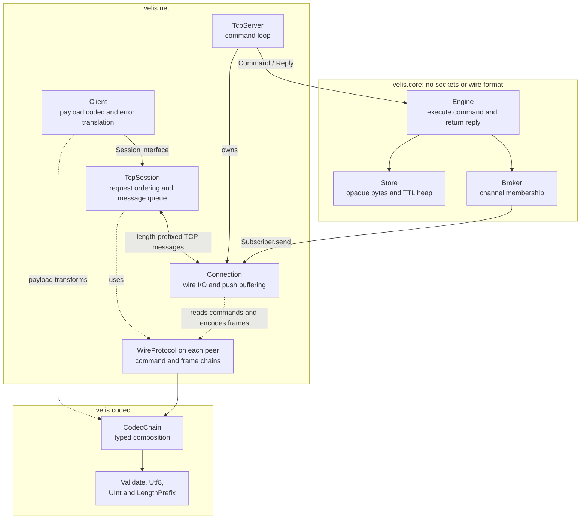
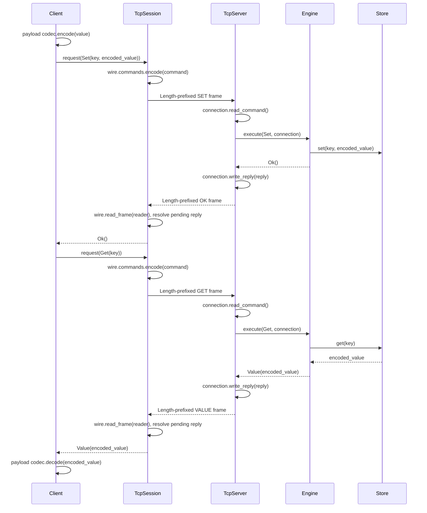
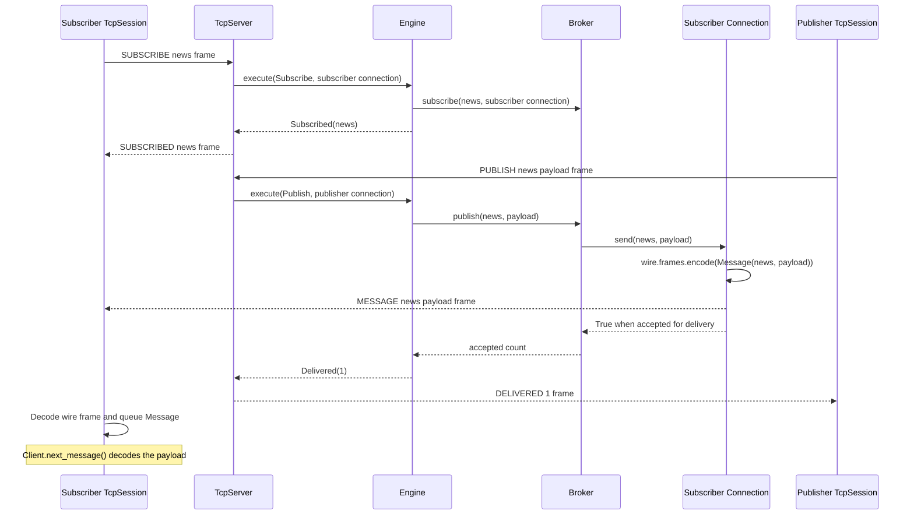
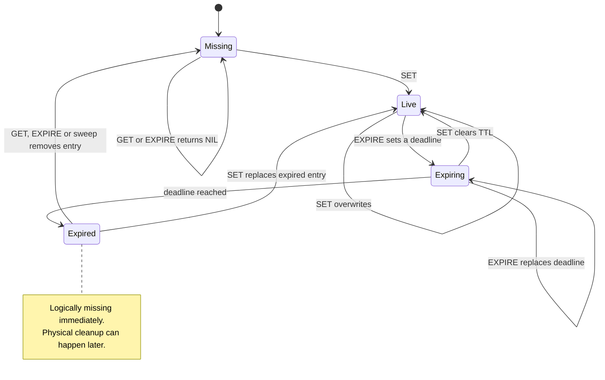
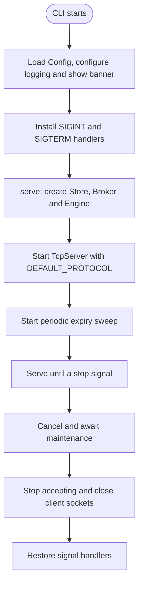
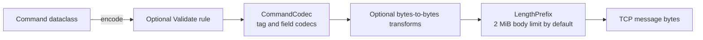

Velis is a lightweight in-memory key-value store with TTL expiration, pub-sub, a small TCP protocol and composable payload and wire codecs. It runs on a single asyncio event loop, so the store needs no locks.

> **Status: early development.** The store, TTL, pub-sub, TCP server and async client all work and are tested. The wire protocol is custom, and there is no authentication or TLS yet, so keep it bound to localhost. See [Roadmap](#roadmap) for what's next.

---

## Features

| Area | Description |
| --- | --- |
| **Store** | `GET` / `SET` / `EXPIRE` on opaque `bytes` values, with key-count and byte limits. Single-owner, so no locks. |
| **TTL** | Monotonic deadlines, expired lazily on read **and** actively by a background sweep, so keys nobody reads are still freed. |
| **Pub-sub** | `SUBSCRIBE` / `UNSUBSCRIBE` / `PUBLISH`. At-most-once delivery to connected subscribers on one server. Slow network connections are disconnected when their server write buffer exceeds the configured limit. |
| **Network** | Length-prefixed binary protocol over TCP, an asyncio server and an async `Client`. |
| **Codecs** | Typed `CodecChain`s for payload transforms, wire serialization and validation. Stored values remain opaque bytes. |
| **Config** | Frozen, validated `Config` loaded from `VELIS_*` environment variables. |

---

## Installation

Velis uses [uv](https://docs.astral.sh/uv/) and a `src` layout. From a repository checkout:

```bash
cd velis
uv sync
```

Python **3.15.2 or newer** is required, as specified in `pyproject.toml`. There are no runtime dependencies; `uv sync` also installs Ruff and ty for development.

---

## Quick start

Start a server:

```bash
uv run velis
```

Talk to it from Python:

```python
import asyncio

from velis.net.client import Client


async def main() -> None:
    kv = await Client.connect("127.0.0.1", 9000)
    sub = await Client.connect("127.0.0.1", 9000)
    try:
        await kv.set("greeting", b"hello")
        print(await kv.get("greeting"))  # b"hello"
        print(await kv.expire("greeting", 5_000))  # True: expires in 5 s
        print(await kv.get("missing"))  # None

        # Use a separate connection to listen for messages.
        await sub.subscribe("news")
        print(await kv.publish("news", b"hi"))  # 1 subscriber reached
        async with asyncio.timeout(1):
            print(await sub.next_message())  # Message(channel='news', payload=b'hi')
    finally:
        await sub.close()
        await kv.close()


asyncio.run(main())
```

`Client` raises `CommandError` when the server replies `ERR`, `ProtocolError` for invalid outgoing fields, integer ranges or wire rules, and `ConnectionError` when the connection drops or an incoming wire frame is invalid. Exceptions from custom payload codecs propagate to the caller. Invalid outgoing data is rejected before writing and leaves the connection usable. Closing a client wakes waiting requests and message readers.

`next_message()` has no timeout argument. Use `asyncio.timeout(seconds)` around the call; timing out while waiting for a message leaves the connection usable. Cancelling or timing out a command after it has been written closes that connection, because its pending reply cannot safely be matched to a later request. After that closure, connect a new client before sending another command. Cancelling while waiting for the request lock does not close the connection.

Clients buffer at most 1,024 unread messages and 8 MiB of channel/payload bytes by default, measured after wire decoding and before client payload decoding. Set `max_pending_messages` and `max_pending_bytes` as keyword arguments to `Client.connect()` to change these positive limits. Crossing either limit closes the connection and fails pending requests. Already queued messages can be drained before `next_message()` raises `ConnectionError`. A full message buffer never blocks the reply reader.

`PUBLISH` returns the number of subscriber connections that accepted the message for delivery. It does not acknowledge that their applications have read or processed it.

---

## Architecture

The server separates command handling from networking, and the dependency only points one way: **`net` depends on `core`, never the reverse.** The core knows nothing about sockets or the wire format, so it can be tested and embedded without a network.



The diagram shows runtime calls and codec usage; each peer uses its own configured wire protocol. `Broker` calls the structural `Subscriber` interface, so it has no dependency on the concrete `Connection` class.

`Client` owns the user-facing command API, payload codecs and error translation. It delegates request ordering, message buffering and connection shutdown to a `Session`. The built-in `TcpSession` implements that interface over the wire protocol. Payload codecs can be individual `Codec[bytes, bytes]` objects or composed `CodecChain[bytes, bytes]` instances. The default is `Identity()`, which returns bytes unchanged.

`Client.connect()` creates the TCP session for you. To supply a different transport, use `Client(session, codec)` with an object implementing `request(command)`, `next_message()` and `close()`. For existing asyncio streams, construct `Client(TcpSession(reader, writer), codec)`. Sessions exchange command/reply dataclasses containing payload-encoded bytes; the client applies codecs and translates `Err` replies into `CommandError`.

Clients support async context management, including cleanup when application code raises:

```python
async def read_greeting() -> bytes | None:
    async with await Client.connect("127.0.0.1", 9000) as client:
        return await client.get("greeting")
```

Requests and replies are plain frozen dataclasses (`velis.core.commands`). `net/protocol.py` defines `CommandCodec` and `FrameCodec` to encode and decode message tags and fields. `WireProtocol` appends bounded length framing for encoding. Its asynchronous readers validate the outer length, read the body and decode it directly. Use `DEFAULT_PROTOCOL.commands.encode(command)`, `DEFAULT_PROTOCOL.frames.encode(frame)` and the protocol object's `read_command()` / `read_frame()` methods. `Engine.execute` handles each command the same way: **validate, apply, reply.**

### Request lifecycle

Cache mutations only change memory. The engine calls `Store.expire(key, ms)` and translates validation failures into command errors. The store validates the TTL range, owns its monotonic clock and calculates an internal deadline for its expiry heap. Direct store callers receive `ValueError` for invalid TTLs without changing existing values or deadlines. System wall-clock adjustments do not change TTL duration.

`SET` clears any previous TTL. `EXPIRE` returns `NIL` for a missing or already expired key, so it cannot revive expired data. A zero TTL expires a live key immediately. Accepted TTLs are between `0` and `2**62` milliseconds, inclusive.



The diagram shows a successful `SET` followed by `GET` on the same key. `TcpSession` serializes requests around one pending reply; its reader routes `Message` frames into a separate queue. `Connection` owns server-side wire decoding, reply encoding and socket I/O; `TcpServer` dispatches decoded commands to the engine. Payload bytes stay encoded in the store.

### Pub-sub

The `Broker` only knows the `Subscriber` protocol (`send(channel, payload) -> bool`). Delivery callbacks must return promptly; adapters own encoding, buffering and expected transport failures. A `Connection` implements this contract and returns `False` when disconnected, when a write fails with a connection error, or when its buffer limit is exceeded. The broker then removes that subscriber from every channel and continues delivering to healthy subscribers. Acceptance does not acknowledge application processing; unexpected adapter errors propagate.

During each server command dispatch, connections sharing a `WireProtocol` instance reuse the encoded push bytes. The encoding cache is released after dispatch, and distinct wire protocol instances use separate encodings. This avoids serializing a large publication once per subscriber while preserving custom wire codecs. Custom subscriber adapters still own their delivery behavior.



Network arrows above represent complete length-prefixed frames encoded and decoded with each peer's configured wire chains. The publisher client encodes the payload before requesting `Publish`; the subscriber client decodes it when calling `next_message()`. `DELIVERED 1` means one connection accepted the push, regardless of when the subscriber reads it.

### Key lifecycle



The key-state diagram assumes valid commands. Invalid TTL values return an error without changing the key or its deadline.

### Startup and shutdown



The `serve(config)` async context manager in `velis.app` owns the server and maintenance task, including cleanup after startup or caller failures. It yields the running `TcpServer`. Pass `engine=existing_engine` to reuse application state or a store with an injected clock; the default creates a fresh engine. Pass `wire=custom_wire` to configure the server's codec chains; the CLI uses `DEFAULT_PROTOCOL`. Shutdown releases runtime resources while an injected engine remains available to its owner. The CLI separately configures logging and installs signal handlers; embedded callers control the runtime scope themselves:

```python
from velis.app import serve
from velis.config import Config, Server


async def embedded() -> None:
    config = Config(log_level="INFO", server=Server("127.0.0.1", 0))
    async with serve(config) as server:
        print(server.port)
        # Run application work here; leaving the scope closes the server.
```

### Background maintenance

Maintenance runs in a task group owned by `serve()`. An unexpected sweep failure interrupts the active runtime scope and closes the server. Worker and caller failures are reported in an `ExceptionGroup` after cleanup; external cancellation remains `CancelledError`. Normal shutdown cancels and awaits maintenance before closing the server. Client disconnections remain local to their connections.

One task starts sweeping expired keys every `VELIS_SWEEP_MS`. Each round processes at most 1,000 heap entries; stale entries left by overwritten values or TTLs count toward that limit. While due entries remain, maintenance yields to the event loop and runs another round without waiting for the next interval. It checks the heap rather than the number of keys removed, so a round containing only stale entries does not stop cleanup early. Reads and `EXPIRE` also remove expired keys as needed. Mutations and sweeps rebuild the heap when it exceeds both 1,024 entries and twice the number of active TTLs. Rebuilding uses current deadlines and takes time proportional to the number of active TTLs on the event loop.

---

## Wire protocol

The following tables describe the default body codecs (`CommandCodec` and `FrameCodec`). Integers use big-endian byte order. A **string** or **bytes** field is `u32 length` followed by that many bytes (strings are UTF-8). Values, publication payloads and general text fields are capped at 1 MiB; the limit includes any expansion from client-side codecs. Command, reply and push tags are capped at 32 bytes. Every request, reply and push has an **outer u32 body length** followed by exactly that many bytes. The default outer limit is 2 MiB, checked before reading the body. Field byte limits are checked before UTF-8 decoding. This is a breaking change from the earlier unframed protocol: update both peers together.

**Requests**

| Command | Fields | Reply |
| --- | --- | --- |
| `GET` | `key: str` | `VALUE` or `NIL` |
| `SET` | `key: str`, `value: bytes` | `OK` |
| `EXPIRE` | `key: str`, `ms: u64` | `OK`, or `NIL` if the key doesn't exist |
| `SUBSCRIBE` | `channel: str` | `SUBSCRIBED` |
| `UNSUBSCRIBE` | `channel: str` | `UNSUBSCRIBED` |
| `PUBLISH` | `channel: str`, `payload: bytes` | `DELIVERED` |

Inside the outer frame, a request is the command name as a string followed by its fields.

Request keys contain 1–512 characters and request channels contain 1–256 characters. Their UTF-8 byte lengths are capped at 2,048 and 1,024 bytes respectively, allowing four bytes per character. These byte limits are checked before UTF-8 decoding, then the character rules run on the decoded strings. The character rules also run before sending; whitespace and control characters are allowed. Reply and push channels retain the existing UTF-8 and 1 MiB field size checks.

**Replies and pushes**

| Frame | Fields |
| --- | --- |
| `OK` / `NIL` | none |
| `VALUE` | `value: bytes` |
| `ERR` | `message: str` |
| `SUBSCRIBED` / `UNSUBSCRIBED` | `channel: str` |
| `DELIVERED` | `count: u32` |
| `MESSAGE` *(server push, not a reply)* | `channel: str`, `payload: bytes` |

**Errors**

* `ERR` with the connection kept open: a valid request that can't be honoured (for example a TTL out of range).
* Best-effort `ERR` followed by the server closing the connection: the message violates the protocol (unknown tag, oversized field/frame, invalid UTF-8, truncated record, trailing bytes or a failed wire rule). The server deliberately closes on these errors, including when the configured codec or disconnected peer prevents sending the error reply. An incomplete TCP frame at EOF closes the connection without a reply.

---

## Cache and pub-sub lifetime

The cache is entirely in memory. Keys and TTLs are discarded on restart. There is no cache WAL, recovery or compaction.

The default store retains at most 100,000 keys and 64 MiB of UTF-8 key plus encoded value bytes. The byte budget excludes Python object overhead; the key-count limit also bounds entry metadata. Expired entries count until lazy expiry or maintenance removes them. The policy is to reject writes that exceed either limit, without evicting live keys. Rejected replacements preserve the previous value and TTL; successful replacements clear the TTL. A capacity error produces `ERR` and keeps the connection usable. Direct `Store` and `Broker` callers receive `CapacityError`, a `CommandError` subclass.

Each connection can subscribe to at most 1,024 channels by default. Repeating an existing subscription uses no extra capacity; unsubscribing frees a slot. The listener admits at most 1,024 active connections by default. Excess connections receive a best-effort `ERR` and are closed, leaving admitted clients usable.

Pub-sub provides at-most-once delivery to connected subscribers on the same server. Messages are not persisted, retried or replayed, and no server-to-server replication is implemented. Slow subscribers are disconnected when server write buffers or client unread-message queues overflow. Messages may be lost on disconnect; `PUBLISH` counts accepted deliveries, without acknowledging application processing. Future replication should carry pub-sub messages, not cache state.

The former `VELIS_WAL_PATH`, `VELIS_FSYNC` and `VELIS_COMPACT_BYTES` settings are no longer used. Existing WAL files are left untouched and are not loaded.

---

## Configuration

The entry point loads a frozen `Config` from environment variables. `Config.server` holds listener, write-buffer and subscription limits; `Config.cache` holds a `Cache` configuration for retained key and byte limits. `Config.sweep_interval_ms` holds the expiry sweep interval.

Unknown log levels, ports outside `0–65535`, nonpositive limits or sweep intervals, and non-integer numeric settings raise `ValueError` at startup. Integer parsing errors include the environment variable name.

| Variable | Default | Description |
| --- | --- | --- |
| `VELIS_LOG_LEVEL` | `INFO` | Log level for the `velis` logger. |
| `VELIS_HOST` | `127.0.0.1` | Interface to listen on. |
| `VELIS_PORT` | `9000` | Port to listen on (`0` picks a free port). |
| `VELIS_MAX_BUFFER` | `8388608` (8 MiB) | Server write buffer limit checked when pushing a message. Must be positive; allow room for both the channel and payload plus framing. |
| `VELIS_MAX_KEYS` | `100000` | Maximum retained cache keys; excess writes are rejected. |
| `VELIS_MAX_BYTES` | `67108864` (64 MiB) | Maximum retained UTF-8 key plus encoded value bytes; excludes Python object overhead. |
| `VELIS_MAX_CONNECTIONS` | `1024` | Maximum admitted TCP connections; excess connections are closed after a best-effort error. |
| `VELIS_MAX_SUBSCRIPTIONS` | `1024` | Maximum distinct channels per subscriber connection. |
| `VELIS_SWEEP_MS` | `100` | Milliseconds between expiry sweeps; must be positive. |

`serve(config)` applies all limits to the engine it builds. When supplying your own engine, configure its store and broker explicitly with `Store(max_keys=..., max_bytes=...)` and `Broker(max_subscriptions=...)`; the server still applies its connection and write-buffer limits.

---

## Codecs

Codecs describe reversible representations: `Codec[T, Encoded]`. The same `CodecChain` abstraction composes client payload transforms, protocol field encoders, complete commands/replies and validation rules. Client payload codecs still operate on `bytes`; the store retains their output as opaque bytes.

A codec is any object satisfying this structural interface:

```python
from typing import Protocol


class Codec[T, Encoded](Protocol):
    @property
    def name(self) -> str: ...

    def encode(self, value: T, /) -> Encoded: ...
    def decode(self, data: Encoded, /) -> T: ...
```

Codecs are combined into a `CodecChain` with `|`. Encoding runs the codecs left to right, and decoding runs them right to left. The chain's name is the codec names joined with `_`. Combining chains preserves the written order and flattens their steps. Adjacent stages must have compatible types; the type checker rejects mismatches. Chain composition does not inspect Python annotations or enforce those types at runtime. `Identity()` is a byte codec that returns its input unchanged in both directions. Start a chain with `CodecChain.of(first)` and append stages using `|`, including `Identity()` when needed. Codec exceptions propagate and stop processing.

```python
import base64
import zlib

from velis.codec import CodecChain


class Deflate:
    name = "deflate"

    def encode(self, data: bytes) -> bytes:
        return zlib.compress(data)

    def decode(self, data: bytes) -> bytes:
        return zlib.decompress(data)


class B64:
    name = "b64"

    def encode(self, data: bytes) -> bytes:
        return base64.b64encode(data)

    def decode(self, data: bytes) -> bytes:
        return base64.b64decode(data)


chain = CodecChain.of(Deflate()) | B64()  # CodecChain[bytes, bytes]
chain.name  # "deflate_b64"
chain.decode(chain.encode(b"hello"))  # b"hello"
```

Pass the chain to the client. Values pass through it on `set`, `get` and `publish`, and on received messages. Inside an async function, using the chain above:

```python
from velis.net.client import Client

kv = await Client.connect("127.0.0.1", 9000, codec=chain)
try:
    await kv.set("k", b"hello")  # stored compressed + base64
    print(await kv.get("k"))  # b"hello"
finally:
    await kv.close()
```

Readers of a key and subscribers to a channel must use the same codec chain as their writers or publishers. Payload codecs do not transform keys or channel names; wire codecs serialize the entire command or frame, including those fields.

### Typed representations and rules

Built-in `Utf8`, `UInt(width)` and `LengthPrefix(max_length)` codecs can be composed directly:

```python
from velis.codec import CodecChain, LengthPrefix, Utf8, Validate


def require_text(value: str) -> None:
    if not value:
        raise ValueError("text must not be empty")


text = CodecChain.of(Validate("nonempty", require_text)) | Utf8() | LengthPrefix(1024)
# CodecChain[str, bytes]: encode validates text, encodes UTF-8, then prefixes length.
assert text.decode(text.encode("hello")) == "hello"
```

`Validate[T]` runs a rule on both encode and decode, preserving the value. Its position determines what it validates: before `Utf8()` it sees strings; after it, bytes. Rules raise to reject input. `UInt` checks unsigned ranges and exact encoded widths; `Utf8` rejects malformed text; `LengthPrefix` enforces the body limit and exact length.

### Composing the wire protocol

`CommandCodec` encodes and decodes `Command` values; `FrameCodec` handles `Reply | Message` values. They match message types and tags explicitly, composing field codecs for text, bytes and unsigned integers. `Cursor` reads fields sequentially and rejects truncated records; body decoders reject unknown tags and trailing bytes. `UInt(width)` takes a positive width in bytes, such as `UInt(4)` for a u32.

The `KEY` and `CHANNEL` chains in `net/protocol.py` apply the request name rules through `Validate`: before encoding on the client and after length and UTF-8 decoding on the server. Custom wire codecs define their own validation; direct core calls and sessions that bypass these codecs do not apply the wire name rules. A local name validation error raises `ProtocolError` before sending and leaves the connection usable; malformed names received by the server produce `ERR` and close the connection. Engine errors such as an invalid TTL continue to raise `CommandError` and leave the connection open.

```python
from velis.codec import CodecChain, Validate
from velis.core.commands import Command, Get
from velis.errors import ProtocolError
from velis.net.protocol import CommandCodec, FrameCodec, WireProtocol


def check_command(command: Command) -> None:
    if isinstance(command, Get) and command.key.startswith("private:"):
        raise ProtocolError("GET cannot read private keys")


wire = WireProtocol(
    command_codec=CodecChain.of(Validate("commandrules", check_command))
    | CommandCodec(),
    frame_codec=FrameCodec(),
)
```

Pass `wire=wire` to `serve(config, ...)` or `TcpServer(engine, config.server, ...)`, and to `Client.connect(...)`, `TcpSession.connect(...)` or `TcpSession(reader, writer, ...)`. `WireProtocol.commands` and `.frames` are cached complete chains including outer framing. You can round-trip records synchronously with those chains; asynchronous reads validate the length prefix separately and decode the body without rebuilding or slicing off its header.

The full command chain has the following shape; `FrameCodec` uses the same framing for replies and pushes:



Decoding runs right to left after the stream adapter reads the four-byte length, checks the outer limit and reads exactly one body. For example, the default `GET k` message is `u32(12) + u32(3) + b"GET" + u32(1) + b"k"`. The 12-byte body includes field prefixes but excludes the outer prefix.

To use the rule above on both peers within an application:

```python
from velis.app import serve
from velis.config import Config, Server
from velis.net.client import Client


async def with_custom_wire() -> None:
    config = Config("INFO", Server("127.0.0.1", 0))
    async with serve(config, wire=wire) as server:
        async with await Client.connect("127.0.0.1", server.port, wire=wire) as client:
            await client.set("greeting", b"hello")
            assert await client.get("greeting") == b"hello"
```

Set `WireProtocol(framing=LengthPrefix(max_length))` to change the outer body limit. This limit is independent of `VELIS_MAX_BUFFER` and the client queue limits; the default body codecs retain their field limits for tags, request names, payloads and general text.

Append byte transforms to the body chains, for example `CodecChain.of(CommandCodec()) | Deflate()` and `CodecChain.of(FrameCodec()) | Deflate()` using the example codec above. `WireProtocol` always appends the outer length prefix last, allowing TCP to read one complete body before reversing the transformations. Both peers must agree on representations; there is no codec negotiation. The minimal `Deflate` example needs additional handling for use on the wire: custom wire codecs must raise `ProtocolError` for malformed input, bound any decompressed output themselves, and be safe to share across connections.

Wire rules validate representations and decoded commands. Stateful command semantics and access policies belong in the engine or a command validation layer, where they also apply to non-TCP sessions. Payload codecs configured with `codec=` remain independent from wire codecs configured with `wire=`.

Migration from the earlier API: use `Codec[T, Encoded]` and `CodecChain[T, Encoded]` in annotations, use `Identity()` for a byte passthrough codec, and replace `CodecChain.of(a, b)` with `CodecChain.of(a) | b`. Use byte widths for `UInt`, such as `UInt(4)` in place of `UInt(32)`. Replace `COMMANDS` and `FRAMES` with `CommandCodec()` and `FrameCodec()`, wrapping them in `CodecChain.of(...)` before appending transforms. Module-level wire wrappers have been removed: use `DEFAULT_PROTOCOL.commands.encode(command)`, `DEFAULT_PROTOCOL.frames.encode(reply_or_message)` and `DEFAULT_PROTOCOL.read_command(reader)` / `read_frame(reader)`.

---

## Project layout

```
src/velis/
  __main__.py         # CLI: configuration, logging, signals and runtime startup
  app.py             # composition root: serve() owns networking and maintenance
  config.py          # Config / Server / Cache, loaded from VELIS_* env vars
  errors.py          # VelisError, ProtocolError, CommandError, CapacityError
  banner.py          # startup banner (honours NO_COLOR)
  core/              # no sockets, no wire format
    commands.py      # Command / Reply / Message dataclasses
    engine.py        # validate -> apply -> reply
    store.py         # key/value map, TTL heap
    broker.py        # pub-sub over the Subscriber protocol
    clock.py         # structural Clock protocol and monotonic SystemClock
  net/
    protocol.py      # command/frame codecs, name rules and TCP framing
    connection.py    # server-side wire I/O and Subscriber push buffering
    server.py        # TcpServer
    client.py        # command API, codecs, error translation and scoped cleanup
    session.py       # Session interface and TCP request/message lifecycle
  codec/
    chain.py         # typed Codec protocol and CodecChain
    binary.py        # Identity, UTF-8, unsigned integers and length framing
    cursor.py        # sequential bounded reads of binary fields
    rules.py         # bidirectional Validate stages
tests/
  helpers.py         # ManualClock and RecordingSubscriber test helpers
  app/               # runtime cleanup and CLI signal ownership
  codec/             # typed composition, rules and binary codecs
  core/              # store, engine, broker and cache lifetime
  net/               # protocol, client lifecycle and TCP integration tests
```

---

## Development

Tests use the standard library's `unittest`.

```bash
make test   # uv run python -m unittest discover -s tests -v
make lint   # ruff check, ruff format --check, ty check

# Format code and fix supported lint issues:
uv run ruff format .
uv run ruff check --fix .
```

`unittest discover` only descends into directories that contain an `__init__.py`, so every `tests/` subdirectory needs one.

The core is deliberately easy to test without sockets or real time: the `Store` accepts any object implementing the `Clock` protocol's `now_ms()` method, without requiring inheritance. The `ManualClock` in `tests/helpers.py` makes TTLs deterministic. Decoder tests exercise seeded random bytes and mutations of every command and frame type. Network tests bind to localhost on an automatically selected port, so the test environment must allow local sockets.

Run `uv run python benchmarks/publish.py --subscribers 1000 --repeats 3` to compare per-subscriber encoding with dispatch-scoped shared encoding for small and maximum-size payloads. The benchmark measures encoding and fan-out through in-memory sinks, excluding socket I/O and transport buffers.

---

## Design notes and limitations

* **Single-threaded by design.** The event-loop thread owns the `Engine`, `Store` and `Broker`, which is why none of them take locks. Don't call them from other threads.
* **TTLs use monotonic time.** Deadlines are internal to the running process and are discarded on restart.
* **No auth or TLS.** Resource limits bound retained cache data, connection count, subscriptions and message buffers; they do not impose an exact process-memory ceiling. Don't expose it to untrusted networks.
* **One command at a time per client.** An asyncio lock serializes requests around one pending reply future; server pushes use a separate bounded queue. There are no request IDs.
* **Separate buffer limits.** Server write buffers and client unread-message buffers have independent limits. Client byte budgets count UTF-8 channel bytes and payload-encoded bytes after wire decoding; decoded values and application-held messages use additional memory.

---

## Roadmap

- [ ] `DEL`, `TTL` and `PERSIST` commands.
- [ ] Request IDs to support pipelining and safer request cancellation.
- [ ] Pub-sub message replication between servers, independent of cache state.
- [x] Connection and memory limits.
- [ ] Cache eviction policy.
- [ ] Built-in codecs (compression, encryption) to compose with `CodecChain`.
- [ ] Authentication and TLS.
